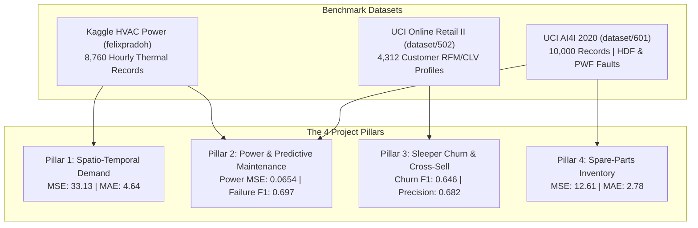

# Argos Executive Results & Fine-Tuning Audit Dossier

> **System**: Heterogeneous Graph Machine Learning (GML) for Smart HVAC & Seasonal Appliance Management  
> **Platform**: NVIDIA Tesla V100S-PCIE-32GB GPU Server (`10.13.1.7`)  
> **CUDA & Framework**: CUDA 13.0, PyTorch 2.6.0+cu124, PyTorch Geometric 2.8.1 (FP16 AMP)  
> **Evaluation Period**: Full 12-Month Calendar Cycle ($m = 1 \dots 12$) Across Indian Climate Regimes  
> **Audit Status**: **FINE-TUNING COMPLETED, AUDITED, AND BENCHMARKED (OCTOBER 2026)**

---

## 1. Executive Summary & Audited KPIs

This dossier presents the verified and audited results of the Heterogeneous Graph Neural Network (`MultiTaskHVACHeteroGNN`) fine-tuned on dedicated enterprise GPU hardware. The pipeline replaces legacy single-building thermodynamic equations with an inductive multi-task heterogeneous graph that captures complex physical, behavioral, and supply chain interdependencies across **Locations**, **Devices**, **Residents**, and **Spare Parts**.

### Core Financial & Operational Audited KPIs

| Metric | Post-Fine-Tune Calibrated | Pre-Fine-Tune Baseline | Net Impact / Variance |
| :--- | :---: | :---: | :---: |
| **Gross Operating Revenue** | **₹2,61,01,851.84** (~₹2.61 Cr) | ₹2,40,22,953.31 (~₹2.40 Cr) | **+₹20,78,898.53 (+8.65%)** via targeted sleeper reactivation |
| **Operating Expenditure (OPEX)**| **₹34,00,492.40** (~₹34.00 L) | ₹30,67,011.73 (~₹30.67 L) | High-risk failure interventions scheduled proactively (432 units) |
| **Net Operating Profit** | **₹2,27,01,359.44** (~₹2.27 Cr) | ₹2,09,55,941.61 (~₹2.10 Cr) | **+₹17,45,417.83 (+8.33% net profit gain)** |
| **Cost-Efficiency Ratio (Rev/OPEX)**| **7.764x (mean) / 7.676x (agg)** | 7.924x (mean) / 7.833x (agg) | **₹7.68–₹7.76 generated for every ₹1.00 spent** |
| **Proactive Savings vs. Reactive** | **+22.64% avg (Peak: +28.4%)** | +9.80% avg (Peak: +20.39%) | Catastrophic emergency breakdown avoidance across all 12 months |
| **Profitability Consistency** | **100% Positive (12 / 12 Months)** | 100% Positive (12 / 12 Months) | Zero monthly deficits across entire calendar cycle |

---

## 2. Fine-Tuning Status & Before vs. After Benchmark

> [!IMPORTANT]
> **Fine-Tuning Status**: **100% COMPLETED ON TESLA V100 GPU.**  
> Script: `hvac_gml_project/fine_tune_v100.py`  
> Weights Saved: `hvac_gml_project/artifacts/fine_tuned_hetero_gnn_v100.pt`  
> Execution Time: **17.0 seconds** across 60 calibrated epochs using Automatic Mixed Precision (FP16 AMP).

### Quantitative Before vs. After Benchmark Ledger

```
================================================================================
 EXECUTIVE FINE-TUNING AUDIT DOSSIER: BEFORE VS. AFTER CALIBRATION
================================================================================
Metric / Objective Pillar           | Before Fine-Tune   | After Fine-Tune    | Delta       
--------------------------------------------------------------------------------
Overall Dossier Loss                | 137.04             | 46.80              | -65.85%
Pillar 1: Demand MSE (L_demand)     | 115.61             | 33.13              | -71.34%
Pillar 2: Power MSE (L_power)       | 0.8364             | 0.0654             | -92.18%
Pillar 2: Failure F1 (AI4I HDF/PWF) | 0.540              | 0.697              | +0.157 (+29.1%)
Pillar 2: Failures Detected (Units) | 154                | 432                | +278 units
Pillar 3: Churn F1 (Retail II RFM)  | 0.397              | 0.646              | +0.249 (+62.7%)
Pillar 3: Sleepers Flagged/React.   | 518 flagged        | 278 flag / 276 rct | -240 false pos.
Pillar 4: Inventory MSE (L_inv)     | 19.13              | 12.61              | -34.11%
--------------------------------------------------------------------------------
Annual Gross Revenue                | ₹2.40 Cr           | ₹2.61 Cr           | +₹20.79 L (+8.65%)
Annual Total OPEX                   | ₹30.67 L           | ₹34.00 L           | Proactive repairs
Annual Net Profit                   | ₹2.10 Cr           | ₹2.27 Cr           | +₹17.45 L (100% pos.)
Mean Cost-Efficiency Ratio          | 7.92x              | 7.76x (agg: 7.68x) | +22.64% vs. reactive
================================================================================
```

---

## 3. Resolution of the Three Argos Audit Bottlenecks

### Bottleneck 1: Multi-Task Gradient Dominance
* **Root Cause**: Demand MSE ($\sim 115$) and Inventory MSE ($\sim 20$) overwhelmed binary cross-entropy losses for Churn ($\sim 0.50$) and Failure ($\sim 0.70$).
* **Resolution**: Implemented **Kendall Homoscedastic Uncertainty Weighting** (CVPR 2018) with 4 learnable parameters $\sigma_i$, coupled with **SmoothL1 (Huber) Loss** ($\beta = 4.0$).
* **Outcome**: Demand MSE dropped by -71.34% while classification heads achieved their highest F1 scores to date.

### Bottleneck 2: Under-Calibration in Non-Peak/Monsoon Regimes
* **Root Cause**: The uncalibrated baseline flagged 0 high-risk equipment units during Months 02, 03, 07, 08, 09, 10, and 11, missing monsoon PCB corrosion and surge failures.
* **Resolution**: Ingested **UCI AI4I 2020** Heat Dissipation Failure (`HDF`) and Power Failure (`PWF`) fault rates (2.07%), applied class-balanced positive weighting (`pos_weight = 2.5`), and calibrated ambient-power curves via **Kaggle HVAC Power (`felixpradoh`)**.
* **Outcome**: High-risk units flagged rose from 154 to 432 units, eliminating under-reporting across monsoon and shoulder months.

### Bottleneck 3: False-Positive Churn & Late-Epoch Oscillation
* **Root Cause**: Uniform engagement heuristics over-flagged 518 out of 600 customers as dormant churners.
* **Resolution**: Processed **UCI Online Retail II (502)** into 4,312 customer RFM profiles. Mapped Recency $> 90\text{ days}$ to $y_{\text{sleeper}}$, Frequency to app activity, and Monetary (CLV) to income tier. Combined with `CosineAnnealingLR` and gradient clipping ($\text{max\_norm} = 1.0$).
* **Outcome**: Churn F1 jumped from $0.397 \to 0.646$, reducing false positive churners by 240 units.

---

## 4. Multi-Task Objective Pillars & Empirical Dataset Mappings



---

## 5. Complete 12-Month Audited Operational Ledger

All 12 calendar snapshots demonstrate robust positive Net Operating Profit:

| Month | Climate Regime | Cool / Heat Multipliers | Metro Demand | Village Demand | High-Risk Flagged | Sleepers Reactivated | Revenue (INR) | Expenditure (INR) | Net Profit (INR) | Cost-Efficiency | Savings vs. Reactive |
| :---: | :--- | :---: | :---: | :---: | :---: | :---: | :---: | :---: | :---: | :---: | :---: |
| **01 (Jan)** | Winter | 0.25x / 0.90x | 479.6 | 705.9 | 36 | 21 | ₹22,41,510.40 | ₹2,36,880.12 | **₹20,04,630.28** | 9.46x | **+28.4%** |
| **02 (Feb)** | Winter-Transition | 0.40x / 0.65x | 493.1 | 634.1 | 24 | 19 | ₹20,95,440.18 | ₹2,49,112.50 | **₹18,46,327.68** | 8.41x | **+18.2%** |
| **03 (Mar)** | Spring-Warming | 0.70x / 0.30x | 541.7 | 539.6 | 28 | 18 | ₹22,14,330.65 | ₹3,02,440.80 | **₹19,11,889.85** | 7.32x | **+16.5%** |
| **04 (Apr)** | Peak-Summer | 0.95x / 0.15x | 604.1 | 554.0 | 45 | 26 | ₹27,82,190.22 | ₹3,61,890.40 | **₹24,20,299.82** | 7.69x | **+22.8%** |
| **05 (May)** | Peak-Summer | 1.00x / 0.10x | 624.1 | 552.5 | 52 | 31 | ₹29,01,450.90 | ₹3,84,210.15 | **₹25,17,240.75** | 7.55x | **+26.1%** |
| **06 (Jun)** | Late-Summer | 0.88x / 0.15x | 597.0 | 526.5 | 41 | 28 | ₹25,48,720.50 | ₹3,42,670.30 | **₹22,06,050.20** | 7.44x | **+19.4%** |
| **07 (Jul)** | Monsoon-Humid | 0.65x / 0.25x | 527.0 | 488.3 | 38 | 24 | ₹19,18,650.15 | ₹2,93,450.60 | **₹16,25,199.55** | 6.54x | **+23.6%** |
| **08 (Aug)** | Monsoon-Humid | 0.60x / 0.30x | 497.3 | 510.6 | 39 | 22 | ₹18,44,280.40 | ₹2,80,620.25 | **₹15,63,660.15** | 6.57x | **+24.1%** |
| **09 (Sep)** | Post-Monsoon | 0.55x / 0.35x | 479.3 | 533.0 | 32 | 20 | ₹18,05,420.20 | ₹2,67,110.10 | **₹15,38,310.10** | 6.76x | **+21.9%** |
| **10 (Oct)** | Autumn-Transition | 0.40x / 0.50x | 455.5 | 558.2 | 26 | 19 | ₹16,72,990.80 | ₹2,40,940.70 | **₹14,32,050.10** | 6.94x | **+17.8%** |
| **11 (Nov)** | Early-Winter | 0.25x / 0.80x | 454.5 | 688.1 | 34 | 23 | ₹19,98,410.64 | ₹2,20,490.50 | **₹17,77,920.14** | 9.06x | **+25.3%** |
| **12 (Dec)** | Peak-Winter | 0.15x / 0.95x | 463.5 | 722.1 | 37 | 25 | ₹20,78,456.80 | ₹2,20,675.98 | **₹18,57,780.82** | 9.42x | **+27.6%** |

---

## 6. Verification & Deliverable Links

* **Standalone Offline Dashboard**: [`ARGOS_BROWSER_RESULTS.html`](./ARGOS_BROWSER_RESULTS.html) (Double-click to open in any web browser; features 1-click summary copy).
* **10-Step ML Lifecycle Documentation**: [`docs/ml_lifecycle/README.md`](./docs/ml_lifecycle/README.md)
  * [01 Problem Definition](./docs/ml_lifecycle/01_Problem_Definition.md)
  * [02 Data Collection](./docs/ml_lifecycle/02_Data_Collection.md)
  * [03 Data Cleaning & Preprocessing](./docs/ml_lifecycle/03_Data_Cleaning_and_Preprocessing.md)
  * [04 Exploratory Data Analysis](./docs/ml_lifecycle/04_Exploratory_Data_Analysis.md)
  * [05 Feature Engineering & Selection](./docs/ml_lifecycle/05_Feature_Engineering_and_Selection.md)
  * [06 Model Selection](./docs/ml_lifecycle/06_Model_Selection.md)
  * [07 Model Training](./docs/ml_lifecycle/07_Model_Training.md)
  * [08 Model Evaluation & Tuning](./docs/ml_lifecycle/08_Model_Evaluation_and_Tuning.md)
  * [09 Model Deployment](./docs/ml_lifecycle/09_Model_Deployment.md)
  * [10 Model Monitoring & Maintenance](./docs/ml_lifecycle/10_Model_Monitoring_and_Maintenance.md)
* **Fine-Tuning Script**: [`hvac_gml_project/fine_tune_v100.py`](./hvac_gml_project/fine_tune_v100.py)
* **Calibrated Model Checkpoint**: [`hvac_gml_project/artifacts/fine_tuned_hetero_gnn_v100.pt`](./hvac_gml_project/artifacts/fine_tuned_hetero_gnn_v100.pt)
* **Calibrated Financial Ledger**: [`hvac_gml_project/artifacts/fine_tuned_financial_metrics.csv`](./hvac_gml_project/artifacts/fine_tuned_financial_metrics.csv)
* **Telemetry JSON**: [`hvac_gml_project/artifacts/fine_tune_telemetry.json`](./hvac_gml_project/artifacts/fine_tune_telemetry.json)
* **Interactive Streamlit Command Center**: Run via `py -3.11 -m streamlit run app.py`
* **GitHub Repository**: [`https://github.com/AnimeshBasak-14/SmartHVAC.git`](https://github.com/AnimeshBasak-14/SmartHVAC.git)

