# HVAC & Smart Appliance Heterogeneous Graph Machine Learning (GML) System

[](https://share.streamlit.io/)
[-76B900?logo=nvidia)](https://www.nvidia.com)
[](https://pytorch-geometric.readthedocs.io/)
[](https://neo4j.com)

## Executive Overview
This repository contains the end-to-end production implementation of an enterprise-grade **Heterogeneous Graph Neural Network (GNN)** pipeline designed for smart HVAC systems and connected residential appliances. It simultaneously optimizes:
1. **Spatio-Temporal Service Demand Forecasting** (Metropolitan cooling vs. Rural village heating).
2. **Preventive Device Health & Failure Triage** (Compressor and heating element failure prediction).
3. **Customer Retention & "Sleeper" Churn Reactivation** (Counter-seasonal cross-sell link prediction).
4. **Supply Chain & Spare Parts Inventory Optimization** (Stockout risk and warehouse holding cost balancing).

The system is accelerated via **NVIDIA Tesla V100 GPU (FP16 Mixed Precision)**, integrates with **Neo4j Graph Database**, and serves an interactive **Streamlit Command Center**.

---

## 📚 Comprehensive Documentation Suite

| Document | Core Topics Covered |
| :--- | :--- |
| **[System Architecture & Implementation](docs/ARCHITECTURE_AND_IMPLEMENTATION.md)** | Mathematical formulation, 10-stage ML Lifecycle mapping, `HeteroConv` + `SAGEConv` layer design, V100 AMP FP16 acceleration, and divergence self-healing. |
| **[GML Foundations: What, Why, How & Where](docs/GML_FOUNDATIONS_WHAT_WHY_HOW_WHERE.md)** | Conceptual foundations of Graph Machine Learning, comparison against Tabular ML (XGBoost/RF), relational inductive bias, and enterprise deployment areas. |
| **[Dataset Guide: What, Why, How & Where](docs/DATASET_GUIDE_WHAT_WHY_HOW_WHERE.md)** | In-depth schemas of the 4 entity tables and 3 edge tables, seasonal cyclical encoding ($\sin/\cos$), normalization protocols, and real-world industrial data mapping. |
| **[Modular Codebase Reference](hvac_gml_project/README.md)** | Component-by-component walkthrough of all 10 source code files, configurations, test suites, and launch scripts. |

---

## 🔄 Machine Learning Lifecycle Alignment

The pipeline maps directly to the standard 10-stage ML lifecycle:

```mermaid
flowchart LR
    P01["01. Problem Definition"] --> P02["02. Data Collection"]
    P02 --> P03["03. Data Preprocessing"]
    P03 --> P04["04. Exploratory Analysis"]
    P04 --> P05["05. Feature Engineering"]
    P05 --> P06["06. Model Selection"]
    P06 --> P07["07. Model Training (V100)"]
    P07 --> P08["08. Evaluation & Tuning"]
    P08 --> P09["09. Deployment (Streamlit)"]
    P09 --> P10["10. Monitoring & Self-Healing"]
```



1. **01. Problem Definition**: Solving non-I.I.D. multi-objective optimization across interconnected appliances, customers, locations, and components.
2. **02. Data Collection**: Relational ingestion of `locations.csv`, `devices.csv`, `parts.csv`, `residents.csv`, and bidirectional edge CSVs.
3. **03. Data Preprocessing**: Unit price, power, and temperature scaling with type-safe integer indexing to eliminate missing node assertions.
4. **04. Exploratory Data Analysis (EDA)**: Temperature vs. grid stability distributions, power vs. failure scatter matrices, and customer engagement histograms.
5. **05. Feature Engineering**: Cyclical temporal features ($\sin(2\pi(m-1)/12), \cos(2\pi(m-1)/12)$) and regional climate regime multipliers.
6. **06. Model Selection**: Multi-task `HeteroConv` architecture with bipartite `SAGEConv` message passing and latent dot-product link prediction.
7. **07. Model Training**: 120-epoch training on NVIDIA Tesla V100 GPU utilizing PyTorch FP16 Automatic Mixed Precision (`GradScaler`).
8. **08. Model Evaluation & Tuning**: Tracking 4 multi-task loss components, learning rate self-healing, and auditing monthly financial metrics.
9. **09. Model Deployment**: Interactive Command Center accessible locally, on lab networks, and deployable via Streamlit Cloud.
10. **10. Model Monitoring & Maintenance**: JSON telemetry logging, max VRAM tracking, and Neo4j Bolt graph database synchronization.

---

## ⚡ Audited Business & Financial KPIs

Trained across all 12 calendar months on the Tesla V100 GPU, the pipeline demonstrates strictly positive net profit and dramatic operational savings:

* **Annual Revenue**: **₹2,40,22,953.31** (~₹2.40 Crore INR)
* **Annual Operating Expenditure**: **₹30,67,011.73** (~₹30.67 Lakh INR)
* **Annual Net Profit**: **₹2,09,55,941.61** (~₹2.10 Crore INR)
* **Mean Cost-Efficiency Ratio**: **7.924x** (Revenue generates ~7.9x operating expenditure)
* **Mean Cost Savings Gain**: **+9.80%** (Proactive GML maintenance vs. reactive breakdown repairs)

---

## 🚀 Quickstart: Local Execution & Streamlit Cloud

### Option A: Deploying on Streamlit Cloud (One-Click)
1. Fork or push this repository to GitHub: `https://github.com/AnimeshBasak-14/SmartHVAC.git`
2. Open [share.streamlit.io](https://share.streamlit.io/) and create a **New app**.
3. Select repository: `AnimeshBasak-14/SmartHVAC`, Branch: `main`.
4. Main file path: `app.py`.
5. Click **Deploy!**

### Option B: Running Locally (Windows / Linux)
```bash
# 1. Clone repository
git clone https://github.com/AnimeshBasak-14/SmartHVAC.git
cd SmartHVAC

# 2. Install dependencies
pip install -r requirements.txt

# 3. Run test suite
python hvac_gml_project/tests/test_pipeline.py

# 4. Launch Command Center
streamlit run app.py
```

### Option C: Training on NVIDIA Tesla V100 Lab Server
```bash
cd hvac_gml_project
python train_and_monitor.py
streamlit run dashboard_app.py --server.port 8501 --server.headless true
```
