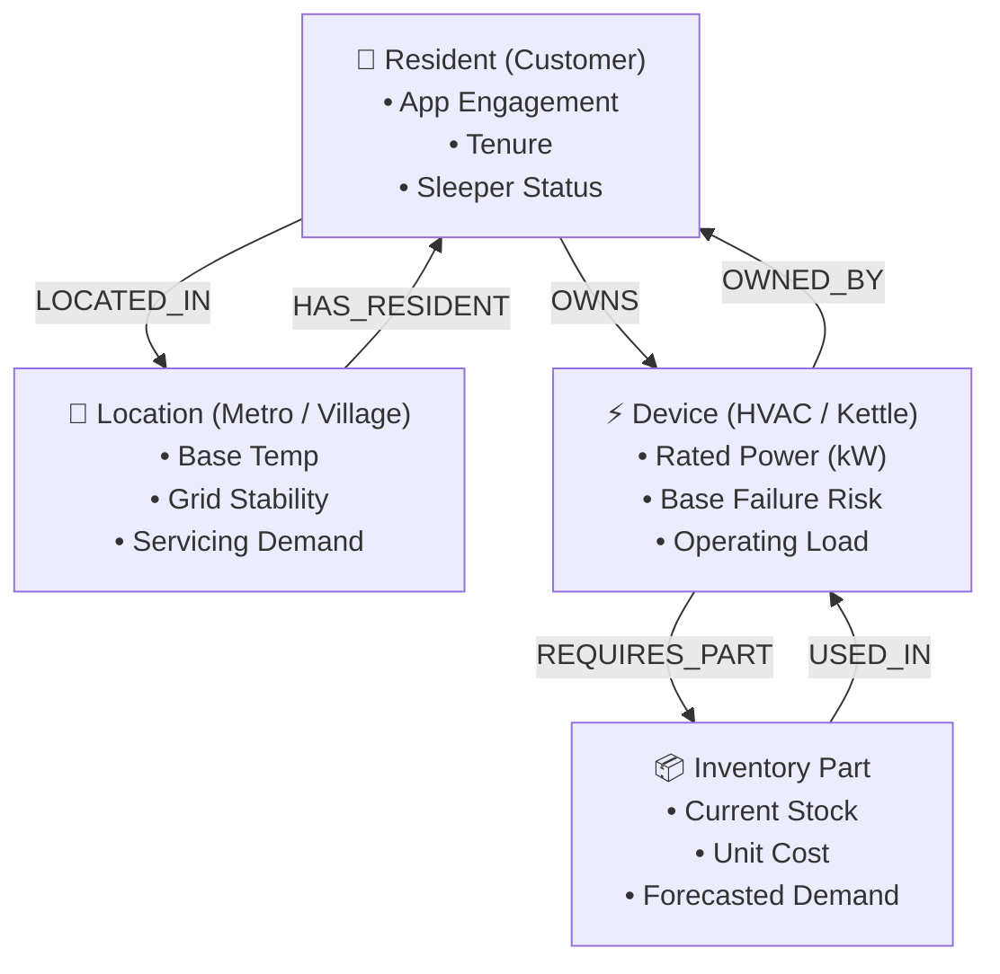

# System Architecture, Working & Implementation Guide

## Executive Overview
This document provides a comprehensive technical walkthrough of the **HVAC & Smart Appliance Heterogeneous Graph Machine Learning (GML) System**. It outlines the mathematical formulation, heterogeneous graph topology, multi-task neural network architecture, hardware acceleration on NVIDIA Tesla V100 GPU (FP16 AMP), Neo4j graph database integration, and end-to-end execution flow mapped directly to the **10-Stage Machine Learning Lifecycle**.

---

## 1. End-to-End Machine Learning Lifecycle

The pipeline strictly adheres to the standard 10-stage Machine Learning Lifecycle:

```mermaid
flowchart LR
    P01["01. Problem Definition"] --> P02["02. Data Collection"]
    P02 --> P03["03. Data Preprocessing"]
    P03 --> P04["04. Exploratory Analysis"]
    P04 --> P05["05. Feature Engineering"]
    P05 --> P06["06. Model Selection"]
    P06 --> P07["07. Model Training (V100)"]
    P07 --> P08["08. Evaluation & Tuning"]
    P08 --> P09["09. Deployment (Streamlit)"]
    P09 --> P10["10. Monitoring & Self-Healing"]
```

| Lifecycle Stage | Pipeline Implementation & Code Mapping |
| :--- | :--- |
| **01. Problem Definition** | Multi-objective optimization for smart appliances: Spatio-temporal service dispatch, device failure prevention, customer churn prevention, and inventory stocking. |
| **02. Data Collection** | `data_pipeline.py`: Ingestion of multi-entity relational CSV tables (`locations`, `devices`, `parts`, `residents`) or deterministic synthesis if CSVs are missing. |
| **03. Data Cleaning & Preprocessing** | Feature normalization (scaling unit prices by $60,000$, power by $3.5\text{ kW}$, temperatures by $45^\circ\text{C}$), null handling, and type-safe integer node indexing. |
| **04. Exploratory Data Analysis (EDA)** | `dashboard_app.py` (Tabs 2 & 3): Scatter correlations between temperature vs. grid stability, power draw vs. failure probability, and customer app engagement histograms. |
| **05. Feature Engineering & Selection** | `encode_month_features()`: Cyclical temporal transformation ($\sin/\cos$) of calendar month ($1 \dots 12$) combined with India seasonal climate regime multipliers (`cool_mult`, `heat_mult`). |
| **06. Model Selection** | `hetero_gnn_model.py`: Multi-relational `HeteroConv` with GraphSAGE (`SAGEConv`) message passing + multi-task regression/classification heads + dot-product link prediction. |
| **07. Model Training** | `train_and_monitor.py`: 120-epoch training on NVIDIA Tesla V100 GPU using PyTorch FP16 Automatic Mixed Precision (`torch.amp.autocast('cuda')` & `GradScaler`). |
| **08. Model Evaluation & Tuning** | `business_financial_engine.py`: Multi-task MSE & BCE tracking, convergence monitoring, learning rate self-healing, and executive P&L statement generation. |
| **09. Model Deployment** | `dashboard_app.py` and root `app.py`: Interactive Command Center deployed locally on port 8501 and on Streamlit Cloud with live Plotly and PyVis network visualization. |
| **10. Model Monitoring & Maintenance** | `artifacts/training_telemetry.json`: Real-time VRAM telemetry logging, loss component auditing, and bi-directional Neo4j Bolt graph sync. |

---

## 2. Heterogeneous Graph Schema & Relational Topology

Unlike homogeneous graphs where all nodes and edges share identical feature semantics, this ecosystem is modeled as a **Heterogeneous Graph** $\mathcal{G} = (\mathcal{V}, \mathcal{E}, \mathcal{T}_v, \mathcal{T}_e)$ with 4 distinct node types ($\mathcal{T}_v$) and 6 bidirectional edge types ($\mathcal{T}_e$).

### Graph Topology Diagram

### Node Specifications ($8$-Dimensional Input Feature Vectors)

1. **`location` Node ($N = 40$)**:
   $$\mathbf{x}_{\text{loc}} = \begin{bmatrix} \text{is\_metro}, & \frac{T_{\text{base}}}{45}, & \text{grid\_stability}, & \text{pop\_density}, & \sin(\theta), & \cos(\theta), & \mu_{\text{cool}}, & \mu_{\text{heat}} \end{bmatrix}^T$$
   * Target ($y_{\text{demand}}$): Continuous location servicing demand units.

2. **`device` Node ($N = 180$)**:
   $$\mathbf{x}_{\text{dev}} = \begin{bmatrix} \text{is\_cooling}, & \frac{\text{price}}{60000}, & \frac{\text{margin}}{8000}, & \frac{P_{\text{load}}}{3.5}, & p_{\text{fail}}, & \sin(\theta), & \cos(\theta), & \mu_{\text{stress}} \end{bmatrix}^T$$
   * Target 1 ($y_{\text{power}}$): Operating power draw (kW).
   * Target 2 ($y_{\text{failure}}$): Binary failure risk state ($0$ = Healthy, $1$ = Failure Imminent).

3. **`resident` Node ($N = 600$)**:
   $$\mathbf{x}_{\text{res}} = \begin{bmatrix} \text{is\_metro}, & \text{app\_active}, & \text{engagement}_{\text{dyn}}, & \frac{\text{tenure}}{48}, & \text{income\_tier}, & \sin(\theta), & \cos(\theta), & \frac{\text{regime\_id}}{2} \end{bmatrix}^T$$
   * Target ($y_{\text{sleeper}}$): Binary churn / dormancy flag ($1$ = Sleeper customer).

4. **`part` Node ($N = 50$)**:
   $$\mathbf{x}_{\text{part}} = \begin{bmatrix} \text{for\_cooling}, & \frac{\text{cost}}{10000}, & \frac{\text{holding\_cost}}{300}, & \frac{\text{stock}}{150}, & \sin(\theta), & \cos(\theta), & \mu_{\text{cool}}, & \mu_{\text{heat}} \end{bmatrix}^T$$
   * Target ($y_{\text{inventory}}$): Forecasted spare parts replenishment demand units.

---

## 3. Mathematical Formulation of Temporal Dynamics

Time is treated as a continuous dynamic conditioning signal across all 12 monthly snapshots ($m \in \{1, \dots, 12\}$).

### Cyclical Temporal Transformation
To preserve circular calendar continuity (where Month 12 smoothly transitions into Month 1 without discontinuity):
$$\theta_m = \frac{2\pi (m - 1)}{12}$$
$$\text{month\_sin} = \sin(\theta_m), \quad \text{month\_cos} = \cos(\theta_m)$$

### Seasonal Climate Regimes (India Context)
| Month ($m$) | Season Name | Regime ID | Cooling Multiplier ($\mu_{\text{cool}}$) | Heating Multiplier ($\mu_{\text{heat}}$) | Physical Mechanism |
| :---: | :--- | :---: | :---: | :---: | :--- |
| **1** | Peak-Winter | 0 | $0.25$ | $0.90$ | Heating appliances & geysers peak in Village/Metro |
| **2** | Winter-Transition | 0 | $0.40$ | $0.65$ | Moderate heating demand, pre-summer HVAC checkups |
| **3** | Spring-Warming | 1 | $0.70$ | $0.30$ | Rising temperatures, pre-cooling servicing |
| **4** | Peak-Summer | 1 | $0.95$ | $0.15$ | Extreme ambient heat, compressor load surges |
| **5** | Peak-Summer | 1 | $1.00$ | $0.10$ | Maximum grid stress, peak AC failures & power draw |
| **6** | Late-Summer-Monsoon | 1 | $0.88$ | $0.15$ | High cooling demand + early humidity shocks |
| **7** | Monsoon-Humid | 2 | $0.65$ | $0.25$ | High humidity triggers PCB corrosion & filter clogging |
| **8** | Monsoon-Humid | 2 | $0.60$ | $0.30$ | Steady preventive maintenance demand |
| **9** | Post-Monsoon | 2 | $0.55$ | $0.35$ | Moderate weather, transitional maintenance |
| **10** | Autumn-Transition | 2 | $0.40$ | $0.50$ | Cooling declines, early heating cross-sell triggers |
| **11** | Early-Winter | 0 | $0.25$ | $0.80$ | Heating appliances surge, cooling customers go dormant |
| **12** | Peak-Winter | 0 | $0.15$ | $0.95$ | Induction kettles & water heaters peak |

---

## 4. Multi-Task Heterogeneous GNN Architecture

### Layer 1: Node-Specific Input Projection
Each node type $v \in \{\text{resident}, \text{location}, \text{device}, \text{part}\}$ projects its $8$-dimensional raw feature vector into a shared latent embedding space of dimension $d = 128$:
$$\mathbf{h}_v^{(0)} = \text{LeakyReLU}\left(\mathbf{W}_v \mathbf{x}_v + \mathbf{b}_v\right)$$

### Layer 2: Heterogeneous Message Passing (`HeteroConv` + `SAGEConv`)
For $l \in \{1, \dots, L\}$ where $L = 3$ layers:
$$\mathbf{h}_v^{(l)} = \text{Dropout}\left(\text{LeakyReLU}\left(\sum_{r \in \mathcal{R}} \text{SAGEConv}_r\left(\{\mathbf{h}_u^{(l-1)} : u \in \mathcal{N}_r(v)\}\right)\right) + \mathbf{h}_v^{(l-1)}, p=0.2\right)$$
Where:
* $\mathcal{R} = \{\text{LOCATED\_IN}, \text{HAS\_RESIDENT}, \text{OWNS}, \text{OWNED\_BY}, \text{REQUIRES\_PART}, \text{USED\_IN}\}$
* Residual skip-connections ($\dots + \mathbf{h}_v^{(l-1)}$) prevent over-smoothing across deep layers.

### Multi-Task Output Prediction Heads
1. **Model 1: Spatio-Temporal Demand Regressor**:
   $$\hat{y}_{\text{demand}} = \mathbf{W}_{d2} \cdot \text{ReLU}\left(\mathbf{W}_{d1} \mathbf{h}_{\text{loc}}^{(L)} + \mathbf{b}_{d1}\right) + b_{d2}$$
2. **Model 2A: Appliance Operating Power Draw Regressor**:
   $$\hat{y}_{\text{power}} = \mathbf{W}_{p2} \cdot \text{ReLU}\left(\mathbf{W}_{p1} \mathbf{h}_{\text{dev}}^{(L)} + \mathbf{b}_{p1}\right) + b_{p2}$$
3. **Model 2B: Device Failure Risk Classifier**:
   $$\hat{y}_{\text{failure}} = \sigma\left(\mathbf{W}_{f2} \cdot \text{ReLU}\left(\mathbf{W}_{f1} \mathbf{h}_{\text{dev}}^{(L)} + \mathbf{b}_{f1}\right) + b_{f2}\right)$$
4. **Model 3: Customer Sleeper Churn Classifier**:
   $$\hat{y}_{\text{sleeper}} = \sigma\left(\mathbf{W}_{s2} \cdot \text{ReLU}\left(\mathbf{W}_{s1} \mathbf{h}_{\text{res}}^{(L)} + \mathbf{b}_{s1}\right) + b_{s2}\right)$$
5. **Model 4: Spare-Parts Inventory Forecasting Regressor**:
   $$\hat{y}_{\text{inv}} = \mathbf{W}_{i2} \cdot \text{ReLU}\left(\mathbf{W}_{i1} \mathbf{h}_{\text{part}}^{(L)} + \mathbf{b}_{i1}\right) + b_{i2}$$

### Link Prediction Head (Counter-Seasonal Cross-Selling)
To reactivate dormant "Sleeper" cooling HVAC owners during winter months, a bilateral dot-product link predictor scores customer-appliance pairings:
$$\text{Score}(u_{\text{resident}}, v_{\text{device}}) = \sigma\left(\langle \mathbf{h}_{u}^{(L)}, \mathbf{h}_{v}^{(L)} \rangle\right)$$

### Joint Loss Function
$$\mathcal{L}_{\text{total}} = w_1 \mathcal{L}_{\text{demand}}^{\text{MSE}} + w_2 \left(\mathcal{L}_{\text{power}}^{\text{MSE}} + \mathcal{L}_{\text{failure}}^{\text{BCE}}\right) + w_3 \mathcal{L}_{\text{sleeper}}^{\text{BCE}} + w_4 \mathcal{L}_{\text{inventory}}^{\text{MSE}}$$
Default weights: $w_1 = 1.0, w_2 = 1.5, w_3 = 1.2, w_4 = 1.0$.

---

## 5. Hardware Acceleration (NVIDIA Tesla V100 GPU + FP16 AMP)

* **Architecture**: NVIDIA Volta V100 GPU (640 Tensor Cores, 32 GB HBM2 memory).
* **Automatic Mixed Precision (AMP)**: Forward pass operations execute under `torch.amp.autocast('cuda')` in FP16 to maximize Tensor Core throughput while maintaining master weights in FP32.
* **Gradient Scaling**: `torch.amp.GradScaler('cuda')` prevents gradient underflow in small loss terms.
* **Self-Healing Divergence Protection**: If `NaN` or `Inf` loss is detected during backpropagation, the engine automatically catches the divergence, halves the learning rate ($10^{-3} \to 5 \times 10^{-4}$), and restarts training without manual intervention.

---

## 6. Neo4j Graph Database Integration & Local Fallback

The system includes a bi-directional Neo4j Bolt connector (`neo4j_connector.py`):
* **Connection**: Communicates via Bolt protocol at `bolt://localhost:7687`.
* **Zero-Crash Graceful Fallback**: If Neo4j is offline or unreachable, the system automatically detects the connection failure, logs a non-fatal warning, switches seamlessly to local PyG in-memory graph mode, and exports pre-formulated Cypher queries to `artifacts/training_telemetry.json` for manual or scheduled batch ingestion.
