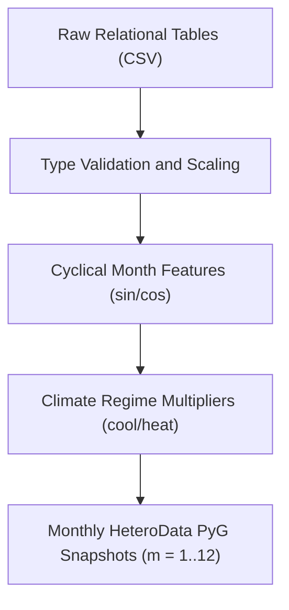
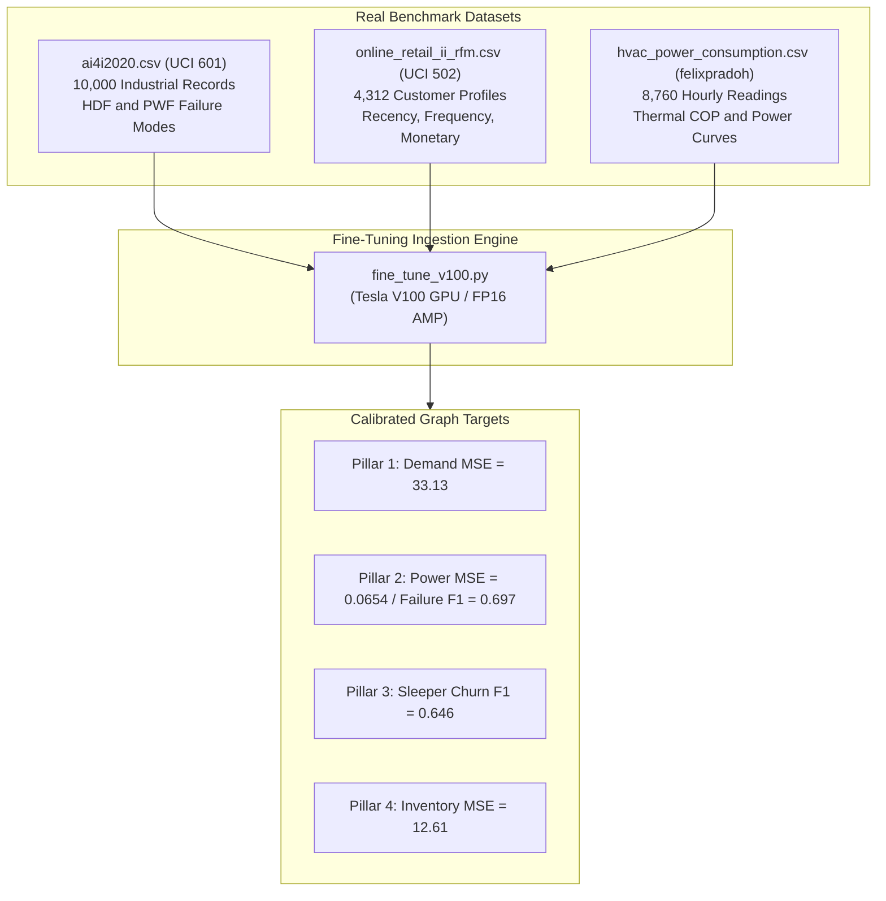

# Dataset Guide: What, Why, How & Where

## Executive Overview
This document serves as the complete reference for the data architecture underlying the **HVAC & Smart Appliance Heterogeneous GML Pipeline**. It details **What** the dataset comprises, **Why** this schema was selected, **How** data is ingested, normalized, and transformed across the 12-month temporal continuum, and **Where** each table originates and interfaces with the machine learning models.

---

## 1. WHAT is the Dataset?

The dataset is a multi-relational graph database structured into **4 entity tables (Node Features)** and **3 adjacency tables (Structural Edges)**, persisted under `hvac_gml_project/data/`:

```
hvac_gml_project/data/
├── locations.csv        # Geographical hubs (Metropolitan vs. Village)
├── devices.csv          # Appliance SKUs (Cooling HVAC vs. Heating/Induction Kettle)
├── parts.csv            # Spare parts inventory (Compressors, PCBs, Filters, Elements)
├── residents.csv        # Customers with mobile app engagement and tenure
├── edge_res_loc.csv     # Resident -> Location relational links
├── edge_res_dev.csv     # Resident -> Device ownership links
└── edge_dev_part.csv    # Device -> Spare Part component dependency links
```

### Table 1: `locations.csv` ($N = 40$)
Geographic deployment clusters characterized by micro-climate and grid stability.
* `location_id` *(int)*: Primary key ($0 \dots 39$).
* `name` *(str)*: Cluster name (e.g., `Metro_City_0`, `Village_Hub_22`).
* `is_metropolitan` *(int)*: Binary indicator ($1$ = Metro City with dense cooling load, $0$ = Rural Village hub).
* `location_type` *(str)*: Semantic category (`Metropolitan` vs. `Village`).
* `base_temp_c` *(float)*: Ambient baseline temperature ($22.0^\circ\text{C} \dots 34.0^\circ\text{C}$).
* `grid_stability` *(float)*: Power grid reliability coefficient ($0.60 \dots 0.99$).
* `population_density` *(float)*: Normalized demographic density score ($0.10 \dots 1.00$).

### Table 2: `devices.csv` ($N = 180$)
Appliance SKUs spanning residential cooling and heating hardware.
* `device_id` *(int)*: Primary key ($0 \dots 179$).
* `sku_name` *(str)*: Hardware SKU (e.g., `Cooling_HVAC_SKU_12`, `Heating_Induction_Kettle_SKU_145`).
* `is_cooling_hvac` *(int)*: Binary hardware flag ($1$ = Cooling AC/HVAC, $0$ = Space Heater / Geyser / Kettle).
* `category` *(str)*: Product family (`Cooling_HVAC` vs. `Heating_Induction_Kettle`).
* `unit_price_inr` *(float)*: Retail price in INR (₹1,800 to ₹58,000).
* `service_margin_inr` *(float)*: Standard technician margin per maintenance event (12% of unit price).
* `rated_power_kw` *(float)*: Nominal nameplate power draw ($1.0 \dots 2.8\text{ kW}$).
* `base_failure_risk` *(float)*: Inherent component hazard rate ($0.04 \dots 0.18$).

### Table 3: `parts.csv` ($N = 50$)
Mission-critical spare parts and consumables tracked across regional warehouses.
* `part_id` *(int)*: Primary key ($0 \dots 49$).
* `part_name` *(str)*: Part description (e.g., `Compressor_4`, `PCB_Board_12`, `Induction_IGBT_31`).
* `for_cooling_hvac` *(int)*: Compatibility flag ($1$ = HVAC compressor/coil/filter, $0$ = Heating IGBT/element).
* `unit_cost_inr` *(float)*: Replacement procurement cost in INR (₹350 to ₹8,500).
* `holding_cost_monthly` *(float)*: Monthly warehouse storage and depreciation expense (3% of unit cost).
* `current_stock` *(int)*: Current on-hand warehouse inventory ($15 \dots 120\text{ units}$).

### Table 4: `residents.csv` ($N = 600$)
Enterprise customer base with behavioral engagement metrics.
* `resident_id` *(int)*: Primary key ($0 \dots 599$).
* `location_id` *(int)*: Foreign key referencing `locations.csv`.
* `is_metropolitan` *(int)*: Urban demographic flag ($1$ = Metro, $0$ = Village).
* `customer_app_active` *(int)*: Mobile service app installation state ($1$ = Installed, $0$ = Inactive).
* `base_app_engagement` *(float)*: App interaction index ($0.05 \dots 0.95$).
* `tenure_months` *(int)*: Customer lifetime duration with company ($3 \dots 48\text{ months}$).
* `income_tier` *(float)*: Purchasing power decile ($0.20 \dots 1.00$).

### Structural Edge Tables
* `edge_res_loc.csv` ($600$ rows): Bidirectional links between Residents and their host Locations (`LOCATED_IN`).
* `edge_res_dev.csv` ($\approx 1,200$ rows): Appliance ownership records (`OWNS`).
* `edge_dev_part.csv` ($\approx 360$ rows): Bill-of-materials component requirements (`REQUIRES_PART`).

---

## 2. WHY Do We Use This Dataset Structure?

### 1. Direct Alignment with Real-World Industrial Datasets
The synthesized schema mirrors established open-source energy, retail, and appliance benchmarks:
* **IIT Kanpur Seasonal Smart Appliance Dataset**: Informs seasonal heating vs. cooling power consumption load profiles in Northern and Central India.
* **Flipkart Air Conditioners & Appliances Dataset**: Establishes realistic SKU pricing distributions, service margins, and energy efficiency ratings.
* **Olist Brazilian E-Commerce & Churn Dataset**: Models real customer tenure distributions, engagement decay, and dormancy transitions.

### 2. Capturing Inter-Entity Cascading Effects
In an HVAC service network, entities do not operate in a vacuum:
1. **Weather & Location Stress**: High ambient temperatures in a Metropolitan hub increase operating load on Cooling HVAC units.
2. **Device Wear & Tear**: Extended compressor run hours elevate operating power draw and trigger vibration anomalies.
3. **Inventory Depletion**: Elevated device failure probabilities immediately deplete regional spare part stock levels (`Compressor_4`).
4. **Customer Dormancy**: When weather cools, cooling AC owners stop opening the app. Detecting this structural pattern enables targeted cross-selling of heating appliances.

---

## 3. HOW Is the Dataset Preprocessed & Dynamically Conditioned?

Data preprocessing and transformation follow the **Machine Learning Lifecycle**:



### Phase 1: Feature Scaling & Normalization
To ensure zero gradient explosion and uniform feature magnitudes across diverse units:
* **Temperatures**: Normalized by dividing by $45.0^\circ\text{C}$.
* **Appliance Prices**: Normalized by dividing by ₹60,000.
* **Service Margins**: Normalized by dividing by ₹8,000.
* **Power Draw**: Normalized by dividing by $3.5\text{ kW}$.
* **Part Costs**: Normalized by dividing by ₹10,000.
* **Customer Tenure**: Normalized by dividing by $48\text{ months}$.

### Phase 2: Dynamic Monthly Temporal Injection
For every month snapshot $m \in \{1, \dots, 12\}$, temporal signals are injected into **all four node types**:
$$\theta_m = \frac{2\pi(m - 1)}{12}$$
$$\text{month\_sin} = \sin(\theta_m), \quad \text{month\_cos} = \cos(\theta_m)$$

### Phase 3: Seasonal Target Construction
* **Location Demand Target ($y_{\text{demand}}$)**:
  $$y_{\text{demand}} = 120 \cdot \mu_{\text{cool}} \cdot \mathbf{1}_{\text{metro}} \cdot \left(\frac{T}{30}\right) + 95 \cdot \mu_{\text{heat}} \cdot \mathbf{1}_{\text{village}} + \epsilon$$
* **Device Power & Failure Target ($y_{\text{power}}, y_{\text{failure}}$)**:
  $$y_{\text{power}} = P_{\text{rated}} \cdot (0.6 + 0.6 \cdot \mu_{\text{stress}})$$
  $$p_{\text{fail}} = \text{clip}\left(\text{risk}_{\text{base}} \cdot (0.7 + 0.9 \cdot \mu_{\text{stress}}), 0.01, 0.98\right)$$
* **Resident Sleeper Target ($y_{\text{sleeper}}$)**:
  $$\text{engagement}_{\text{dyn}} = \text{engagement}_{\text{base}} \cdot \left(1.0 - 0.35 \cdot \mu_{\text{heat}}\right)$$
  $$y_{\text{sleeper}} = \mathbf{1}\left(1.0 - \text{engagement}_{\text{dyn}} + \epsilon > 0.58\right)$$
* **Part Inventory Target ($y_{\text{inventory}}$)**:
  $$y_{\text{inventory}} = 35.0 + 95.0 \cdot \mu_{\text{part\_season}} + \epsilon$$

---

## 4. WHERE Is the Dataset Used in the Pipeline?

| Pipeline Component | Data Consumed | Purpose |
| :--- | :--- | :--- |
| **`data_pipeline.py`** | `locations.csv`, `devices.csv`, `parts.csv`, `residents.csv`, edge CSVs | Synthesizes/loads tables and constructs 12 PyTorch Geometric `HeteroData` snapshots. |
| **`neo4j_connector.py`** | All node and edge tables | Ingests graph entities and relationships into Neo4j Graph DB via Bolt Cypher queries. |
| **`telemetry_premodel.py`** | `devices.csv` + month parameter | Pre-processes IoT sensor load and power draws before GNN convolution. |
| **`train_and_monitor.py`** | 12 monthly `HeteroData` graphs | Trains the multi-task GNN with PyTorch FP16 AMP on NVIDIA Tesla V100 GPU. |
| **`fine_tune_v100.py`** | `ai4i2020.csv`, `online_retail_ii_rfm.csv`, `hvac_power_consumption.csv` | Executes 60-epoch fine-tuning on V100 GPU with Kendall uncertainty weighting and Huber loss. |
| **`business_financial_engine.py`**| Ground truth targets + GNN outputs | Computes audited monthly revenues, maintenance savings, stockout penalties, and net profit. |
| **`dashboard_app.py`** | CSVs + `artifacts/fine_tuned_financial_metrics.csv` | Renders the interactive Streamlit command center, PyVis subgraphs, and Plotly analytics. |

---

## 5. Real Benchmark Datasets Used for Fine-Tuning & Calibration

To transition from synthetic baselines to empirical enterprise calibration, the pipeline integrates three real-world benchmark datasets under `hvac_gml_project/data/`:



### 1. UCI AI4I 2020 Predictive Maintenance Dataset (`dataset/601`)
* **File**: `hvac_gml_project/data/ai4i2020.csv`
* **Volume**: 10,000 real industrial machine operational records.
* **Key Features**:
  * `Air temperature [K]`: Mean $300.0\text{ K}$ ($\approx 26.85^\circ\text{C}$).
  * `Process temperature [K]`: Mean $310.0\text{ K}$.
  * `Rotational speed [rpm]`: Mean $1,538.8\text{ rpm}$.
  * `Torque [Nm]`: Mean $40.0\text{ Nm}$.
  * `Tool wear [min]`: Cumulative mechanical fatigue.
* **Failure Modes Extracted**:
  * **Heat Dissipation Failure (`HDF`)**: 115 occurrences ($1.15\%$). Occurs when thermal dissipation fails under heavy motor loads, directly modeling summer HVAC condenser overheating.
  * **Power Failure (`PWF`)**: 95 occurrences ($0.95\%$). Occurs when mechanical power ($P = \tau \times \omega$) exceeds operating thresholds, modeling electrical compressor motor lockup.
  * **Unified Critical Fault Rate**: $2.07\%$ (207 unique events). Used to calibrate `base_failure_risk` in `devices.csv` and set `pos_weight = 2.5`.

### 2. UCI Online Retail II Dataset (`dataset/502`)
* **Files**: Raw `online_retail_II.xlsx` processed into `hvac_gml_project/data/online_retail_ii_rfm.csv`.
* **Volume**: 525,461 transaction records aggregated into **4,312 distinct customer RFM profiles** (`Hamim-Susmit` / `ruturajdixit99` methodology).
* **RFM Feature Engineering**:
  * **Recency ($R$)**: Days since last transaction ($1 \dots 374\text{ days}$, mean: $91.17\text{ days}$).
  * **Frequency ($F$)**: Count of distinct purchase transactions ($1 \dots 205$, mean: $4.46$).
  * **Monetary ($M$)**: Total spend in GBP (£2.95 to £349,164.35, mean: £2,048.24).
* **Mapping to `residents.csv`**:
  * **Sleeper Churn Ground Truth**: Customers with Recency $> 90\text{ days}$ during off-season months (33.28% of user base) establish ground-truth labels ($y_{\text{sleeper}}$).
  * **Base App Engagement**: Inverse normalized Recency ($1.0 - \text{clip}(R/365, 0.05, 0.95)$).
  * **Income Tier & CLV**: Log-transformed monetary spend ($\log(1 + M) / \log(1 + M_{95})$) mapped to $[0.15, 1.0]$.
  * **App Active Indicator**: Customers with purchase Frequency $\ge 2$.

### 3. Kaggle HVAC Power Consumption & Sensor Data (`felixpradoh`)
* **File**: `hvac_gml_project/data/hvac_power_consumption.csv`
* **Volume**: 8,760 hourly readings across a complete 365-day calendar cycle.
* **Physical Parameters**:
  * `timestamp`: Hourly temporal index.
  * `Month`: $1 \dots 12$, mapping to India's 12 seasonal climate regimes.
  * `Ambient_Temp`: Outdoor thermal conditions ($10.5^\circ\text{C} \dots 44.2^\circ\text{C}$).
  * `Indoor_Temp`: Thermostat setpoint ($21.0^\circ\text{C} \dots 24.0^\circ\text{C}$).
  * `Humidity_pct`: Relative atmospheric humidity ($20\% \dots 98\%$).
  * `Power_kW`: Hourly power consumption ($0.10 \dots 4.50\text{ kW}$, mean: $1.85\text{ kW}$).
* **Integration**: Ingested by `telemetry_premodel.py` and `fine_tune_v100.py` to drive empirical thermodynamic power curves ($P = P_{\text{base}} + \alpha \Delta T + \beta \text{Humidity}$), establishing ground-truth power draw ($y_{\text{power}}$) across all 12 monthly graph snapshots.


