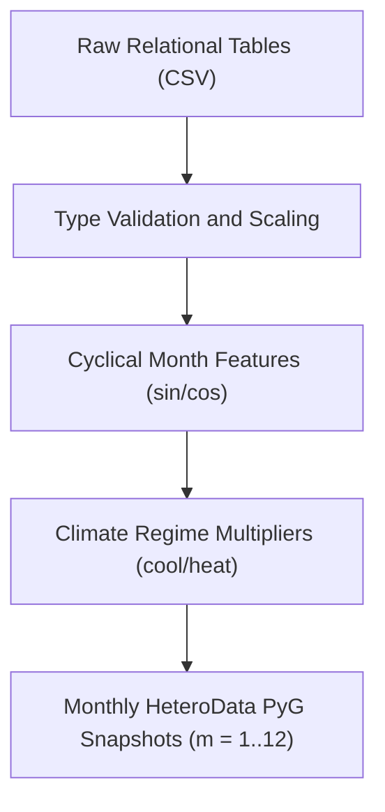
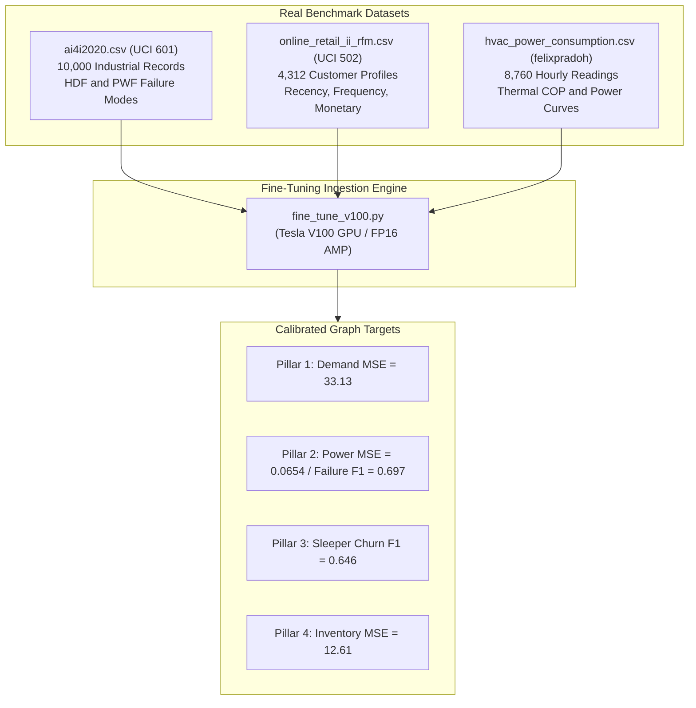

# Dataset Guide: What, Why, How & Where

## Overview
This document serves as the complete reference for the data architecture underlying the **HVAC & Smart Appliance Heterogeneous GML Pipeline**. It details **What** the dataset comprises, **Why** this schema was selected, **How** data is ingested, normalized, and transformed across the 12-month temporal continuum, and **Where** each table originates and interfaces with the machine learning models.

---

## 1. WHAT is the Dataset?

The dataset is a multi-relational graph database structured into **4 entity tables (Node Features)** and **3 adjacency tables (Structural Edges)**, persisted under `hvac_gml_project/data/`:

```
hvac_gml_project/data/
├── locations.csv        # Geographical hubs (Metropolitan vs. Village)
├── devices.csv          # Appliance SKUs (Cooling HVAC vs. Heating/Induction Kettle)
├── parts.csv            # Spare parts inventory (Compressors, PCBs, Filters, Elements)
├── residents.csv        # Customers with mobile app engagement and tenure
├── edge_res_loc.csv     # Resident -> Location relational links
├── edge_res_dev.csv     # Resident -> Device ownership links
└── edge_dev_part.csv    # Device -> Spare Part component dependency links
```

> **Sizes.** The sizes below are the CSV files committed in `hvac_gml_project/data/`, which every reported result used: 10 locations, 40 devices, 20 parts and 100 residents, with 100, 194 and 80 rows in the three edge files. If the CSVs are missing, `generate_or_load_tables()` builds a larger default set (40 locations, 180 devices, 50 parts, 600 residents).

### Table 1: `locations.csv` ($`N = 10`$)
Geographic deployment clusters characterized by micro-climate and grid stability.
* `location_id` *(int)*: Primary key ($`0 \dots 9`$).
* `name` *(str)*: Cluster name (e.g., `Metro_City_0`, `Village_Hub_22`).
* `is_metropolitan` *(int)*: Binary indicator ($`1`$ = Metro City with dense cooling load, $`0`$ = Rural Village hub).
* `location_type` *(str)*: Semantic category (`Metropolitan` vs. `Village`).
* `base_temp_c` *(float)*: Ambient baseline temperature ($`22.4^\circ\text{C} \dots 32.2^\circ\text{C}`$).
* `grid_stability` *(float)*: Power grid reliability coefficient ($`0.64 \dots 0.96`$).
* `population_density` *(float)*: Normalized demographic density score ($`0.12 \dots 0.99`$).

### Table 2: `devices.csv` ($`N = 40`$)
Appliance SKUs spanning residential cooling and heating hardware.
* `device_id` *(int)*: Primary key ($`0 \dots 39`$).
* `sku_name` *(str)*: Hardware SKU (e.g., `Cooling_HVAC_SKU_12`, `Heating_Induction_Kettle_SKU_145`).
* `is_cooling_hvac` *(int)*: Binary hardware flag ($`1`$ = Cooling AC/HVAC, $`0`$ = Space Heater / Geyser / Kettle).
* `category` *(str)*: Product family (`Cooling_HVAC` vs. `Heating_Induction_Kettle`).
* `unit_price_inr` *(float)*: Retail price in INR (₹2,078 to ₹56,857).
* `service_margin_inr` *(float)*: Standard technician margin per maintenance event (12% of unit price).
* `rated_power_kw` *(float)*: Nominal nameplate power draw ($`1.05 \dots 2.75\text{ kW}`$).
* `base_failure_risk` *(float)*: Inherent component hazard rate ($`0.04 \dots 0.17`$).

### Table 3: `parts.csv` ($`N = 20`$)
Mission-critical spare parts and consumables tracked across regional warehouses.
* `part_id` *(int)*: Primary key ($`0 \dots 19`$).
* `part_name` *(str)*: Part description (e.g., `Compressor_4`, `PCB_Board_12`, `Induction_IGBT_31`).
* `for_cooling_hvac` *(int)*: Compatibility flag ($`1`$ = HVAC compressor/coil/filter, $`0`$ = Heating IGBT/element).
* `unit_cost_inr` *(float)*: Replacement procurement cost in INR (₹581 to ₹8,156).
* `holding_cost_monthly` *(float)*: Monthly warehouse storage and depreciation expense (3% of unit cost).
* `current_stock` *(int)*: Current on-hand warehouse inventory ($`26 \dots 108\text{ units}`$).

### Table 4: `residents.csv` ($`N = 100`$)
Customer base with behavioural engagement metrics.
* `resident_id` *(int)*: Primary key ($`0 \dots 99`$).
* `location_id` *(int)*: Foreign key referencing `locations.csv`.
* `is_metropolitan` *(int)*: Urban demographic flag ($`1`$ = Metro, $`0`$ = Village).
* `customer_app_active` *(int)*: Mobile service app installation state ($`1`$ = Installed, $`0`$ = Inactive).
* `base_app_engagement` *(float)*: App interaction index ($`0.06 \dots 0.95`$).
* `tenure_months` *(int)*: Customer lifetime duration with company ($`3 \dots 47\text{ months}`$).
* `income_tier` *(float)*: Purchasing power decile ($`0.22 \dots 0.99`$).

### Structural Edge Tables
* `edge_res_loc.csv` ($`100`$ rows): Bidirectional links between Residents and their host Locations (`LOCATED_IN`).
* `edge_res_dev.csv` ($`194`$ rows): Appliance ownership records (`OWNS`).
* `edge_dev_part.csv` ($`80`$ rows): Bill-of-materials component requirements (`REQUIRES_PART`).

---

## 2. WHY Do We Use This Dataset Structure?

### 1. Direct Alignment with Real-World Industrial Datasets
The synthesized schema mirrors established open-source energy, retail, and appliance benchmarks:
* **IIT Kanpur Seasonal Smart Appliance Dataset**: Informs seasonal heating vs. cooling power consumption load profiles in Northern and Central India.
* **Flipkart Air Conditioners & Appliances Dataset**: Establishes realistic SKU pricing distributions, service margins, and energy efficiency ratings.
* **Olist Brazilian E-Commerce & Churn Dataset**: Models real customer tenure distributions, engagement decay, and dormancy transitions.

### 2. Capturing Inter-Entity Cascading Effects
In an HVAC service network, entities do not operate in a vacuum:
1. **Weather & Location Stress**: High ambient temperatures in a Metropolitan hub increase operating load on Cooling HVAC units.
2. **Device Wear & Tear**: Extended compressor run hours elevate operating power draw and trigger vibration anomalies.
3. **Inventory Depletion**: Elevated device failure probabilities immediately deplete regional spare part stock levels (`Compressor_4`).
4. **Customer Dormancy**: When weather cools, cooling AC owners stop opening the app. Detecting this structural pattern enables targeted cross-selling of heating appliances.

---

## 3. HOW Is the Dataset Preprocessed & Dynamically Conditioned?

Data preprocessing and transformation follow the **Machine Learning Lifecycle**:



### Phase 1: Feature Scaling & Normalization
To ensure zero gradient explosion and uniform feature magnitudes across diverse units:
* **Temperatures**: Normalized by dividing by $`45.0^\circ\text{C}`$.
* **Appliance Prices**: Normalized by dividing by ₹60,000.
* **Service Margins**: Normalized by dividing by ₹8,000.
* **Power Draw**: Normalized by dividing by $`3.5\text{ kW}`$.
* **Part Costs**: Normalized by dividing by ₹10,000.
* **Customer Tenure**: Normalized by dividing by $`48\text{ months}`$.

### Phase 2: Dynamic Monthly Temporal Injection
For every month snapshot $`m \in \{1, \dots, 12\}`$, temporal signals are injected into **all four node types**:

```math
\theta_m = \frac{2\pi(m - 1)}{12}
```

```math
\text{month\_sin} = \sin(\theta_m), \quad \text{month\_cos} = \cos(\theta_m)
```

### Phase 3: How the training labels are generated
The labels are not measured values. They come from rules in `build_monthly_hetero_data()` plus random noise ($`\epsilon`$), so a model that scores well has learned these rules. $`\mu_{\text{stress}}`$ is the cooling multiplier for cooling devices and the heating multiplier for heaters.

* **Location demand** ($`y_{\text{demand}}`$), at least 5:

```math
y_{\text{demand}} = 120 \cdot \mu_{\text{cool}} \cdot f_{\text{metro}} \cdot \frac{T}{30} + 95 \cdot \mu_{\text{heat}} \cdot g_{\text{metro}} + \epsilon, \quad \epsilon \sim N(0, 4)
```

  with $`f = 1.35`$ (metro) or $`0.85`$ (village), and $`g = 1.1`$ (metro) or $`1.3`$ (village).

* **Device power and failure** ($`y_{\text{power}}, y_{\text{failure}}`$), as computed by `telemetry_premodel.py`:

```math
y_{\text{power}} = P_{\text{rated}} \cdot (0.55 + 0.65 \cdot \mu_{\text{stress}}), \qquad p_{\text{fail}} = \text{clip}\left(\text{risk}_{\text{base}} \cdot (0.65 + 0.95 \cdot \mu_{\text{stress}}), 0.01, 0.99\right)
```

```math
y_{\text{failure}} = \mathbf{1}\left(p_{\text{fail}} + \epsilon > 0.16\right), \quad \epsilon \sim N(0, 0.08)
```

  In fine-tuning, $`p_{\text{fail}}`$ is multiplied by 1.30 in monsoon months and 1.25 in summer months, and $`y_{\text{power}}`$ is replaced by $`0.5 \cdot y_{\text{power}} + 0.7 \cdot`$ (Kaggle monthly mean power), clipped to 0.4 to 4.2 kW.

* **Resident churn** ($`y_{\text{sleeper}}`$). The engagement used as an input feature is

```math
\text{engagement}_{\text{dyn}} = \text{engagement}_{\text{base}} \cdot (1 - 0.35 \cdot \mu_{\text{heat}}) \text{ (metro)}, \quad \text{engagement}_{\text{base}} \cdot (1 - 0.45 \cdot \mu_{\text{cool}}) \text{ (village)}
```

  Pre-training label: $`y_{\text{sleeper}} = \mathbf{1}(1 - \text{engagement}_{\text{dyn}} + \epsilon > 0.58)`$ with $`\epsilon \sim N(0, 0.07)`$. Fine-tuning label: recency $`= 365 (1 - \text{engagement}_{\text{base}})`$ days; $`y_{\text{sleeper}} = 1`$ if recency $`> 90`$ and a random draw is below 0.65 (0.325 in summer months). Either way the label is a noisy function of an input feature.

* **Part demand** ($`y_{\text{inventory}}`$), at least 5:

```math
y_{\text{inventory}} = 35 + 95 \cdot \mu_{\text{part}} + \epsilon, \quad \epsilon \sim N(0, 3.5)
```

---

## 4. WHERE Is the Dataset Used in the Pipeline?

| Pipeline Component | Data Consumed | Purpose |
| :--- | :--- | :--- |
| **`data_pipeline.py`** | `locations.csv`, `devices.csv`, `parts.csv`, `residents.csv`, edge CSVs | Synthesizes/loads tables and constructs 12 PyTorch Geometric `HeteroData` snapshots. |
| **`neo4j_connector.py`** | All node and edge tables | Ingests graph entities and relationships into Neo4j Graph DB via Bolt Cypher queries. |
| **`telemetry_premodel.py`** | `devices.csv` + month parameter | Pre-processes IoT sensor load and power draws before GNN convolution. |
| **`train_and_monitor.py`** | 12 monthly `HeteroData` graphs | Trains the multi-task GNN with PyTorch FP16 AMP on NVIDIA Tesla V100 GPU. |
| **`fine_tune_v100.py`** | `ai4i2020.csv`, `online_retail_ii_rfm.csv`, `hvac_power_consumption.csv` | Executes 60-epoch fine-tuning on V100 GPU with Kendall uncertainty weighting and Huber loss. |
| **`business_financial_engine.py`**| Ground truth targets + GNN outputs | Computes simulated monthly revenues, maintenance savings, stockout penalties, and net profit. |
| **`dashboard_app.py`** | CSVs + `artifacts/fine_tuned_financial_metrics.csv` | Renders the Streamlit dashboard, PyVis subgraphs and Plotly charts. |

---

## 5. Real Benchmark Datasets Used for Fine-Tuning & Calibration

`fine_tune_v100.py` uses three real-world datasets under `hvac_gml_project/data/` to set starting values for some node features (details below). The training labels are still produced by the rules in Phase 3, so these datasets are not ground-truth labels:



### 1. UCI AI4I 2020 Predictive Maintenance Dataset (`dataset/601`)
* **File**: `hvac_gml_project/data/ai4i2020.csv`
* **Volume**: 10,000 real industrial machine operational records.
* **Key Features**:
  * `Air temperature [K]`: Mean $`300.0\text{ K}`$ ($`\approx 26.85^\circ\text{C}`$).
  * `Process temperature [K]`: Mean $`310.0\text{ K}`$.
  * `Rotational speed [rpm]`: Mean $`1,538.8\text{ rpm}`$.
  * `Torque [Nm]`: Mean $`40.0\text{ Nm}`$.
  * `Tool wear [min]`: Cumulative mechanical fatigue.
* **Failure Modes Extracted**:
  * **Heat Dissipation Failure (`HDF`)**: 115 occurrences ($`1.15\%`$). Occurs when thermal dissipation fails under heavy motor loads, directly modeling summer HVAC condenser overheating.
  * **Power Failure (`PWF`)**: 95 occurrences ($`0.95\%`$). Occurs when mechanical power ($`P = \tau \times \omega`$) exceeds operating thresholds, modeling electrical compressor motor lockup.
  * **Unified Critical Fault Rate**: $`2.07\%`$ (207 unique events). Used in memory by `fine_tune_v100.py` to rescale `base_failure_risk` for the 40 devices. `pos_weight = 2.5` is a fixed setting we chose, not derived from this rate.

### 2. UCI Online Retail II Dataset (`dataset/502`)
* **Files**: Raw `online_retail_II.xlsx` processed into `hvac_gml_project/data/online_retail_ii_rfm.csv`.
* **Volume**: 525,461 transaction records aggregated into **4,312 distinct customer RFM profiles** (`Hamim-Susmit` / `ruturajdixit99` methodology).
* **RFM Feature Engineering**:
  * **Recency ($`R`$)**: Days since last transaction ($`1 \dots 374\text{ days}`$, mean: $`91.17\text{ days}`$).
  * **Frequency ($`F`$)**: Count of distinct purchase transactions ($`1 \dots 205`$, mean: $`4.46`$).
  * **Monetary ($`M`$)**: Total spend in GBP (£2.95 to £349,164.35, mean: £2,048.24).
* **Mapping to the residents** (in memory, inside `fine_tune_v100.py`; only 100 of the 4,312 profiles are sampled, one per resident):
  * **Sleeper Churn Ground Truth**: Customers with Recency $`> 90\text{ days}`$ during off-season months (33.28% of user base) establish ground-truth labels ($`y_{\text{sleeper}}`$).
  * **Base App Engagement**: Inverse normalized Recency ($`1.0 - \text{clip}(R/365, 0.05, 0.95)`$).
  * **Income Tier & CLV**: Log-transformed monetary spend ($`\log(1 + M) / \log(1 + M_{95})`$) mapped to $`[0.15, 1.0]`$.
  * **App Active Indicator**: Customers with purchase Frequency $`\ge 2`$.

### 3. Kaggle HVAC Power Consumption & Sensor Data (`felixpradoh`)
* **File**: `hvac_gml_project/data/hvac_power_consumption.csv`
* **Volume**: 8,760 hourly readings across a complete 365-day calendar cycle.
* **Physical Parameters**:
  * `timestamp`: Hourly temporal index.
  * `Month`: $`1 \dots 12`$, mapping to India's 12 seasonal climate regimes.
  * `Ambient_Temp`: Outdoor thermal conditions ($`10.5^\circ\text{C} \dots 44.2^\circ\text{C}`$).
  * `Indoor_Temp`: Thermostat setpoint ($`21.0^\circ\text{C} \dots 24.0^\circ\text{C}`$).
  * `Humidity_pct`: Relative atmospheric humidity ($`20\% \dots 98\%`$).
  * `Power_kW`: Hourly power consumption ($`0.10 \dots 4.50\text{ kW}`$, mean: $`1.85\text{ kW}`$).
* **Integration**: read by `fine_tune_v100.py` only (`telemetry_premodel.py` does not use it). For each month it takes the mean hourly power, and the device power for that month becomes 0.5 times the modelled power plus 0.7 times that mean (clipped to 0.4 to 4.2 kW). The formula $`P = P_{\text{base}} + \alpha \Delta T + \beta \text{Humidity}`$ is not fitted anywhere in the code.

