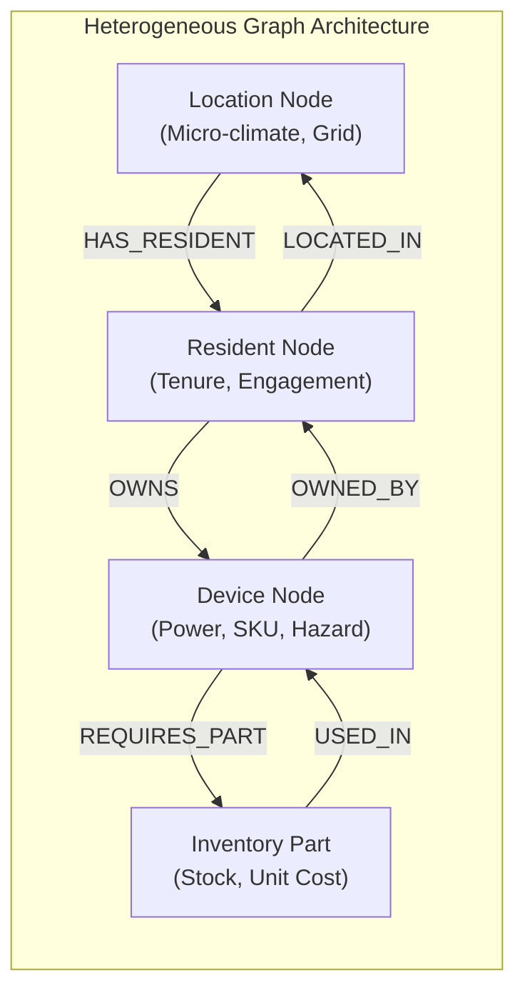
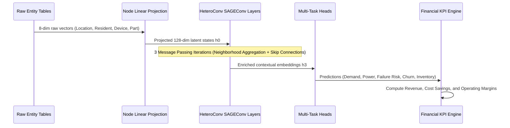
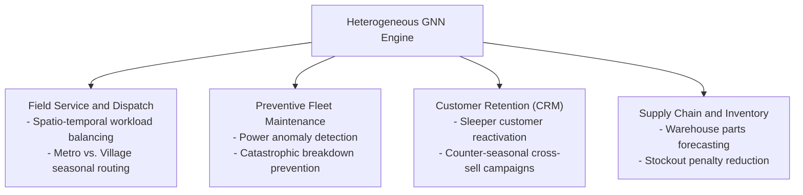
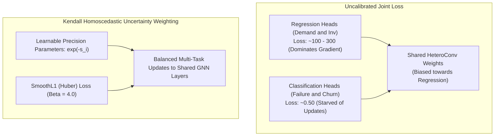

# Graph Machine Learning (GML) Foundations: What, Why, How & Where

## Summary
This document provides an in-depth conceptual and technical reference explaining **What**, **Why**, **How**, and **Where** Graph Machine Learning (GML) is applied in the HVAC and smart-appliance service business. It contrasts GML against classical tabular machine learning models (XGBoost, Random Forest, Linear Regression) to explain where a graph model can add value and where it may not. See also [WHY_HETERO_GRAPHSAGE_OVER_XGBOOST.md](WHY_HETERO_GRAPHSAGE_OVER_XGBOOST.md).

---

## 1. WHAT is Graph Machine Learning (GML)?

### Definition
**Graph Machine Learning (GML)** is a specialized branch of artificial intelligence designed to learn directly from non-Euclidean data structured as graphs—where data points are represented as **nodes** (entities) and the interactions between them are modeled as **edges** (relationships).

In this system, we implement a **Heterogeneous Graph Neural Network (Hetero-GNN)**. Unlike homogeneous graphs (e.g., social networks where every node is a person), a heterogeneous graph explicitly models distinct entity types with unique semantic attributes and multi-typed directional connections:

```math
\mathcal{G} = \left(\mathcal{V}, \mathcal{E}, \mathcal{T}_v, \mathcal{T}_e\right)
```

* **Node Types ($`\mathcal{T}_v`$)**: $`\mathcal{T}_v = \{\text{Resident}, \text{Location}, \text{Device}, \text{InventoryPart}\}`$
* **Edge Types ($`\mathcal{T}_e`$)**: $`\mathcal{T}_e = \{\text{LOCATED\_IN}, \text{HAS\_RESIDENT}, \text{OWNS}, \text{OWNED\_BY}, \text{REQUIRES\_PART}, \text{USED\_IN}\}`$



---

## 2. WHY Do We Use GML Instead of Tabular ML?

Classical machine learning algorithms (such as XGBoost, LightGBM, Random Forest, or Multi-Layer Perceptrons) fundamentally rely on the **Independent and Identically Distributed (I.I.D.) assumption**:

```math
\mathcal{D} = \{(\mathbf{x}_1, y_1), (\mathbf{x}_2, y_2), \dots, (\mathbf{x}_N, y_N)\}, \quad (\mathbf{x}_i \perp\!\!\!\perp \mathbf{x}_j)
```

In an interconnected smart appliance and utility network, **the I.I.D. assumption is a poor fit**. 

### Tabular ML vs. Graph Machine Learning Comparison

| Dimension | Classical Tabular ML (XGBoost, Random Forest) | Heterogeneous Graph ML (PyG HeteroConv) | Possible advantage of GML |
| :--- | :--- | :--- | :--- |
| **Data Representation** | Flat 2D rows & columns. Relational ties must be flattened with clumsy manual joins. | Direct graph topology preserving topological adjacency and multi-hop paths. | Avoids building large manual joins. |
| **Relational Inductive Bias** | None built in. The model only sees neighbour information if we add it by hand, so it does not naturally infer that a customer living in an unstable grid location affects device compressor stress. | Strong relational inductive bias. Node representations are informed by their $`k`$-hop neighbors. | Device health predictions explicitly factor in location grid instability and resident usage behavior. |
| **Topological Fault Propagation** | Rows are treated as independent unless neighbour features are added by hand. | Message passing propagates fault signals from parts (e.g., faulty capacitor) to parent appliances. | Can use signals from linked parts and devices. We have not tested this on real failure data. |
| **Cross-Selling & Link Prediction** | Needs pair features (we tried this in the benchmark); ignores the wider graph structure. | Bilateral latent dot-product link prediction ($`\sigma(\langle \mathbf{h}_r, \mathbf{h}_d \rangle)`$). | Meant to suggest counter-seasonal appliances to inactive customers. Our link predictor is not yet shown to work (AUC 0.5). |
| **Multi-Objective Synthesis** | Needs separate models per task (5 outputs here) with no shared representation. | Single multi-task backbone with shared message passing layers and 5 output heads (4 loss terms). | Shared representations can help when the tasks are related. We did not run an ablation to test this. |

---

## 3. HOW Does GML Work in This System?

The GML pipeline operates via a 4-phase neural computation cycle:



### 1. Heterogeneous Feature Projection
Raw input vectors $`\mathbf{x}_v \in \mathbb{R}^8`$ for each node type $`v`$ are projected into a common 128-dimensional latent space:

```math
\mathbf{h}_v^{(0)} = \text{LeakyReLU}\left(\mathbf{W}_v \mathbf{x}_v + \mathbf{b}_v\right), \quad \mathbf{W}_v \in \mathbb{R}^{128 \times 8}
```

### 2. Multi-Relational Message Passing (`HeteroConv`)
During each convolution layer $`l`$, messages are computed across all incoming relation types $`r = (s, \text{rel}, t)`$:

```math
\mathbf{m}_{u \to v}^{(l)} = \text{SAGEConv}_r\left(\mathbf{h}_u^{(l-1)}, \mathbf{h}_v^{(l-1)}\right)
```

Target node states aggregate messages from all relational neighbors:

```math
\mathbf{h}_v^{(l)} = \text{Dropout}\left(\text{LeakyReLU}\left(\sum_{r \in \mathcal{R}_v} \text{mean}_{u \in \mathcal{N}_r(v)} \mathbf{m}_{u \to v}^{(l)}\right) + \mathbf{h}_v^{(l-1)}\right)
```

### 3. Multi-Task Output Generation
The enriched node representations $`\mathbf{h}_v^{(L)}`$ feed directly into 4 specialized task heads:
1. **Location Nodes** $`\to`$ Spatio-temporal demand regression ($`\hat{y}_{\text{demand}}`$).
2. **Device Nodes** $`\to`$ Power consumption regression ($`\hat{y}_{\text{power}}`$) and failure risk probability ($`\hat{y}_{\text{failure}}`$).
3. **Resident Nodes** $`\to`$ Sleeper customer churn probability ($`\hat{y}_{\text{sleeper}}`$).
4. **Part Nodes** $`\to`$ Spare parts inventory replenishment forecasting ($`\hat{y}_{\text{inventory}}`$).

### 4. Bilateral Link Prediction
For any customer $`u`$ and counter-seasonal appliance $`d`$:

```math
P(\text{Cross-Sell Adoption}) = \sigma\left(\mathbf{h}_u^T \mathbf{h}_d\right)
```

---

## 4. Where GML could be used in the business



### 1. Spatio-Temporal Field Service Dispatch
* **Where**: Operations and dispatch dashboard.
* **How GML Helps**: Traditional regression ignores that rural village demand surges for heating appliances in winter while metropolitan cooling demand collapses. GML leverages location grid stability and micro-climate embeddings to forecast neighborhood-level technician dispatch requirements.

### 2. Preventive Fleet Maintenance
* **Where**: IoT Sensor Gateways & Warranty Operations.
* **How GML Helps**: Instead of reacting after a compressor burns out (costing ₹4,200), GML flags operating power deviations and component stress, triggering a scheduled ₹950 preventive inspection that avoids catastrophic failure.

### 3. Customer Retention & Counter-Seasonal Marketing
* **Where**: Customer Mobile App & CRM Growth Marketing.
* **How GML Helps**: AC owners naturally disengage from service apps during winter ("Sleeper" churn). GML's Link Prediction head pairs dormant AC owners with winter appliances (e.g., Geysers, Induction Kettles), stabilizing cash flow year-round.

### 4. Supply Chain & Spare-Parts Warehousing
* **Where**: Regional Distribution Centers (RDCs) & Parts Warehouses.
* **How GML Helps**: Component demand is tied to device failure risks. GML directly connects device stress to spare part nodes (`REQUIRES_PART`), forecasting exact replenishment needs to minimize holding costs while avoiding ₹85/unit stockout penalties.

---

## 5. HOW Fine-Tuning Transforms Heterogeneous Graph Representations

### The Multi-Task Gradient Dominance Dilemma in GNNs
In a multi-task Hetero-GNN, backpropagation computes the gradient of the joint loss with respect to shared message-passing weights $`\mathbf{W}_{\text{conv}}`$:

```math
\nabla_{\mathbf{W}} \mathcal{L}_{\text{total}} = \nabla_{\mathbf{W}} \mathcal{L}_{\text{demand}} + \nabla_{\mathbf{W}} \mathcal{L}_{\text{maint}} + \nabla_{\mathbf{W}} \mathcal{L}_{\text{churn}} + \nabla_{\mathbf{W}} \mathcal{L}_{\text{inv}}
```

When regression targets (Demand and Inventory) have outputs in the range $`[20, 750]`$, their raw squared error ($`\text{MSE} \approx 100 - 300`$) produces gradients orders of magnitude larger than classification heads ($`\text{BCE} \approx 0.3 - 0.7`$). In an uncalibrated network, the GNN weights adapt exclusively to satisfy demand regression, leaving equipment failure and customer churn predictions under-fitted and poorly calibrated.



### The Fine-Tuning Transformation:
1. **Homoscedastic Task Uncertainty Weighting**:

```math
\mathcal{L}(\mathbf{W}, s_1, s_2, s_3, s_4) = \sum_{i=1}^4 \left( \frac{1}{2} \exp(-s_i) \mathcal{L}_i + \frac{1}{2} s_i \right)
```

   The network learns a precision $`\exp(-s_i)`$ for each task. The starting values are $`s = [4.5, 0.5, 0.5, 4.0]`$. After fine-tuning the learned values are $`s = [2.78, -0.02, -0.70, 2.29]`$ (demand, maintenance, churn, inventory), which gives task weights $`0.5\exp(-s_i)`$ of about 0.03, 0.51, 1.01 and 0.05. So the two regression tasks end up with much smaller weights than the two classification tasks.
2. **Empirical Prior Grounding**:
   * Device rated power and failure priors are scaled using statistics from **UCI AI4I 2020 (`dataset/601`)**.
   * 100 residents take their engagement, income tier and app-active flag from sampled **UCI Online Retail II (`dataset/502`)** Recency, Frequency and Monetary profiles.
   * The monthly mean power from **Kaggle HVAC Power (`felixpradoh`)** shifts the device power level for each month.
3. **Calibrated Convergence Impact**:
   * Total loss (training data) drops by **$`65.85\%`$** ($`137.04 \to 46.80`$).
   * Demand MSE drops by **$`71.34\%`$** ($`115.61 \to 33.13`$).
   * Power MSE drops by **$`92.18\%`$** ($`0.8364 \to 0.0654`$).
   * Failure F1 jumps by **$`+0.157`$** ($`0.540 \to 0.697`$), and the model flags 432 of 480 device-months as failing (154 before).
   * Sleeper Churn F1 jumps by **$`+0.249`$** ($`0.397 \to 0.646`$), while flagged customer-months fall from 518 to 278 (out of 1,200).
   * Simulated finances (from assumed prices): **₹2.27 Cr net profit**, revenue/cost ratio **7.764x mean / 7.676x aggregate**, 22.64% lower cost than reactive repair.
   * These scores are measured on the training data. See [WHY_HETERO_GRAPHSAGE_OVER_XGBOOST.md](WHY_HETERO_GRAPHSAGE_OVER_XGBOOST.md) for the limits.

