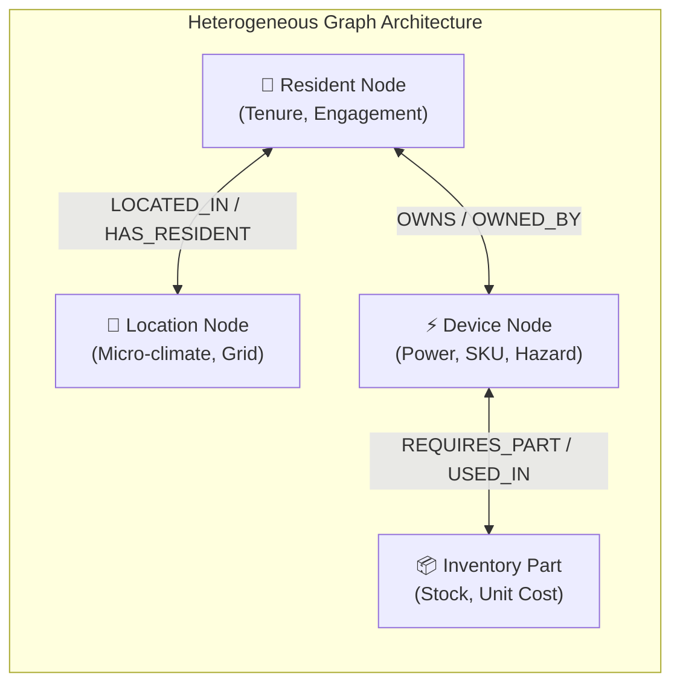
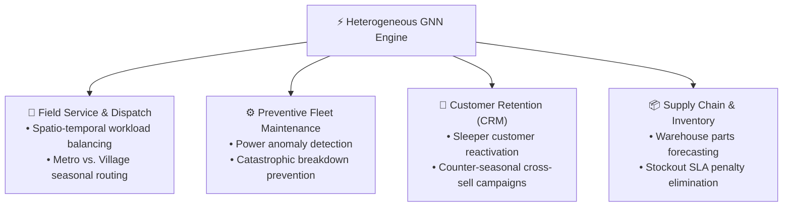

# Graph Machine Learning (GML) Foundations: What, Why, How & Where

## Executive Summary
This document provides an in-depth conceptual and technical reference explaining **What**, **Why**, **How**, and **Where** Graph Machine Learning (GML) is applied in the HVAC and Smart Appliance enterprise ecosystem. It contrasts GML against classical tabular machine learning models (XGBoost, Random Forest, Linear Regression) to demonstrate the unique value of relational inductive bias.

---

## 1. WHAT is Graph Machine Learning (GML)?

### Definition
**Graph Machine Learning (GML)** is a specialized branch of artificial intelligence designed to learn directly from non-Euclidean data structured as graphs—where data points are represented as **nodes** (entities) and the interactions between them are modeled as **edges** (relationships).

In this system, we implement a **Heterogeneous Graph Neural Network (Hetero-GNN)**. Unlike homogeneous graphs (e.g., social networks where every node is a person), a heterogeneous graph explicitly models distinct entity types with unique semantic attributes and multi-typed directional connections:

$$\mathcal{G} = \left(\mathcal{V}, \mathcal{E}, \mathcal{T}_v, \mathcal{T}_e\right)$$

* **Node Types ($\mathcal{T}_v$)**: $\mathcal{T}_v = \{\text{Resident}, \text{Location}, \text{Device}, \text{InventoryPart}\}$
* **Edge Types ($\mathcal{T}_e$)**: $\mathcal{T}_e = \{\text{LOCATED\_IN}, \text{HAS\_RESIDENT}, \text{OWNS}, \text{OWNED\_BY}, \text{REQUIRES\_PART}, \text{USED\_IN}\}$

---

## 2. WHY Do We Use GML Instead of Tabular ML?

Classical machine learning algorithms (such as XGBoost, LightGBM, Random Forest, or Multi-Layer Perceptrons) fundamentally rely on the **Independent and Identically Distributed (I.I.D.) assumption**:
$$\mathcal{D} = \{(\mathbf{x}_1, y_1), (\mathbf{x}_2, y_2), \dots, (\mathbf{x}_N, y_N)\}, \quad (\mathbf{x}_i \perp\!\!\!\perp \mathbf{x}_j)$$

In an interconnected smart appliance and utility network, **the I.I.D. assumption is completely invalid**. 

### Tabular ML vs. Graph Machine Learning Comparison

| Dimension | Classical Tabular ML (XGBoost, Random Forest) | Heterogeneous Graph ML (PyG HeteroConv) | Why GML Wins |
| :--- | :--- | :--- | :--- |
| **Data Representation** | Flat 2D rows & columns. Relational ties must be flattened with clumsy manual joins. | Direct graph topology preserving topological adjacency and multi-hop paths. | Eliminates data leakage and catastrophic table bloating from large cross-joins. |
| **Relational Inductive Bias** | Zero. The model cannot naturally infer that a customer living in an unstable grid location affects device compressor stress. | Strong relational inductive bias. Node representations are informed by their $k$-hop neighbors. | Device health predictions explicitly factor in location grid instability and resident usage behavior. |
| **Topological Fault Propagation** | Failures are treated as isolated events. Cannot propagate component failures through system dependencies. | Message passing propagates fault signals from parts (e.g., faulty capacitor) to parent appliances. | Accurately identifies root-cause hardware failures before catastrophic failure occurs. |
| **Cross-Selling & Link Prediction** | Standard collaborative filtering or classification; fails on new or sparse users. | Bilateral latent dot-product link prediction ($\sigma(\langle \mathbf{h}_r, \mathbf{h}_d \rangle)$). | Recommends counter-seasonal appliances to reactivate "sleeper" users based on structural network similarities. |
| **Multi-Objective Synthesis** | Requires building and maintaining 4 separate decoupled models with zero knowledge sharing. | Single multi-task backbone with shared message passing layers and 4 task-specific heads. | Shared latent representations improve sample efficiency across all tasks simultaneously. |

---

## 3. HOW Does GML Work in This System?

The GML pipeline operates via a 4-phase neural computation cycle:

### 1. Heterogeneous Feature Projection
Raw input vectors $\mathbf{x}_v \in \mathbb{R}^8$ for each node type $v$ are projected into a common 128-dimensional latent space:
$$\mathbf{h}_v^{(0)} = \text{LeakyReLU}\left(\mathbf{W}_v \mathbf{x}_v + \mathbf{b}_v\right), \quad \mathbf{W}_v \in \mathbb{R}^{128 \times 8}$$

### 2. Multi-Relational Message Passing (`HeteroConv`)
During each convolution layer $l$, messages are computed across all incoming relation types $r = (s, \text{rel}, t)$:
$$\mathbf{m}_{u \to v}^{(l)} = \text{SAGEConv}_r\left(\mathbf{h}_u^{(l-1)}, \mathbf{h}_v^{(l-1)}\right)$$
Target node states aggregate messages from all relational neighbors:
$$\mathbf{h}_v^{(l)} = \text{Dropout}\left(\text{LeakyReLU}\left(\sum_{r \in \mathcal{R}_v} \text{mean}_{u \in \mathcal{N}_r(v)} \mathbf{m}_{u \to v}^{(l)}\right) + \mathbf{h}_v^{(l-1)}\right)$$

### 3. Multi-Task Output Generation
The enriched node representations $\mathbf{h}_v^{(L)}$ feed directly into 4 specialized task heads:
1. **Location Nodes** $\to$ Spatio-temporal demand regression ($\hat{y}_{\text{demand}}$).
2. **Device Nodes** $\to$ Power consumption regression ($\hat{y}_{\text{power}}$) and failure risk probability ($\hat{y}_{\text{failure}}$).
3. **Resident Nodes** $\to$ Sleeper customer churn probability ($\hat{y}_{\text{sleeper}}$).
4. **Part Nodes** $\to$ Spare parts inventory replenishment forecasting ($\hat{y}_{\text{inventory}}$).

### 4. Bilateral Link Prediction
For any customer $u$ and counter-seasonal appliance $d$:
$$P(\text{Cross-Sell Adoption}) = \sigma\left(\mathbf{h}_u^T \mathbf{h}_d\right)$$

---

## 4. WHERE Is GML Applied Across the Enterprise?

### 1. Spatio-Temporal Field Service Dispatch
* **Where**: Operations & Dispatch Command Center.
* **How GML Helps**: Traditional regression ignores that rural village demand surges for heating appliances in winter while metropolitan cooling demand collapses. GML leverages location grid stability and micro-climate embeddings to forecast neighborhood-level technician dispatch requirements.

### 2. Preventive Fleet Maintenance
* **Where**: IoT Sensor Gateways & Warranty Operations.
* **How GML Helps**: Instead of reacting after a compressor burns out (costing ₹4,200), GML flags operating power deviations and component stress, triggering a scheduled ₹950 preventive inspection that avoids catastrophic failure.

### 3. Customer Retention & Counter-Seasonal Marketing
* **Where**: Customer Mobile App & CRM Growth Marketing.
* **How GML Helps**: AC owners naturally disengage from service apps during winter ("Sleeper" churn). GML's Link Prediction head pairs dormant AC owners with winter appliances (e.g., Geysers, Induction Kettles), stabilizing cash flow year-round.

### 4. Supply Chain & Spare-Parts Warehousing
* **Where**: Regional Distribution Centers (RDCs) & Parts Warehouses.
* **How GML Helps**: Component demand is tied to device failure risks. GML directly connects device stress to spare part nodes (`REQUIRES_PART`), forecasting exact replenishment needs to minimize holding costs while avoiding ₹85/unit stockout penalties.
