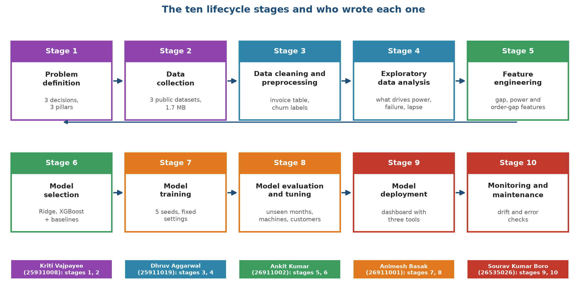
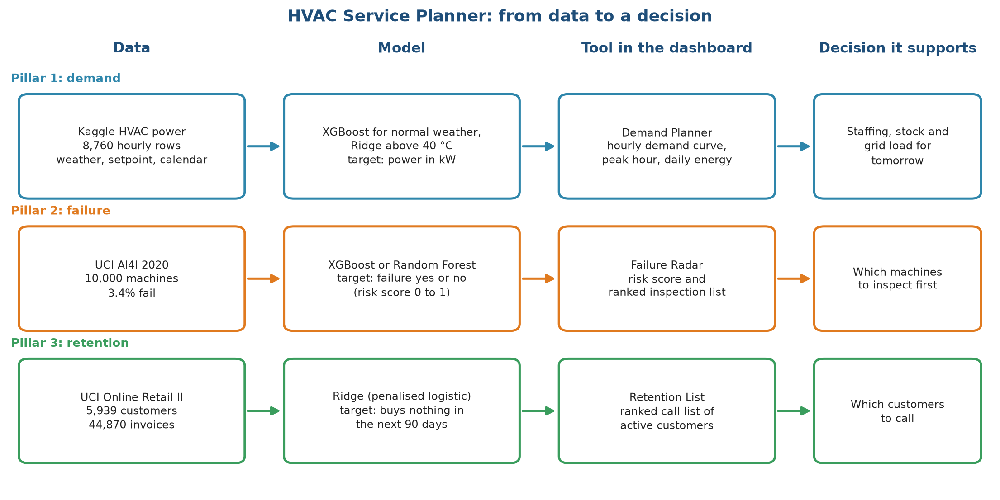
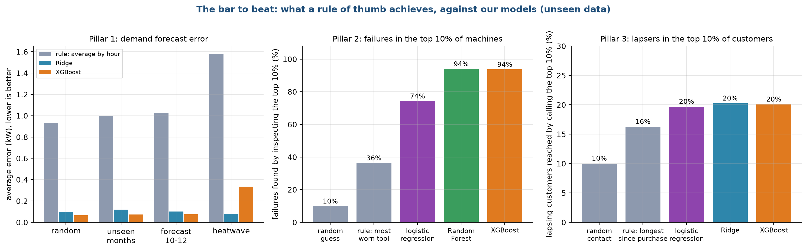

# Stage 1. Problem definition

Owner: Kriti Vajpayee (25931008). Group 1, CSC-505 Machine Learning, IIT Roorkee.

## 1.1 Why this stage comes first

Every later choice in the project, from which data to collect to which metric to report, follows from how the problem is stated. A vague statement such as "use machine learning for HVAC companies" cannot be tested. We therefore spent the first days writing down who would use the result, what they would decide with it, and what number would tell us the model is good enough. This document records that reasoning. The other nine stage documents refer back to it.

The lifecycle we follow has ten stages. Figure 1 shows them in order, with the group member who wrote each one. The arrow that returns from stage 5 to stage 6 only marks the line break in the picture: the work itself ran in order, and we went back to earlier stages whenever a result surprised us (for example, we revisited the churn table in stage 3 after seeing weak results in stage 8).

Figure 1 is a map of the report. Stages 1 and 2 (purple) set up the problem and the data. Stages 3 and 4 (blue) clean the data and look at it. Stages 5 and 6 (green) turn the data into model inputs and choose the models. Stages 7 and 8 (orange) train and test them. Stages 9 and 10 (red) put the models into a dashboard and describe how to watch them afterwards. Each stage has one author, whose name and enrollment number sit under its box.

## 1.2 The business we are helping

Our topic is "using machine learning for HVAC system providers such as Aire Serv". Aire Serv is a franchise that installs, repairs and maintains heating, ventilation and air-conditioning equipment. A franchise manager makes the same kinds of decisions every week, and most of them are made today with experience and spreadsheets:

1. How many technicians and how much stock do we need for the coming days? Demand for repairs follows the weather, because systems work hardest on the hottest and coldest days. A heatwave brings a rush of calls and a high electricity load.
2. Which customer machines should we visit before they break? A planned inspection costs far less than an emergency call-out, but nobody can inspect every machine.
3. Which customers are drifting away? Winning back a customer who is about to go quiet is cheaper than finding a new one, but the sales team can only phone so many people.

These are three separate decisions with three different kinds of data. We decided to build one product that handles all three, so that the group could show breadth, and to keep each part simple enough that every member can explain it.

## 1.3 The product: HVAC Service Planner

HVAC Service Planner is a small dashboard with three tools. Each tool takes one prediction and turns it into a short list that a manager can act on. Figure 2 shows the path from data to decision for each tool.

Figure 2 reads from left to right. The first column names the dataset behind each tool. The second column names the model and the quantity it predicts. The third column is the tool the manager sees in the dashboard, and the last column is the decision that the tool supports. Pillar 1 predicts a number (power in kilowatts), while Pillars 2 and 3 predict a yes or no outcome and return a risk score between 0 and 1. The model names in the middle column are the result of stages 6 to 8; at the time we wrote the problem statement we only knew that we would compare a few simple models.

| Tool | Manager's question | What the tool returns | Who uses it |
| :--- | :--- | :--- | :--- |
| Demand Planner (Pillar 1) | How much power will the HVAC systems draw tomorrow, and when is the peak? | Hourly demand curve, peak hour, energy for the day | Dispatch and stock planning |
| Failure Radar (Pillar 2) | Which machines should we inspect first? | Risk score per machine and a ranked inspection list | Maintenance lead |
| Retention List (Pillar 3) | Which active customers are about to go quiet? | Ranked call list with each customer's risk | Customer success and marketing |

## 1.4 Turning each question into a machine learning task

A business question becomes a machine learning problem only when we can say what goes in, what comes out, how far ahead we look and how we score the answer. The table below fixes these four things for each pillar. We wrote it before touching any data, and we have not changed it since.

| | Pillar 1: demand | Pillar 2: failure | Pillar 3: retention |
| :--- | :--- | :--- | :--- |
| Task type | Regression (predict a number) | Binary classification, rare event | Binary classification |
| Unit of prediction | One building-hour | One machine | One active customer at a cutoff date |
| Inputs | Outdoor and indoor temperature, humidity, hour, month, HVAC mode | Air and process temperature, rotational speed, torque, tool wear, machine type | Purchase history before the cutoff |
| Output | Power in kW | Failure yes or no, with a risk score | Lapses yes or no, with a risk score |
| Looking ahead | Same hour (weather forecast is the input) | The recorded failure label | 90 days after the cutoff |
| Main metric | Mean absolute error in kW | PR-AUC and share of failures in the top 10% | ROC-AUC and share of lapsers in the top 10% |
| Why this metric | Easy to read: average miss in kW | Failures are 3.4% of machines, so accuracy is meaningless | The team can call only a few customers, so the top of the list matters |

Two decisions in this table deserve a note.

For Pillar 2, a model that always predicts "no failure" is correct for 96.6% of machines and finds none of the failures. Accuracy would reward it. We therefore report PR-AUC, which stays low unless the model finds the rare failures with few false alarms, and the share of all failures that fall inside the 10% of machines with the highest risk. A manager understands the second number directly: "if we inspect one machine in ten, we catch this share of the failures".

For Pillar 3, the Online Retail II data has no column that says whether a customer left. An earlier version of our project used the flag "no purchase in 90 days" as the target while also using the days since the last purchase as an input. That is circular, since the input already contains the answer. We now define the target in the future: take a cutoff date, describe each customer using only what happened before it, and ask whether the customer buys nothing in the next 90 days. Stage 3 explains how the table is built.

## 1.5 What counts as success

We need a bar for "good enough", otherwise any score can be called a success. We set two kinds of bars.

First, the model must beat a rule of thumb that a company could apply today without any machine learning. For each pillar we picked the simplest sensible rule:

* Demand: predict the average load for that hour of the day.
* Failure: inspect the machines with the most tool wear first.
* Retention: call the customers who have not bought for the longest time.

Second, the model must beat two honest baselines from statistics and classic machine learning, so that a more complicated model is justified only if it earns its place. The baselines are ordinary linear or logistic regression (statistics) and a Random Forest (classic machine learning).

Figure 3 shows what the rules of thumb achieve on data they have not seen, next to our two models. This is the bar we set for ourselves, and it is also a preview of the result, since we computed it after the work was done.

In the left panel the grey bars are the error of the "average by hour" rule for demand. It misses by about 0.9 to 1.6 kW depending on the test, while Ridge and XGBoost miss by 0.12 kW or less except in the heatwave test, where XGBoost reaches 0.34 kW. We return to that exception in stage 8. In the middle panel, inspecting the most worn tools first finds 36% of failures in the top 10% of machines, against 10% for a random list, 74% for logistic regression and 94% for Random Forest and XGBoost. In the right panel the recency rule reaches 16% of the customers who lapse in the top 10%, against 10% for random contact and 20% for our models. The retention gain is small, and we say so plainly in the conclusion.

## 1.6 Scope

In scope:

* Three predictions on public data, each tested on data the model never saw.
* A dashboard that turns predictions into lists and curves.
* A written account of what worked, what did not, and what to watch after deployment.

Out of scope, and stated as limits:

* Real Aire Serv data. We had no access to any HVAC service company, so all three datasets are public stand-ins (stage 2).
* Cross-selling a heating product to an air-conditioning customer. It needs product categories and a customer-product graph, which we leave to future work.
* Several buildings. The demand data covers one building, so we cannot compare sites.
* Real-time operation. The dashboard works on stored data and user inputs, and it does not connect to sensors.

## 1.7 Constraints that shaped the design

* Time. The submission deadline fell about a week after the topic was fixed.
* Hardware. Everything had to run on a laptop without a graphics card. Our models train in seconds (stage 7), and the whole pipeline runs in under ten minutes.
* Explainability. Every group member must be able to explain every model at the viva. This ruled out stacking many models and pushed us toward Ridge regression and gradient-boosted trees, which we can describe in a few sentences.
* Size. We kept the data to 1.7 MB so the project can be handed in and reproduced without large downloads.

## 1.8 Decisions we made and changed

The scope above is the result of several changes. Writing them down helps a reader judge how much trust to place in the final choice.

| Change | Reason |
| :--- | :--- |
| Dropped the graph neural network that an earlier version used | In our tests it never beat a simple model by a clear margin, and the synthetic graph gave it nothing to learn from. It remains in the future work section as a hypothesis. |
| Cut the datasets from a larger set of graph tables and zip files to three files | Only three files are needed for the three pillars. |
| Replaced the circular churn label with a future-based one | The earlier label contained its own input. |
| Added a statistical baseline (linear and logistic regression), a Random Forest and rules of thumb | A comparison with only our two chosen models proves nothing. |
| Added a held-out evaluation with five random seeds | A single split can flatter a model by chance. |
| Decided against ANN, LSTM and similar models | The data is tabular and small, and these models would add complexity without evidence of gain. |

## 1.9 Risks and assumptions

| Risk or assumption | Effect if wrong | How we handle it |
| :--- | :--- | :--- |
| The datasets resemble what a real HVAC company holds | Scores would not transfer | Stated as a limit in every stage; the method, not the score, is our claim |
| Pillar 1 data is simulated | Patterns may be cleaner than real life | We call it a clean test bed and add a heatwave test that stresses it |
| A shop is a fair stand-in for a service company | Churn behaviour differs | We keep the definition simple and state the difference |
| Five seeds are enough to see noise | Small gaps might be luck | The selection rule treats gaps below one standard deviation as ties |

## 1.10 Deliverables of the whole project

The group submits a report, a presentation, the code, the data sources and a help file. The code is organised so that one command trains and tests every model, and another opens the dashboard. Stage 9 describes the dashboard and stage 10 describes the checks to run after it goes live.

<!--docs-only-->
## 1.11 Where to find things in the repository

| Item | Location |
| :--- | :--- |
| All settings (seeds, splits, thresholds) | `hvac_ml/config.py` |
| The three pillars | `hvac_ml/pillar1_demand.py`, `pillar2_failure.py`, `pillar3_churn.py` |
| Dashboard | `app.py` |
| Figures used in this document | `hvac_ml/outputs/figures/report/s1_*.png` (made by `hvac_ml/figs_diagrams.py` and `figs_data.py`) |

Next: [Stage 2, Data collection](02_Data_Collection.md).
<!--/docs-only-->
