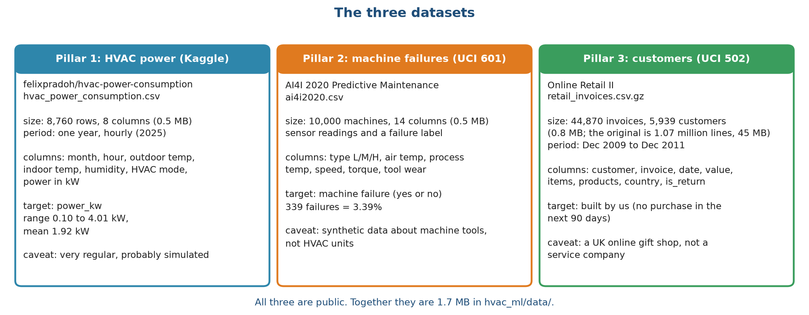
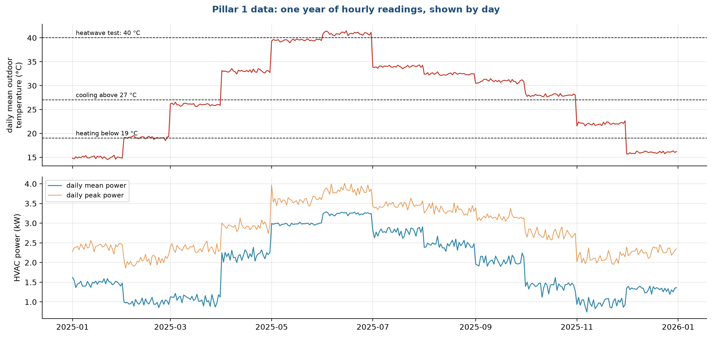
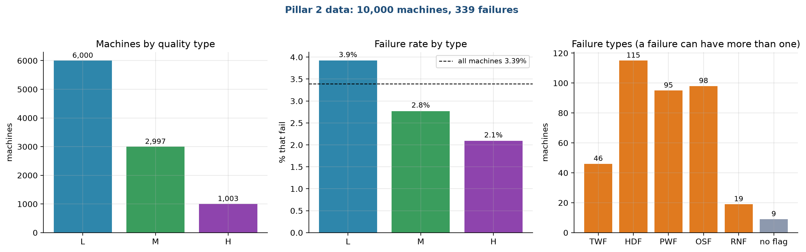
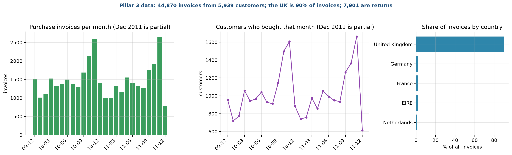

# Stage 2. Data collection

Owner: Kriti Vajpayee (25931008). Group 1, CSC-505 Machine Learning, IIT Roorkee.

## 2.1 What we needed and what we could get

A real HVAC service provider holds three kinds of records: hourly energy readings from its buildings, sensor logs from the machines it maintains, and a history of what each customer bought. We had no access to such a company, so we looked for public datasets that match each record type and are small enough to share with the report. We set four rules for the search:

1. The data must be public and free to use for coursework, with a source link we can cite.
2. Each dataset must support one of the three predictions in stage 1 without anything invented by us.
3. The total size must stay small, so the project runs on a laptop and can be handed in as a zip file.
4. We would rather use a dataset honestly labelled as a stand-in than build artificial data that looks real.

Three datasets passed. Figure 1 shows each one with its size, period, columns, target and the main caveat.

Figure 1 is a data card for each pillar. The blue card is the hourly HVAC power file from Kaggle, 8,760 rows covering one year. The orange card is the AI4I 2020 machine failure file from the UCI repository, 10,000 machines. The green card is Online Retail II from UCI, stored by us as one row per invoice. The line at the bottom says that together they take 1.7 MB. Each card ends with a caveat, because none of the three comes from an HVAC service company.

## 2.2 Source links and licences

| Pillar | Dataset | Link | Licence note |
| :--- | :--- | :--- | :--- |
| 1. Demand | HVAC power consumption (Kaggle, user felixpradoh) | https://www.kaggle.com/datasets/felixpradoh/hvac-power-consumption | We rebuilt this link from the dataset name we recorded. Open it and check the licence before submitting. |
| 2. Failure | AI4I 2020 Predictive Maintenance, UCI #601 | https://archive.ics.uci.edu/dataset/601/ai4i+2020+predictive+maintenance+dataset | Listed on UCI under Creative Commons Attribution 4.0 |
| 3. Churn | Online Retail II, UCI #502 | https://archive.ics.uci.edu/dataset/502/online+retail+ii | Listed on UCI under Creative Commons Attribution 4.0 |

The two UCI files can be downloaded automatically by the code if they are missing. The Kaggle file needs a Kaggle login, so it must be downloaded by hand. The help file explains the steps.

## 2.3 Dataset 1: hourly HVAC power (Pillar 1)

The file has one row for every hour of 2025, 8,760 rows in all, with no missing values. Table 1 lists the columns.

Table 1. Columns of the hourly HVAC power file

| Column | Meaning | Type | Range or values |
| :--- | :--- | :--- | :--- |
| timestamp | Date and hour | datetime | 1 Jan 2025 00:00 to 31 Dec 2025 23:00 |
| Month | Month number | integer | 1 to 12 |
| Hour | Hour of day | integer | 0 to 23 |
| Ambient_Temp | Outdoor temperature in °C | number | 6.06 to 50.38, mean 28.1 |
| Indoor_Temp | Indoor temperature in °C | number | 19.07 to 25.81, mean 22.8 |
| Humidity_pct | Relative humidity in % | number | 15 to 98, mean 54.6 |
| HVAC_Mode | Cooling, Heating or Idle | category | 4,886 cooling, 1,637 heating, 2,237 idle hours |
| Power_kW | HVAC power draw in kW (our target) | number | 0.10 to 4.01, mean 1.92 |

Figure 2 shows the year as daily values. The top panel is the daily mean outdoor temperature with the 19 °C, 27 °C and 40 °C lines that matter later. The bottom panel is the daily mean and peak power.

The temperature does not move smoothly through the year. It steps up or down on the first day of almost every month and then stays flat, and the same shape appears in the power curve. Real weather does not behave this way, which is why we believe the file is simulated. We could not confirm this from the Kaggle page, so we describe it as probably simulated. It also tells us something useful: the month is almost a proxy for the temperature level, and a model that sees an unfamiliar month has to rely on the temperature itself. The monthly average is above 39 °C in May and June, and 824 hours between April and September reach 40 °C or more, which is what our heatwave test uses.

## 2.4 Dataset 2: machine failures, AI4I 2020 (Pillar 2)

The file holds 10,000 simulated machine records. The UCI page describes it as synthetic data built to resemble real industrial maintenance logs. It describes machine tools, not HVAC units, and we use it as a stand-in for "sensor readings that precede a breakdown".

| Column | Meaning | Values |
| :--- | :--- | :--- |
| UDI, Product ID | Row number and product code | identifiers, not used as inputs |
| Type | Product quality class | L 6,000, M 2,997, H 1,003 |
| Air temperature [K] | Surrounding air temperature | 295.3 to 304.5, mean 300.0 |
| Process temperature [K] | Temperature of the process | 305.7 to 313.8, mean 310.0 |
| Rotational speed [rpm] | Spindle speed | 1,168 to 2,886, mean 1,539 |
| Torque [Nm] | Twisting force | 3.8 to 76.6, mean 40.0 |
| Tool wear [min] | Minutes the tool has been in use | 0 to 253 |
| Machine failure | 1 if the machine failed (our target) | 339 ones, 3.39% |
| TWF, HDF, PWF, OSF, RNF | Which failure type occurred | 46, 115, 95, 98 and 19 cases |

The five failure-type columns describe how a failure happened, so they are the answer in disguise. We do not use them as inputs, and a unit test checks that they stay out. Figure 3 gives the composition of the data.

The left panel shows 6,000 low-quality (L), 2,997 medium (M) and 1,003 high (H) machines. The middle panel shows that failure is more common in the low class, 3.9%, than in the medium (2.8%) and high (2.1%) classes, with the dashed line at the overall 3.39%. The right panel counts failure causes. Heat dissipation (HDF, 115), overstrain (OSF, 98) and power (PWF, 95) account for most cases, tool wear (TWF) for 46 and random failures (RNF) for 19. One failure can have more than one cause, and 9 failures carry no cause flag at all. These nine are a quirk of the dataset, and we leave them in.

## 2.5 Dataset 3: customer purchases, Online Retail II (Pillar 3)

Online Retail II is a real transaction log from a UK online gift shop, from 1 December 2009 to 9 December 2011. The original workbook has 1,067,371 lines and is about 45 MB. A line is one product on one invoice. We do not need the product level for the churn task, so we collapse it to one row per invoice.

| Column in our invoice table | Meaning |
| :--- | :--- |
| customer | Customer id (anonymised number) |
| invoice | Invoice number; numbers starting with C are returns |
| date | Date and time of the invoice |
| value | Money value of the invoice (quantity times price, summed) |
| items | Total number of units |
| products | Number of different products |
| country | Customer's country |
| is_return | True for a return or cancellation |

After this step the table has 44,870 invoices from 5,939 customers: 36,969 purchases and 7,901 returns. The UK accounts for 90% of invoices, and 41 countries appear in total. The file shrinks from 45 MB to 0.76 MB. Figure 4 shows how activity changes over time.

The left panel counts purchase invoices per month and the middle panel counts customers who bought in that month. Both peak in October and November of each year, the build-up to Christmas, and drop sharply in December, partly because the last month of data ends on 9 December 2011 and partly because the shop is quiet over the holidays (we did not check the reason in the data). The right panel shows the country split, where the United Kingdom is far ahead of Germany, France, Ireland and the Netherlands. This seasonal pattern matters for churn: a customer who is quiet in December is not necessarily lost. We keep it in mind when we choose the test period in stage 3.

## 2.6 How the data was collected, step by step

1. We downloaded the AI4I archive from UCI and extracted the CSV file.
2. We downloaded the Kaggle HVAC file by hand, because Kaggle needs a login.
3. We downloaded the Online Retail II archive from UCI, read both sheets of the Excel workbook and joined them.
4. We cleaned the retail lines and grouped them into invoices (stage 3), then saved the result as a compressed CSV.
5. We recorded the source link, file name, size and row count of each file in the project documents.
6. We wrote a loader for each dataset that checks the row count and the absence of missing values every time it runs. A test repeats the check.

## 2.7 What we left out

The first version of the project carried a larger collection: synthetic tables for locations, devices, spare parts and residents, a derived customer file whose "sleeper" column was just the days since last purchase compared with 90, and the original zip archives. They were needed only for the graph neural network, which we removed. A backup of that version sits outside the project folder. Removing them cut the data to three files and made the origin of every number easy to trace.

## 2.8 Quality, bias and ethics

* All three datasets are stand-ins. The numbers show that the method works on these data. They do not promise the same scores for a real company.
* The HVAC data covers one building for one year. We cannot say how the model would behave in another climate or another building.
* The failure data is synthetic and describes machine tools. The failure patterns come from the rules used to generate it, so a model can learn those rules almost exactly, which partly explains the high scores in stage 8.
* The retail data is real but anonymised. Customer ids are numbers, and no names or addresses are in the file. We use it only for coursework and we do not try to identify anyone.
* The retail shop sells gifts and mostly to businesses, and 90% of invoices are British. Results may not carry over to other countries.

## 2.9 Data summary

| Item | Pillar 1 | Pillar 2 | Pillar 3 |
| :--- | :--- | :--- | :--- |
| Rows in our file | 8,760 | 10,000 | 44,870 invoices |
| Columns | 8 | 14 | 8 |
| Size on disk | 0.49 MB | 0.52 MB | 0.76 MB |
| Time span | 1 year, hourly | none (one snapshot) | 2 years |
| Missing values | none | none | none after cleaning |
| Target | Power in kW | Failure yes or no | Built in stage 3 |
| Positive share | not applicable | 3.39% | 31% to 58% by cutoff |

<!--docs-only-->
## 2.10 Where to find things in the repository

| Item | Location |
| :--- | :--- |
| Data files | `hvac_ml/data/` |
| Loaders and the invoice builder | `hvac_ml/data.py` |
| Source links | `hvac_ml/config.py` (SOURCES) and `HELP.md` |
| Figures | `hvac_ml/outputs/figures/report/s2_*.png` |

Previous: [Stage 1](01_Problem_Definition.md). Next: [Stage 3, Data cleaning and preprocessing](03_Data_Cleaning_and_Preprocessing.md).
<!--/docs-only-->
