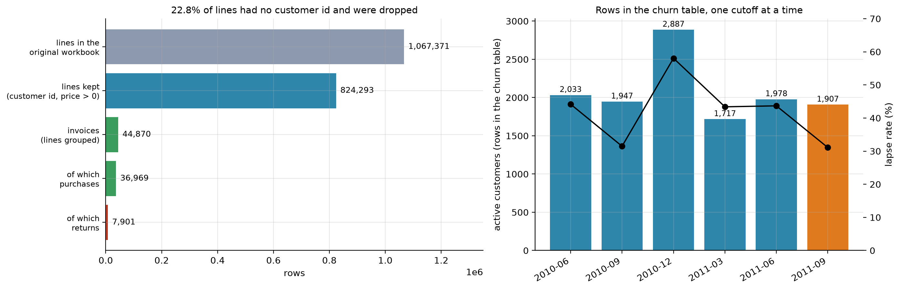
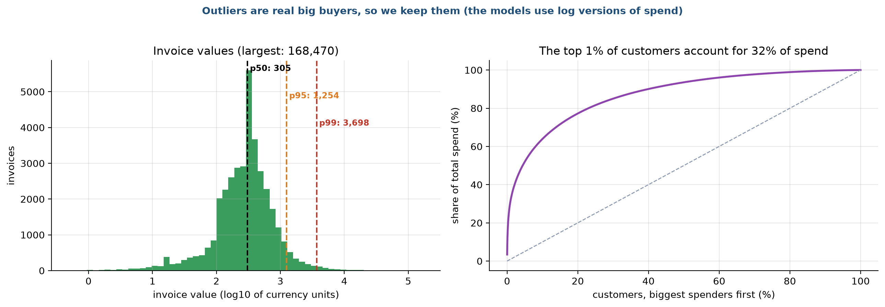
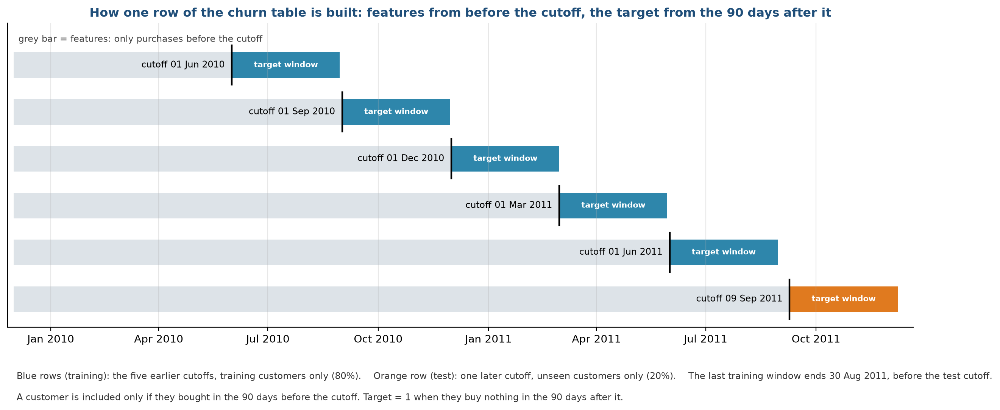
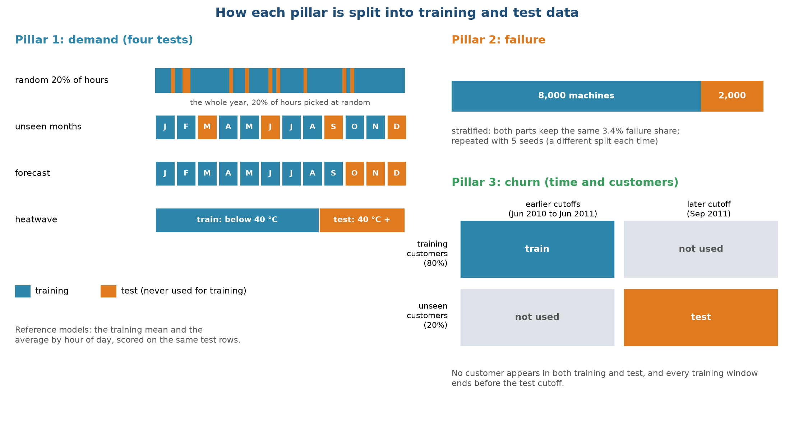

# Stage 3. Data cleaning and preprocessing

Owner: Dhruv Aggarwal (25911019). Group 1, CSC-505 Machine Learning, IIT Roorkee.

## 3.1 Purpose of this stage

Raw data is rarely ready for a model. This stage records every change we made between the downloaded files and the tables that the models read, and why. It has four parts: cleaning (removing or repairing bad records), building the churn table (the one place where we construct the target ourselves), encoding and scaling (turning columns into numbers a model can use), and splitting (deciding which rows may be used for training and which are kept for testing). The splits matter most, because a mistake there makes every later score too good to be true.

## 3.2 Checks on the raw files

Before any cleaning we checked each file for missing values, impossible values and duplicates.

| Check | HVAC power | AI4I failures | Online Retail II |
| :--- | :--- | :--- | :--- |
| Rows | 8,760 | 10,000 | 1,067,371 lines |
| Missing values | none | none | about 22.8% of lines have no customer id |
| Impossible values | none; power is never negative | none | a few lines with a price of zero or less; negative quantities on returns |
| Duplicate rows | none (one row per hour) | none (unique row number) | not checked line by line; invoices are grouped |
| Value ranges | plausible | plausible | very wide, see outliers below |

The HVAC and AI4I files are already tidy, so their cleaning is limited to renaming columns to short names and adding a few checks. The retail file needed real work.

## 3.3 Cleaning the retail transactions

Figure 1 follows the lines of the original workbook through our cleaning steps.

The top bar is the original workbook, 1,067,371 lines. The second bar is what remains after we drop lines without a customer id and lines with a price of zero or less, 824,293 lines, which means 22.8% of the original lines were removed. Grouping the remaining lines by invoice gives 44,870 invoices (third bar). Of these, 36,969 are purchases and 7,901 are returns. The right panel of the same figure shows how many rows each churn snapshot gets, with the lapse rate as a line, which section 3.5 explains. The invoice table is only 0.76 MB, against 45 MB for the original workbook.

The steps, in the order we applied them:

1. Joined the two sheets of the workbook (the data comes in two yearly sheets).
2. Dropped lines with no customer id. Without an id we cannot follow a buyer over time, so such lines are useless for churn. This removed about 243,000 lines.
3. Dropped lines with a price of zero or less. These are stock adjustments and write-offs, not sales. Almost all of them were already in the group above.
4. Marked invoices whose number starts with "C" as returns. We keep them in a separate flag and use them only to compute each customer's return share. A return never counts as a purchase, so it cannot make a lapsing customer look active.
5. Computed the value of each line as quantity times price, and grouped lines by customer and invoice, so that each invoice becomes one row with its date, total value, units, number of distinct products and country.
6. Kept only positive quantities for purchases.

## 3.4 Outliers: kept on purpose

Invoice values range from 0.38 to 168,470 currency units. Figure 2 shows how skewed they are.

The left panel is a histogram of invoice values on a logarithmic axis. Half of all invoices are below 305, 95% are below 1,254 and 99% are below 3,698, yet a few reach six figures. The right panel is a concentration curve: the top 1% of customers account for 32% of all spending. The curve bends sharply upward, which is typical of wholesale customers.

We did not delete these large invoices. They come from real customers, and a customer who spends heavily is exactly the customer a service company wants to keep. Deleting them would remove the cases that matter most for retention. Instead, we give the models logarithmic versions of spend and order value, so that a handful of huge numbers cannot dominate a linear model. Tree models do not care about scale, so XGBoost and Random Forest are unaffected.

## 3.5 Building the churn table

The retail file has no column that says a customer has left, so we build the target. This is the most delicate step in the project, because a careless version leaks the answer into the inputs. Figure 3 shows how each row of the table is built.

Each horizontal line is one snapshot of the customer base. The grey bar is the history we are allowed to use for the features: only purchases before the cutoff date (the black tick). The coloured bar is the 90-day target window after the cutoff, in which we only look to see whether the customer bought anything. A customer is included in a snapshot only if they bought in the 90 days before the cutoff, so we are asking "of the customers who are active now, who will go quiet?". The target is 1 if they buy nothing in the next 90 days.

We take five training snapshots (1 June 2010, 1 September 2010, 1 December 2010, 1 March 2011 and 1 June 2011, blue bars) and one later test snapshot (9 September 2011, orange bar). The last training window ends on 30 August 2011, before the test cutoff, so no training label looks into the test period. The test window ends on 8 December 2011, the last full day in the data.

Table 1 gives the size and the lapse rate of every snapshot, which we also plotted in stage 2.

Table 1. Size and lapse rate of each churn snapshot

| Cutoff | Active customers | Share that lapse |
| :--- | :--- | :--- |
| 1 June 2010 | 2,033 | 44% |
| 1 September 2010 | 1,947 | 31% |
| 1 December 2010 | 2,887 | 58% |
| 1 March 2011 | 1,717 | 43% |
| 1 June 2011 | 1,978 | 44% |
| 9 September 2011 (test) | 1,907 | 31% |

The December 2010 snapshot has the highest lapse rate, because the 90 days after 1 December include the quiet holiday weeks, and the September snapshots have the lowest, because their window covers the pre-Christmas buying season. The same customer can appear in several snapshots, once for each cutoff at which they were active. A customer is a different row at each cutoff, with different features and a different outcome.

## 3.6 Missing values and encodings

After the steps above, only one column has gaps: the average days between orders. It is undefined for a customer with a single order. We fill it with the median of the training data, inside the model pipeline, so that the median never comes from test rows.

Other columns need a numeric form:

| Column | Treatment | Reason |
| :--- | :--- | :--- |
| Hour and month (Pillar 1) | Sine and cosine of the angle on a circle | Hour 23 is next to hour 0 and December is next to January. A plain number would put them far apart. |
| HVAC mode, machine type | One column per category with values 0 or 1 | Models cannot read text, and there is no order between categories. |
| Money and counts (Pillar 3) | Original value plus a log version | Spend is very skewed (section 3.4). |
| Every numeric input | Standardised to mean 0 and standard deviation 1 inside the linear models | Ridge penalises large coefficients, so inputs must have comparable scale. Tree models skip this step. |

All imputing and scaling sit inside the model pipeline, so they are learned from the training rows alone and applied unchanged to the test rows. Doing it outside the pipeline, on the full table, would let test statistics leak into training.

## 3.7 Splitting the data

We decided how to split before looking at any model score. Figure 4 shows the designs.

Pillar 1 has four tests, each harder than the last. The first holds out a random 20% of hours. It is the easy case, since the neighbours of every test hour are in training, so we treat it as an optimistic reference. The second holds out whole months (March, June, September and December), so the model must predict months it never saw. The third trains on January to September and predicts October to December, which imitates a real forecast. The fourth trains on hours below 40 °C and tests on hours at or above 40 °C, which imitates a heatwave. The number of hours in training and test is 7,008 and 1,752 for the random split, 5,832 and 2,928 for unseen months, 6,552 and 2,208 for the forecast, and 7,936 and 824 for the heatwave.

Pillar 2 uses a stratified 80/20 split, with 8,000 machines for training and 2,000 for testing. Stratified means both parts hold the same 3.4% share of failures, so the test set has 68 failures. We repeat the split with five different seeds.

Pillar 3 splits customers and time at once. First, 20% of customers are picked at random and set aside. Training rows come from the earlier cutoffs and the 80% of customers. Test rows come from the later cutoff and the 20% of customers set aside. No customer appears on both sides, and no training window overlaps the test period. This leaves about 8,450 training rows and about 360 test rows, 118 of which are customers who lapse. The test set is small, so the scores vary from seed to seed, and we report that spread in stage 8.

## 3.8 Guards against leakage

Leakage means that information from the answer or the test period reaches the model during training. It produces scores that look excellent and fail in real use. Seven checks protect us, and six of them are automated tests that run before every release.

| Risk | What we did | Test |
| :--- | :--- | :--- |
| Features that use the future (churn) | Features only look at invoices before the cutoff; the test deletes all later invoices and checks that no feature changes | features use only the past |
| Target built from the past (churn) | The target only looks at invoices after the cutoff | label comes from the future |
| Same customer on both sides | Customers are split before rows are built | test customers never appear in training |
| Overlapping windows | The last training window ends before the test cutoff | training cutoffs end before the test cutoff |
| Answer hidden in the inputs (failure) | The five failure-type columns are never inputs | failure features |
| Test statistics in the pipeline | Imputing and scaling are inside the model pipeline | by design |
| Choosing a threshold on test data | The alert threshold comes from out-of-fold training scores | by design |

## 3.9 Known quirks we kept and report

Writing the cleaning rules made us notice several oddities. We kept them and list them here, because a reader should know about them.

* The temperature series in the HVAC file moves in steps at the start of each month (see the year overview in stage 2). We think it is simulated.
* 368 hours have a power value of exactly 0.10 kW. This looks like a floor in the simulation, and all of them are in idle mode.
* Nine failures in AI4I have no failure-cause flag set, and 24 machines have more than one cause flag.
* 100 of the 12,469 rows in the churn table (0.8%) count a customer as active, with a last purchase 90 days before the cutoff (rounded down to whole days), although the order count for the same 90-day window is zero. The two definitions disagree by part of a day at the boundary. We kept these rows because they are under 1% of the table.
* The retail data stops on 9 December 2011, so the last month is partial. Our test window ends on 8 December to avoid this.

## 3.10 Output of this stage

| Output | Rows | Used for |
| :--- | :--- | :--- |
| HVAC table with short column names | 8,760 | Pillar 1 |
| AI4I table with short column names | 10,000 | Pillar 2 |
| Invoice table | 44,870 | Pillar 3, input to the churn builder |
| Churn snapshots, six cutoffs | 12,469 rows in all (10,562 training cutoff rows, 1,907 test cutoff rows) | Pillar 3 |

<!--docs-only-->
## 3.11 Where to find things in the repository

| Item | Location |
| :--- | :--- |
| Cleaning and invoice builder | `hvac_ml/data.py` |
| Churn snapshots and customer split | `hvac_ml/pillar3_churn.py` |
| Demand splits | `hvac_ml/pillar1_demand.py`, function make_split |
| Leakage tests | `hvac_ml/tests/test_pipeline.py` |
| Figures | `hvac_ml/outputs/figures/report/s3_*.png` |

Previous: [Stage 2](02_Data_Collection.md). Next: [Stage 4, Exploratory data analysis](04_Exploratory_Data_Analysis.md).
<!--/docs-only-->
