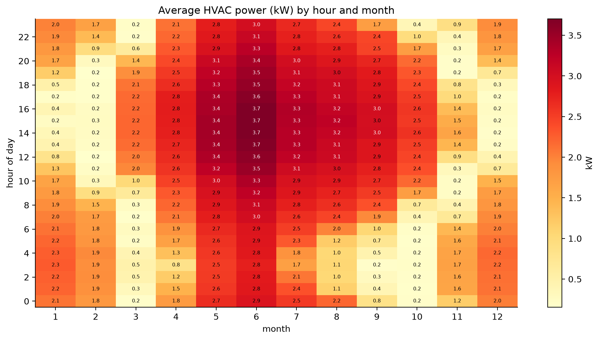
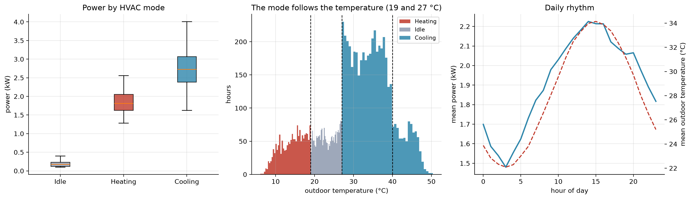
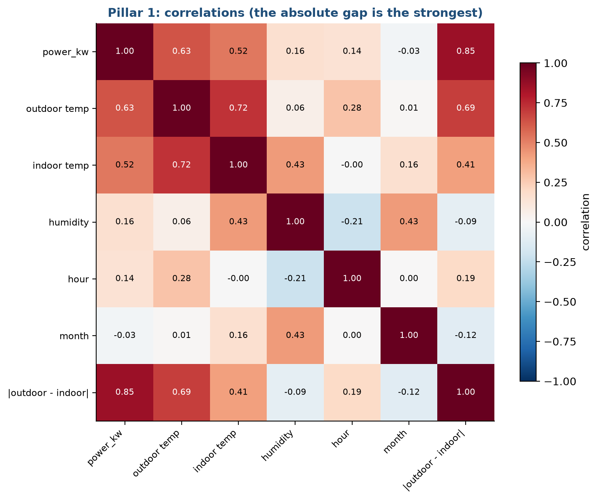
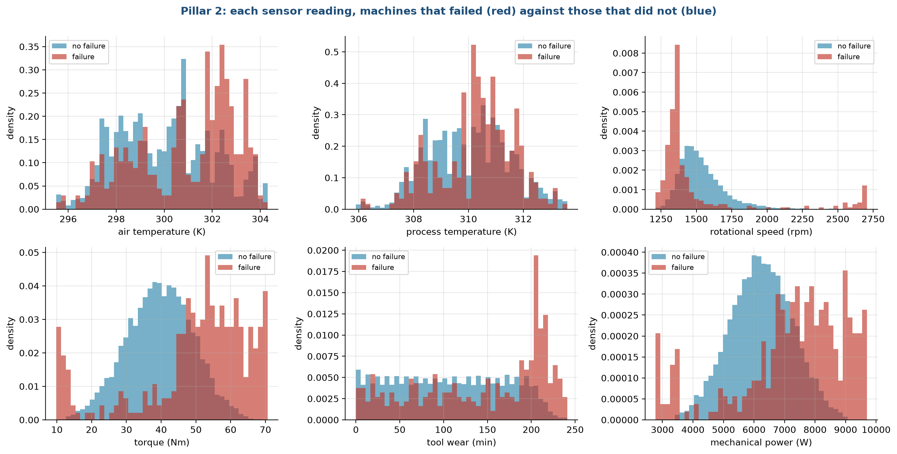
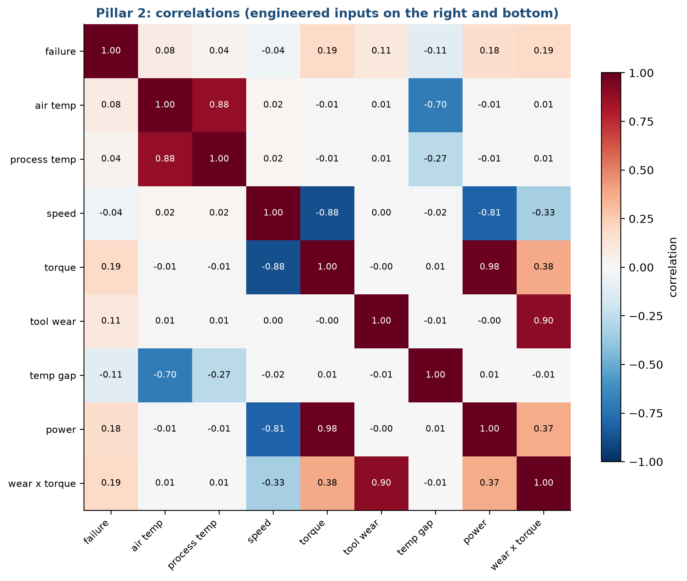
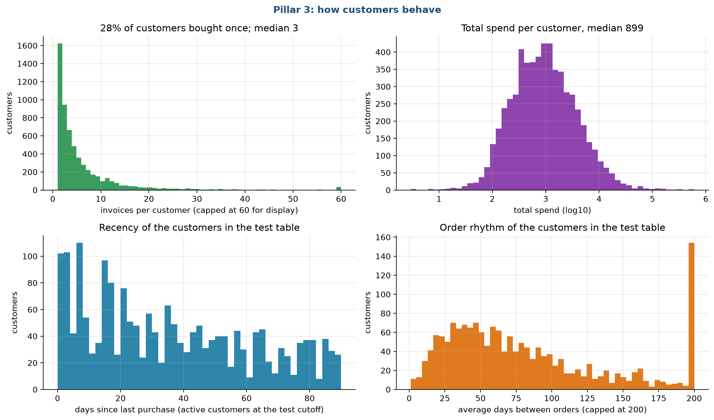
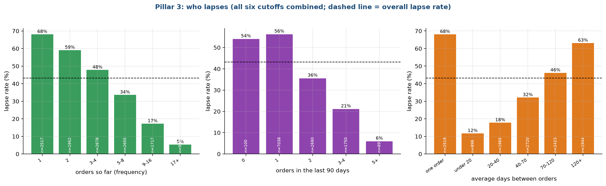
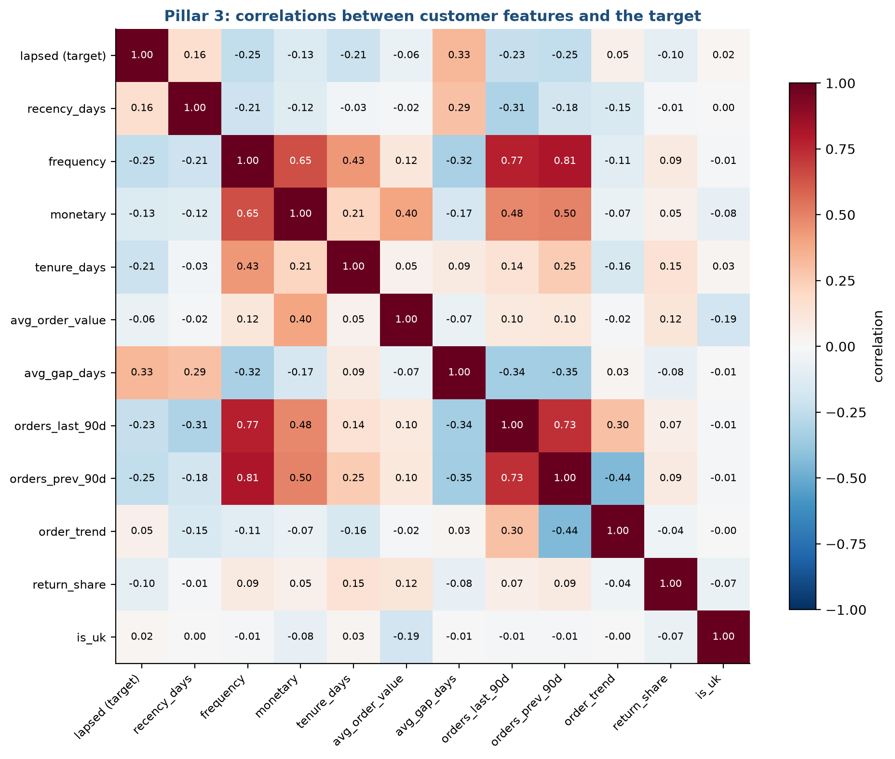

# Stage 4. Exploratory data analysis

Owner: Dhruv Aggarwal (25911019). Group 1, CSC-505 Machine Learning, IIT Roorkee.

## 4.1 What we wanted to learn

Exploratory data analysis (EDA) is the stage where we look at the cleaned data before fitting any model. We had three goals. First, to see what drives each target, so the features in stage 5 come from evidence and not from guesses. Second, to find problems that would mislead a model, such as strong overlaps between inputs or patterns that only hold in part of the data. Third, to decide which models are plausible: a relationship that is a straight line favours a linear model, while a threshold or a hump favours trees.

Every finding below is tied to a decision in a later stage. We use only the data that a model may legitimately see, and for Pillar 3 we use the churn table from stage 3.

## 4.2 Pillar 1: what drives HVAC power

### Power by hour and month

Figure 1 is a heat map of average power for each month (columns) and hour of the day (rows).

Dark red cells are high power and pale yellow cells are close to zero. The map is dominated by the months: May to August are dark red all day, with a peak of 3.7 kW between 12:00 and 17:00 in June. January and December are medium, around 2 kW. February, March, October and November are mostly pale, which means the system sits in idle mode for most hours, with bursts of heating in the cold nights and mornings. Inside a month, the hour matters less than the month, because the daily range of temperature in this data is modest compared with the jump from one month to the next. This is a direct result of the monthly steps we saw in stage 2. It tells us that month alone would explain a good part of the power, and that a model trained without some months has to take its knowledge from the temperature itself.

### Mode and temperature

Figure 2 looks at the HVAC mode.

The left panel shows power for each mode as a box plot. Idle hours draw 0.19 kW on average, heating hours 1.84 kW and cooling hours 2.73 kW, with no overlap between idle and the other two. The middle panel is a histogram of the outdoor temperature coloured by mode. The mode is a pure function of the temperature: heating below 19 °C, idle between 19 °C and 27 °C, cooling above 27 °C. The dotted lines at 19, 27 and 40 °C mark the mode switches and the heatwave threshold. The right panel shows the average power (solid) and outdoor temperature (dashed) over the 24 hours of a day. Power follows the temperature curve closely, from a low of 1.48 kW at 03:00 to a high of 2.23 kW at 14:00.

Two things follow from this. The mode column is almost redundant given the temperature, so including it does little harm and little good. More importantly, the 824 hours at or above 40 °C all lie in cooling mode, and the model must predict power for them from a temperature range that only exists in the test period. This is why the heatwave test is hard.

### Which inputs matter

Figure 3 shows the correlation between every pair of columns.

Each cell is the correlation coefficient between the column on the left and the column at the bottom, from -1 (opposite) to +1 (move together). Look at the first row, which is the correlation with power. The outdoor temperature gives 0.63 and the indoor temperature 0.52. Humidity (0.16) and hour of day (0.14) are weak, and month is close to zero (-0.03) because the relationship between month and power is a hump (high in summer, low in winter, with heating in between). The standout is the last column: the absolute gap between outdoor and indoor temperature, |outdoor - indoor|, has a correlation of 0.85 with power. Heating and cooling both cost power in proportion to how far the outdoor temperature is from the indoor setpoint, in either direction. A raw temperature misses this, because a cold day and a hot day both give a big gap but are at opposite ends of the temperature scale.

### Decisions that come from this

* Add the absolute gap as a feature, and also the gap separated by mode (stage 5).
* A linear model with the gap should do well, and it should extrapolate, because the relationship is a straight line in the gap.
* A tree model has no way to go beyond the highest gap it saw. We expect it to fail in the heatwave test and we check it in stage 8.

## 4.3 Pillar 2: what separates failing machines

### Sensor distributions

Figure 4 compares every sensor reading for machines that failed (red) and machines that did not (blue).

The panels are density histograms, so the two colours can be compared even though there are about 28 healthy machines for each failure. Where the red bars sit apart from the blue ones, that reading carries information.

* Torque: healthy machines centre around 40 Nm, while failures spread to both ends, with a cluster below 20 Nm and a large share above 50 Nm. Failure rates are 18.2% in the top decile of torque.
* Rotational speed: failures concentrate at low speed, near 1,300 rpm, and there is a small second group above 2,600 rpm. The lowest speed decile has a 16.7% failure rate.
* Tool wear: the two distributions look alike up to about 200 minutes, then failures pile up in the last stretch. The top decile has a 12.6% failure rate.
* Mechanical power, torque times speed, which we added as a derived column: failures sit at both extremes, below 4,000 W and above 8,000 W. The top decile has a 16.9% failure rate.
* Air and process temperature: failures lean toward higher temperatures, and the overlap is large.

The torque and power panels show a "U" shape: failure is more likely at both low and high values. A linear model draws one straight line, so it cannot capture a U. Tree models can. This foretells the large gap between logistic regression and the tree models that we see in stage 8.

### Correlations, including the derived inputs

Figure 5 adds three engineered columns to the correlation map.

The first row gives the correlation with failure. All values are small: torque 0.19, wear times torque 0.19, mechanical power 0.18, tool wear 0.11, the temperature gap -0.11, air temperature 0.08. A correlation measures straight-line association, so these numbers understate the U-shaped effects in Figure 4. The rest of the map shows redundancy: air and process temperature move together (0.88), torque and speed are strongly opposite (-0.88), and mechanical power is almost the same as torque (0.98). We keep all of them. Ridge handles correlated inputs by shrinking their coefficients, and trees pick whichever column helps.

### Decisions that come from this

* Add the temperature gap, mechanical power and wear times torque (stage 5). They sum up the physics behind heat, power and overstrain failures.
* Expect tree models to beat linear ones. Do not use accuracy as a metric.
* Do not use the failure-type columns as inputs, because they describe the outcome.

## 4.4 Pillar 3: how customers behave

### Distributions

Figure 6 describes the customers in the retail data.

The top left panel counts customers by the number of invoices. More than a quarter of the customers (28%) bought only once, and the median is three invoices, while a few buy hundreds of times. The top right panel shows total spend per customer on a log scale. The median is 899 currency units and the shape is a bell on the log axis, which is why we added log versions of money columns. The two lower panels describe the active customers in the test snapshot: days since the last purchase is spread evenly from 0 to 90 days with a lump near zero, and the average gap between orders ranges widely, with a pile at the right edge for customers who buy rarely (the axis is capped at 200 days).

### Who lapses

Figure 7 splits the lapse rate by three customer features, using all six snapshots together.

The dashed line is the overall lapse rate of about 43%. The numbers inside the bars show how many customers fall in each group, and small groups are less reliable.

* By number of orders so far (left): a customer with one order lapses 68% of the time, with two orders 59%, with three or four 48%, and those with 17 or more lapse 5% of the time. Loyalty builds with each order.
* By orders in the last 90 days (middle): customers with no recent order (a boundary case of only 100 rows) or one order lapse 54% to 56%, those with two lapse 36%, three or four 21% and five or more 6%.
* By average days between orders (right): customers with one order only lapse 68%, those who reorder in under 20 days lapse 12%, and those who reorder every 120 days or more lapse 63%. A shorter rhythm predicts staying.

The effect is large in each panel, so a model has useful signal to find. What the panels do not show is how these features interact, or whether the signal in one overlaps the others.

### Correlations with the target

Figure 8 gives the correlation among the churn features and with the target.

In the first row, the strongest correlations with lapsing are the average gap between orders (0.33), the number of orders (frequency, -0.25), orders in the previous 90 days (-0.25), orders in the last 90 days (-0.23) and tenure (-0.21). The days since the last purchase, recency, has a correlation of only 0.16. The rule of thumb "call the customers who have been quiet longest" relies on exactly this weakest signal. Some features are tightly bound: frequency with orders in each 90-day window (0.77 and 0.81). Because the customers in the table are active in the last 90 days, recency is squeezed into a narrow range from 0 to 90 days, which limits how much it can tell.

### Decisions that come from this

* Add the order rhythm, tenure, orders in two consecutive windows and their difference (stage 5).
* Keep log versions of the money and count columns, because of the skew.
* Do not expect a large gain from complex models. All the signal is in the customer's own order history, and the correlations are modest. This matches the result in stage 8, where every model reaches about the same score.

## 4.5 Summary of findings

| Pillar | Main finding | Number | Consequence |
| :--- | :--- | :--- | :--- |
| 1 | Power is driven by the gap between outdoor and indoor temperature | correlation 0.85 | Add the absolute gap; a linear model on it can extrapolate |
| 1 | Idle hours draw 0.19 kW, cooling 2.73 kW | by mode | Keep mode as an input |
| 1 | 824 hours reach 40 °C or more, all in cooling mode | 9.4% of hours | Use them as the heatwave test |
| 2 | Failure is U-shaped in torque, speed and power | top-decile failure rate 17% to 18% against 3.4% overall | Trees should beat linear models |
| 2 | No single input has a high correlation with failure | at most 0.19 | Combine inputs; use PR-AUC |
| 3 | Lapse falls from 68% to 5% as order count rises | frequency | The signal is in order history |
| 3 | Recency is the weakest of the main signals | correlation 0.16 | The recency rule should be a weak baseline |
| 3 | Money columns are very skewed | top 1% hold 32% of spend | Use log versions |

## 4.6 Limits of this analysis

* We looked at relationships in the whole data set or in the training snapshots. Such plots can suggest a feature, but they cannot prove that it works on unseen data. Stage 8 tests that.
* Correlation measures only straight-line links. We added the decile failure rates and the group bars to show curved and threshold effects.
* The temperature steps in the HVAC file (stage 2) are probably an artefact of how the data was made, so the clean relationships we see may be cleaner than in real buildings.

<!--docs-only-->
## 4.7 Where to find things in the repository

| Item | Location |
| :--- | :--- |
| Figures | `hvac_ml/outputs/figures/report/s4_*.png`, drawn by `hvac_ml/figs_data.py` |
| Numbers quoted here | `hvac_ml/outputs/results/facts.json`, made by `hvac_ml/report_facts.py` |

Previous: [Stage 3](03_Data_Cleaning_and_Preprocessing.md). Next: [Stage 5, Feature engineering](05_Feature_Engineering.md).
<!--/docs-only-->
