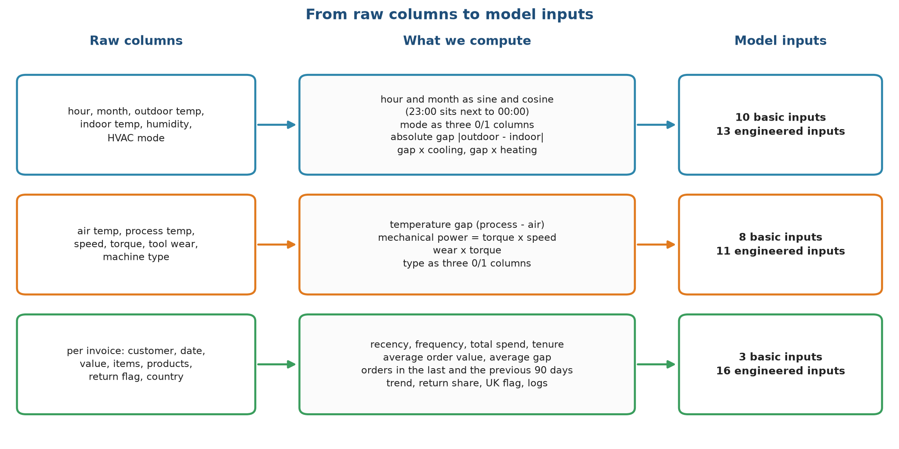
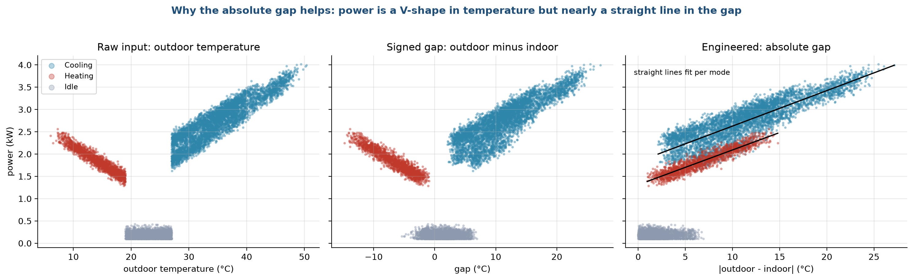
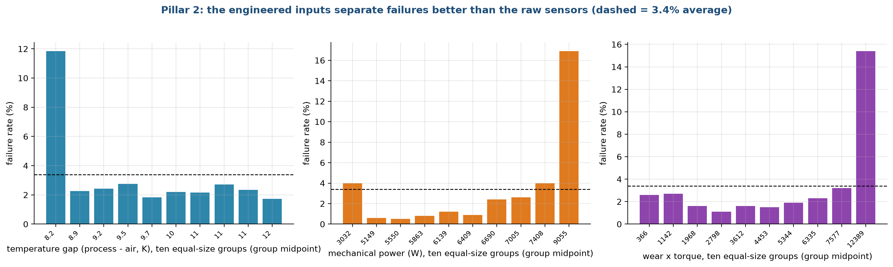
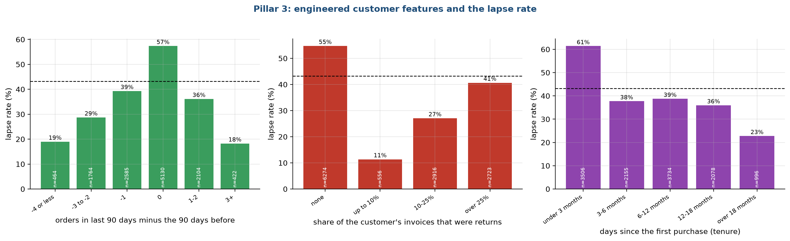
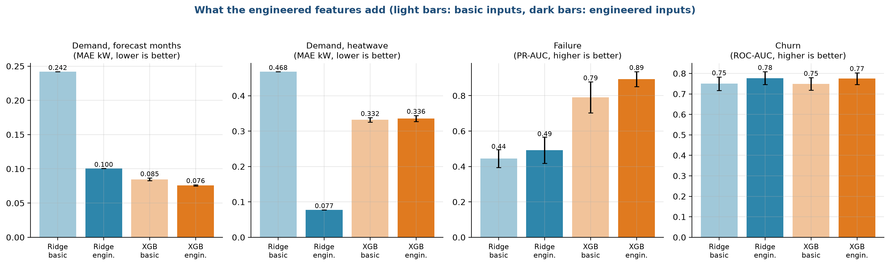
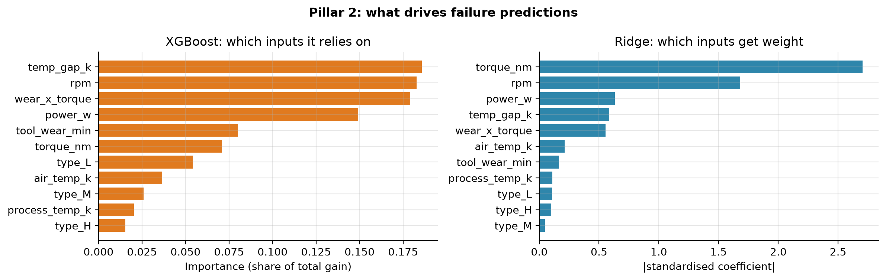
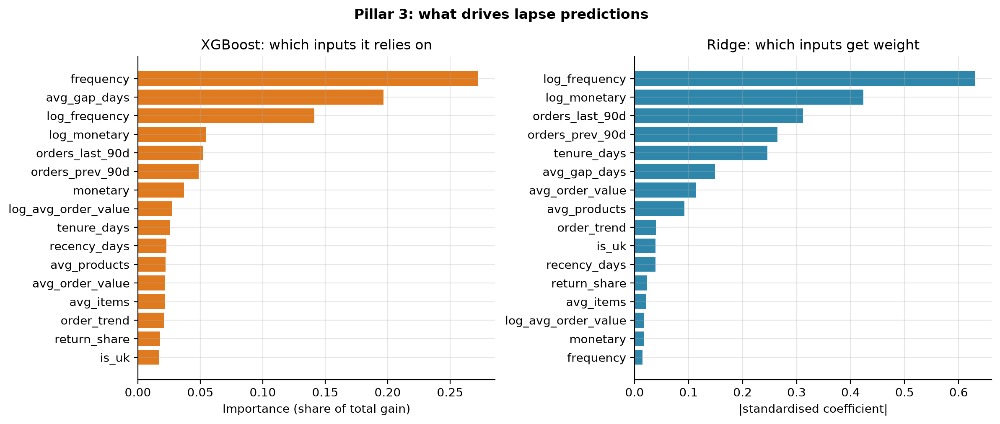

# Stage 5. Feature engineering

Owner: Ankit Kumar (26911002). Group 1, CSC-505 Machine Learning, IIT Roorkee.

## 5.1 What a feature is and why we build them

A model sees a table of numbers. Each column is a feature, and each row is one example (an hour, a machine or a customer). A model can only use what is in the table. If the useful quantity is a ratio, a difference or a count over a window, and the table holds only the raw parts, a simple model may never find it. Feature engineering means computing those quantities ourselves from knowledge of the problem.

Our rule for this stage is that every new feature must have a reason we can state in one sentence, and it must use only information available at prediction time. We compare two versions of the table for every pillar: the basic one, which holds the raw columns with minimal conversion, and the engineered one, which adds the new quantities. Comparing them tells us how much of any improvement comes from better inputs and how much from a better model.

Figure 1 summarises the steps for the three pillars.

Each row is one pillar. The left box lists the raw columns. The middle box lists what we compute. The right box gives the final count of inputs: Pillar 1 goes from 10 basic to 13 engineered inputs, Pillar 2 from 8 to 11, and Pillar 3 from 3 to 16.

## 5.2 Pillar 1: demand features

### Basic inputs (10)

| Input | How it is built | Why |
| :--- | :--- | :--- |
| Outdoor temperature | as is | the main driver of load |
| Indoor temperature | as is | the setpoint the system works toward |
| Humidity | as is | affects cooling effort |
| Hour, as sine and cosine | sin and cos of 2 x pi x hour / 24 | so that 23:00 sits next to 00:00 |
| Month, as sine and cosine | sin and cos of 2 x pi x (month - 1) / 12 | so that December sits next to January |
| Mode (cooling, heating, idle) | three 0 or 1 columns | the system is in one of three states |

### Engineered inputs (3 more, 13 in all)

| Input | How it is built | Why |
| :--- | :--- | :--- |
| Absolute gap | the absolute value of outdoor minus indoor temperature | the exploration in stage 4 showed a correlation of 0.85 with power |
| Gap while cooling | absolute gap times the cooling indicator | the cost per degree of gap differs between cooling and heating |
| Gap while heating | absolute gap times the heating indicator | same reason |

Figure 2 shows why the absolute gap is useful.

The left panel plots power against outdoor temperature. The points form a V: power is high when it is very cold, drops to near zero in the comfortable middle, and climbs again when it is hot. A straight line fitted to such a V is a poor description, because it would have to slope one way for the cold half and the other way for the hot half. The right panel plots power against the absolute gap. The V has folded into a single rising band, which a straight line follows well. The cooling and heating features then let the line have a different slope on each side. We did not add the mode thresholds (19 and 27 °C) as separate features, because the mode column already carries them.

## 5.3 Pillar 2: failure features

### Basic inputs (8)

The five sensor readings (air temperature, process temperature, rotational speed, torque and tool wear) and the machine type as three 0 or 1 columns.

### Engineered inputs (3 more, 11 in all)

| Input | How it is built | Physical meaning |
| :--- | :--- | :--- |
| Temperature gap | process temperature minus air temperature | how much heat the process produces; a small gap means heat is not leaving |
| Mechanical power | torque times rotational speed times 2 pi / 60, in watts | the work done; very low and very high power both strain the machine |
| Wear times torque | tool wear in minutes times torque | overstrain: a worn tool under heavy load |

We chose these because they are the physical quantities named in the dataset's own description of the failure modes (heat dissipation, power failure, overstrain). We did not add the failure thresholds themselves, because that would put the generator's rules directly into the table and make the problem trivial. Figure 3 shows how the failure rate changes across the range of each new feature.

Each bar is one tenth of the machines, ordered from the lowest value to the highest, and its height is the share of those machines that failed. The overall rate is 3.4%. For the temperature gap, the lowest tenth (gaps near 8.2 K) has a failure rate of about 12%, more than three times the average, while the other nine tenths sit near 2%. For mechanical power, the failure rate is under 1% in the middle of the range, about 4% in the lowest tenth and about 17% in the highest, which is the U shape we saw in stage 4. For wear times torque, the rate stays between 1% and 3% for nine tenths of the machines and then jumps to about 15% in the highest tenth. These are the effects we hoped to expose. They are threshold-shaped or U-shaped, so a tree can use them more easily than a straight line, and a straight line gets only part of the benefit.

## 5.4 Pillar 3: customer features

### Basic inputs (3)

The classic customer summary: recency (days since the last purchase), frequency (number of purchase invoices before the cutoff) and monetary value (total spend).

### Engineered inputs (13 more, 16 in all)

| Input | How it is built | Why |
| :--- | :--- | :--- |
| Tenure | days from first purchase to the cutoff | long-standing customers are steadier |
| Average order value | total spend divided by number of invoices | size of the typical order |
| Average gap between orders | tenure divided by (invoices - 1); empty for one-time buyers | the customer's own rhythm; the strongest correlation with lapsing (0.33) |
| Average items and average products per invoice | means over invoices | how big and varied the baskets are |
| Orders in the last 90 days | count of invoices in the 90 days before the cutoff | recent activity |
| Orders in the 90 days before that | count in the window 90 to 180 days before | earlier activity to compare with |
| Order trend | last 90 days minus previous 90 days | whether activity is rising or falling |
| Return share | returns divided by (returns + purchases) | how often the customer sends goods back |
| UK flag | 1 if the customer is in the United Kingdom | the shop sells mostly to the UK |
| Log spend, log frequency, log order value | natural log of one plus the value | spend is very skewed (stage 3) |

All of these use only invoices dated before the cutoff, and a unit test deletes every invoice after the cutoff and checks that no feature changes. Figure 4 looks at three of the new features.

The bars show the share of customers who go on to lapse within each group, and the dashed line is the overall rate of about 43%. The left panel is the order trend. Customers whose orders did not change between the two windows lapse most often (57%), and most of them are customers with a single recent order. Customers whose activity moved a lot in either direction lapse far less (19% for a large fall, 18% for a large rise), because a big change in either direction only happens to customers who order often. The pattern is not a straight line, so a plain linear model would miss it and a tree model may not. The middle panel is the return share. Customers with no returns at all lapse 55% of the time, while those with up to 10% returns lapse only 11%. We expected returns to signal unhappy customers. In this shop, sending goods back means the customer is engaged and orders often. The right panel is the tenure: customers in their first three months lapse 61% of the time and those with more than 18 months only 23%. Each effect is moderate, and the first two run against a first guess, which is a reason to measure them instead of assuming. The gain comes from using many small signals together.

## 5.5 Does feature engineering help?

For every pillar and model we ran the same test with basic and with engineered inputs. Figure 5 compares the two.

The clearest result is the first group of bars. For demand, Ridge regression with basic inputs misses by 0.18 to 0.24 kW on the first three tests, and engineered inputs cut that error to 0.10 to 0.12 kW, about half. In the heatwave test the error falls from 0.47 to 0.08 kW. A linear model cannot build the absolute gap from its parts, so it needs it handed over. XGBoost gains almost nothing for demand, with 0.065 kW on the random test whether or not the gap is included, because trees can build such a shape themselves by splitting. For failure, the PR-AUC rises from 0.45 to 0.49 for Ridge and from 0.79 to 0.89 for XGBoost. For churn the ROC-AUC rises from 0.75 to 0.78 for both models.

| Test | Model | Basic inputs | Engineered inputs |
| :--- | :--- | :--- | :--- |
| Demand, random split (MAE, kW) | Ridge | 0.182 | 0.096 |
| | XGBoost | 0.065 | 0.065 |
| Demand, unseen months (MAE, kW) | Ridge | 0.224 | 0.118 |
| | XGBoost | 0.070 | 0.072 |
| Demand, forecast (MAE, kW) | Ridge | 0.242 | 0.100 |
| | XGBoost | 0.085 | 0.076 |
| Demand, heatwave (MAE, kW) | Ridge | 0.468 | 0.077 |
| | XGBoost | 0.332 | 0.336 |
| Failure (PR-AUC) | Ridge | 0.445 | 0.492 |
| | XGBoost | 0.790 | 0.893 |
| Churn (ROC-AUC) | Ridge | 0.750 | 0.777 |
| | XGBoost | 0.749 | 0.775 |

## 5.6 Which features the models rely on

After training, we looked at which inputs each model uses most. Figure 6 shows this for Pillars 2 and 3.

For failure, XGBoost spreads its reliance over the temperature gap, rotational speed, wear times torque and mechanical power, three of which are our engineered features. Ridge puts the largest weights on torque and speed and little on the others. The orange bars measure the share of the total improvement in the fit that each input provides, and the blue bars show the size of the standardised coefficient.

For churn, both models rely most on how often the customer has ordered (frequency or its log) and, for XGBoost, the average gap between orders. Recency, the basis of the usual rule of thumb, ranks only tenth for XGBoost and eleventh for Ridge.

## 5.7 What we decided not to do

* No automatic feature search. Tools that generate hundreds of combinations can find a pattern that appears only by chance, and nobody can explain the result at a viva.
* No target encoding or other features computed from the answer. They need great care to avoid leaks, and we have no need for them.
* No deleting of correlated features. Ridge shrinks them, and trees pick one of them.
* No features from the test period. The future-based churn target is built separately from the features.

## 5.8 Checks on the features

| Check | Result |
| :--- | :--- |
| No missing values in demand features | tested |
| Failure features exclude the failure-type columns | tested |
| Churn features use only invoices before the cutoff | tested |
| Imputation and scaling are learned from training rows only | in the model pipeline |

<!--docs-only-->
## 5.9 Where to find things in the repository

| Item | Location |
| :--- | :--- |
| Demand features | `hvac_ml/pillar1_demand.py`, function build_features |
| Failure features | `hvac_ml/pillar2_failure.py`, function build_features |
| Churn features | `hvac_ml/pillar3_churn.py`, function customer_snapshot, lists BASIC and ENGINEERED |
| Figures | `hvac_ml/outputs/figures/report/s5_*.png` |

Previous: [Stage 4](04_Exploratory_Data_Analysis.md). Next: [Stage 6, Model selection](06_Model_Selection.md).
<!--/docs-only-->
