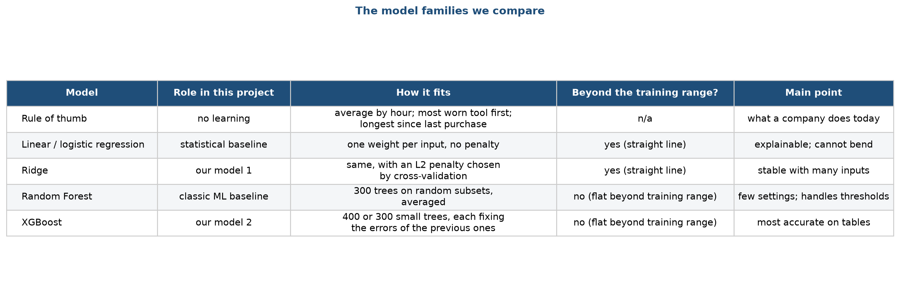
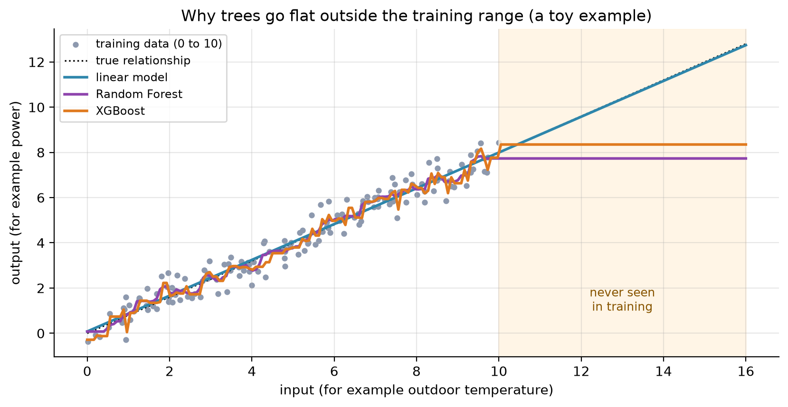
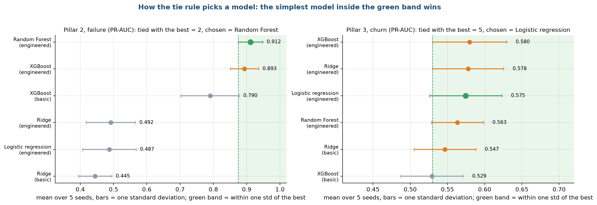
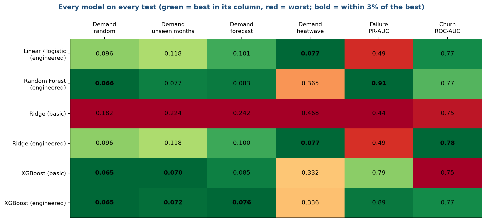

# Stage 6. Model selection

Owner: Ankit Kumar (26911002). Group 1, CSC-505 Machine Learning, IIT Roorkee.

## 6.1 The question of this stage

Which models should we try, and how will we decide which one to ship? A common mistake is to pick a fashionable model first and show that it works. We did the reverse. We set up a fair contest between simple and more complex models, with the rules fixed in advance, and let the numbers on unseen data choose. This document describes the candidates, the reasons for including each, the rule that picks the winner, and the outcome. Stage 7 then explains how the models were trained, and stage 8 gives the full test results.

## 6.2 The candidates

We use five kinds of predictor for each pillar. Figure 1 sums up their roles.

The table in Figure 1 lists the rule of thumb, linear and logistic regression, Ridge, Random Forest and XGBoost. For each it gives its role in this project, how it fits, whether it can predict beyond the range of values it saw in training, and the main point to remember. The column about the training range turns out to matter a great deal for the heatwave test (section 6.4).

| Candidate | Type | In plain words | Why it is in the contest |
| :--- | :--- | :--- | :--- |
| Rule of thumb | No learning | Demand: the average load for that hour. Failure: inspect the most worn tool first. Churn: call the customer who has been quiet longest. | The cheapest alternative. If a model cannot beat it, the product is not worth building. |
| Linear regression (demand) and logistic regression (failure, churn) | Statistical baseline | Each input gets one weight; the prediction is the weighted sum (passed through an S-shaped curve for yes or no tasks). Almost no penalty. | The standard tool of statistics. Its coefficients can be read directly. |
| Ridge | Our model 1 | The same as above, but large weights are penalised, which keeps the model stable when inputs are correlated. | Simple, fast, hard to overfit, and able to extrapolate. |
| Random Forest | Classic machine learning baseline | 300 decision trees, each trained on a random subset of rows and columns, with their answers averaged. | A strong, low-tuning model that handles thresholds and interactions. |
| XGBoost | Our model 2 | Many small trees built one after another, each correcting the errors of the ones before it. | Usually the most accurate model on tables of this size. |

### How Ridge works

A linear model predicts power as a sum, such as: intercept + w1 x gap + w2 x humidity + and so on. Ordinary least squares picks the weights that make the training error as small as possible. With many inputs that move together, those weights can become huge and opposite in sign, and the model becomes unstable. Ridge adds a penalty: it minimises the training error plus a constant (alpha) times the sum of the squared weights. A larger alpha shrinks the weights toward zero. We choose alpha from seven values between 0.001 and 1,000 by five-fold cross-validation on the training data only. For the yes or no tasks, the same idea is applied to logistic regression, and the strength is set by the constant C, chosen from five values from 0.01 to 100.

### How XGBoost works

A single decision tree splits the data by questions such as "is torque above 52 Nm?". XGBoost builds a sequence of small trees. The first tree makes a rough prediction. The second tree is fitted to the errors that remain, the third to the errors after the second, and so on. Each tree is scaled by a learning rate, and we add up all the trees. For demand we use 400 trees of depth 4 with a learning rate of 0.05, and for failure and churn 300 trees of depth 3. Each tree sees 80% of the rows and 80% of the columns. We set these once, and we did not tune them on test data. Stage 8 shows that the results change little over a wide range of settings.

## 6.3 Candidates we left out, and why

| Model | Reason for leaving it out |
| :--- | :--- |
| Graph neural network | An earlier version used a GraphSAGE model. It never beat a simple model by a clear margin, and the synthetic graph held no extra information (see future work). |
| Neural network (ANN), LSTM, RNN | Our data is tabular and small: 8,760 rows, 10,000 rows and about 8,500 rows. Such models need much more data to beat gradient-boosted trees, take longer to train, and are hard to explain at a viva. The demand series is hourly weather-driven load, which the temperature explains better than the sequence order. |
| Support vector machines, k-nearest neighbours, Naive Bayes | They add little over the five we already compare and make the contest harder to follow. |
| Stacking and blending | They make the result hard to explain and hide which model did the work. |
| Automatic model search | It would tune on the data and would be hard to defend as honest. |

## 6.4 The trees-and-extrapolation problem

One property of tree models decides the outcome of the heatwave test. Figure 2 shows a toy example that has nothing to do with HVAC.

The grey dots are training points between 0 and 10, from a relationship that rises in a straight line. The dotted black line is the true relationship, which continues past 10. All three models fit the training range well. Beyond 10, in the shaded area, the linear model (blue) continues along the straight line and stays close to the truth. The Random Forest (purple) and XGBoost (orange) stay flat at the last value they saw. A tree can only output averages of training values, so it cannot predict anything higher than the highest values it was trained on. In our data, power grows in proportion to the gap between outdoor and indoor temperature, and the heatwave hours have larger gaps than any hour in training. We therefore expected linear models to win the heatwave test and trees to lose it, and chose to make the heatwave test a part of the contest.

## 6.5 The selection rule

We wrote the rule before running the contest.

1. Run every candidate on every test, five times, with seeds 42 to 46.
2. For each test, take the mean score of each model over the five seeds. The model with the best mean is the leader.
3. Every model whose mean lies within one standard deviation of the leader is declared tied with it. The standard deviation is the leader's spread over the five seeds.
4. Among tied models, the simplest one wins. Simplest first: linear or logistic regression, Ridge, Random Forest, XGBoost.

The idea is to avoid choosing a complicated model for a difference that is just noise. Figure 3 shows the rule in action for the two classification pillars.

Each dot is the mean over five seeds with a bar of one standard deviation. The green band is the leader's mean minus one standard deviation, up to the top. In the failure panel (left), the leader is Random Forest at 0.912 PR-AUC, and only XGBoost (0.893) falls inside the band, so the two are tied and Random Forest is the simpler. Logistic regression and Ridge sit at about 0.49 and are far outside the band. In the churn panel (right), the leader is XGBoost with a PR-AUC of 0.580, but five models fall in the band, from logistic regression at 0.575 to Ridge with basic inputs at 0.547. The simplest is logistic regression, so it wins. The spread is wide because the churn test set has only about 360 customers.

## 6.6 The contest result at a glance

Figure 4 shows every model on every test at once.

Each row is a model and each column is a test. The number in the cell is the score: mean absolute error in kilowatts for the four demand tests (lower is better) and PR-AUC or ROC-AUC for failure and churn (higher is better). The colours show how each model compares with the others in its column, green for the best and red for the worst. Read the columns in turn.

* Demand, random, unseen months and forecast: the tree models (Random Forest and XGBoost) are green, with errors of 0.065 to 0.085 kW, and the linear models (Ridge and linear regression with engineered inputs) are in the middle with 0.10 to 0.12 kW. Ridge with basic inputs is red at 0.18 to 0.24 kW.
* Demand, heatwave: the picture flips. Linear regression and Ridge with engineered inputs are green at 0.077 kW. Random Forest (0.365) and XGBoost (0.33 to 0.34) are worse by a factor of four to five, and Ridge with basic inputs is the worst at 0.468.
* Failure: Random Forest (0.91) and XGBoost (0.89) lead. The linear models are red at 0.44 to 0.49.
* Churn: the five engineered or tied models sit between 0.77 and 0.78 ROC-AUC. Only the models with basic inputs are slightly worse.

## 6.7 What the rule selects

| Test | Leader (mean) | Models tied with the leader | Pick by the rule | What the product uses |
| :--- | :--- | :--- | :--- | :--- |
| Demand, random split | XGBoost, basic inputs (0.065 kW) | XGBoost, engineered inputs | XGBoost | XGBoost |
| Demand, unseen months | XGBoost, basic inputs (0.070 kW) | none | XGBoost | XGBoost |
| Demand, forecast | XGBoost, engineered inputs (0.076 kW) | none | XGBoost | XGBoost |
| Demand, heatwave | Linear regression and Ridge (0.077 kW) | none | Linear regression (Ridge gives the same score) | Ridge |
| Failure | Random Forest (0.912 PR-AUC) | XGBoost | Random Forest | XGBoost |
| Churn | XGBoost (0.580 PR-AUC) | four more, see Figure 3 | Logistic regression | Ridge |

For demand the answer is a pair: XGBoost for ordinary weather and Ridge for heat beyond 40 °C or outside the temperature range of the training data. We call this the heatwave safeguard, and stage 9 describes how it works in the dashboard.

For failure, the rule alone picks Random Forest. The product uses XGBoost, which finished inside the same band (0.893 against 0.912), because it is one of the two models the group set out to compare and the gap is smaller than one standard deviation. Either would be a sound choice. A reader who prefers the strict rule would add Random Forest to the saved models, which is a small change because every model has the same interface.

For churn, the rule picks logistic regression. The dashboard uses the Ridge version of it, which scores 0.777 ROC-AUC against 0.775 for plain logistic regression. The two are the same method with a different penalty, and we kept Ridge because it is slightly more stable when the inputs are strongly correlated.

## 6.8 Summary of the decision

| Pillar | Recommended model | Reason in one line |
| :--- | :--- | :--- |
| Demand | XGBoost, with Ridge as the heatwave safeguard | Trees are best on ordinary weather, and only a linear model extrapolates |
| Failure | XGBoost or Random Forest | Both reach about 0.9 PR-AUC, far above linear models at 0.49 |
| Retention | Ridge (penalised logistic regression) | Every model ties, so we use a simple one |

<!--docs-only-->
## 6.9 Where to find things in the repository

| Item | Location |
| :--- | :--- |
| Model factories | `hvac_ml/common.py` |
| Model lists per pillar | function model_zoo in each pillar file |
| Selection rule | function pick in `hvac_ml/run.py`; output in `hvac_ml/outputs/results/model_choice.csv` |
| Settings | `hvac_ml/config.py` |
| Figures | `hvac_ml/outputs/figures/report/s6_*.png` |

Previous: [Stage 5](05_Feature_Engineering.md). Next: [Stage 7, Model training](07_Model_Training.md).
<!--/docs-only-->
