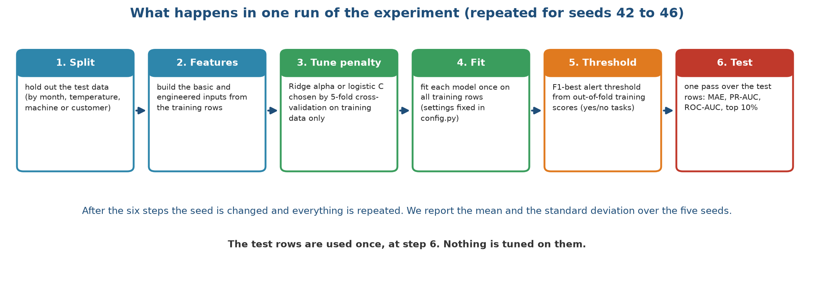
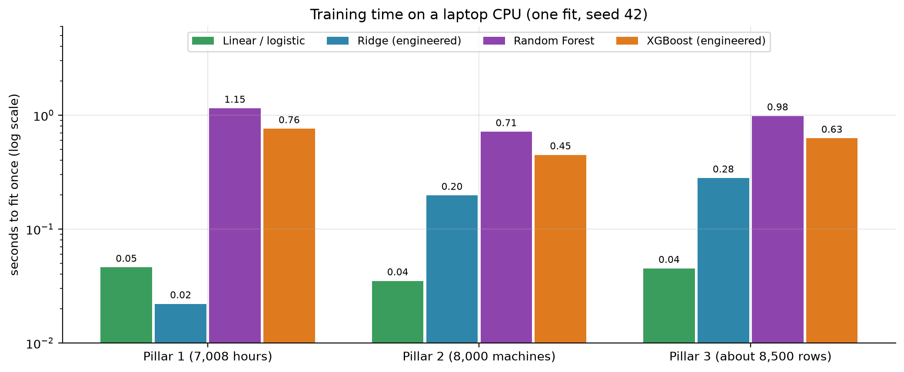
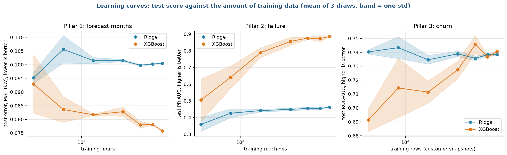
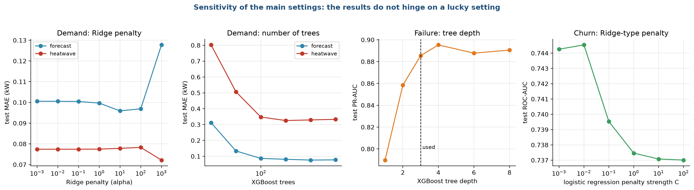

# Stage 7. Model training

Owner: Animesh Basak (26911001). Group 1, CSC-505 Machine Learning, IIT Roorkee.

## 7.1 What training means here

Training is the step where a model looks at labelled examples and sets its internal numbers so that its predictions come close to the known answers. For Ridge those numbers are the weights on each input. For XGBoost they are the splits and leaf values of the trees. In this project, training is cheap: every model fits in under two seconds on a laptop processor. The work is in doing it fairly and repeatably. This document describes the protocol, the settings, the cost, how much data each model needs, and how sensitive the result is to the settings.

## 7.2 The training protocol

Every experiment follows the same six steps, shown in Figure 1.

The six boxes read from left to right.

1. Split. The test data is set aside first (by month, by temperature, or by machine and customer), as described in stage 3.
2. Features. The basic and engineered inputs are built from the training rows.
3. Tune the penalty. Ridge picks its penalty (alpha for numbers, C for yes or no) by five-fold cross-validation on the training rows. That means the training rows are split into five parts, the model is fitted on four and scored on the fifth, and this is repeated five times. No test row is involved.
4. Fit. Each model is fitted once on all training rows. The tree settings are fixed in one configuration file and are not tuned.
5. Threshold. For the yes or no tasks, a model returns a risk score from 0 to 1. To raise an alert we need a cut-off. We choose the cut-off that gives the best F1 score on out-of-fold training scores, meaning scores that the model produced for rows it had not been trained on within the cross-validation. This keeps the test rows out of the choice.
6. Test. The fitted model scores the test rows once. We record the error for demand, and PR-AUC, ROC-AUC, F1, precision, recall and the top-10% capture for failure and churn.

After the six steps, the seed is changed and everything is repeated. We use five seeds, 42 to 46, and report the mean and the standard deviation. A seed changes the random 20% of hours, the stratified split of machines, the 20% of customers set aside, and the random choices inside the tree models. The tests by month and by temperature do not depend on the seed, so only the model's own randomness varies there, and Ridge gives the same answer every time (a standard deviation of zero).

## 7.3 Settings

| Setting | Value | Where it applies |
| :--- | :--- | :--- |
| Seeds | 42, 43, 44, 45, 46 | all experiments |
| Share of data held out | 20% (rows for AI4I, customers for retail, hours for the random demand split) | all pillars |
| Held-out months | 3, 6, 9, 12 | demand, unseen months |
| Forecast months | 10, 11, 12 (train on 1 to 9) | demand, forecast |
| Heatwave threshold | 40 °C | demand, heatwave |
| Training cutoffs | 1 Jun, 1 Sep, 1 Dec 2010; 1 Mar, 1 Jun 2011 | churn |
| Test cutoff | 9 Sep 2011 | churn |
| Prediction window | 90 days | churn |
| Ridge penalty candidates | 0.001, 0.01, 0.1, 1, 10, 100, 1000 | demand, 5-fold cross-validation |
| Logistic penalty candidates (C) | 0.01, 0.1, 1, 10, 100 | failure and churn, 5-fold cross-validation, scored by average precision |
| XGBoost for demand | 400 trees, depth 4, learning rate 0.05, 80% of rows and of columns per tree | |
| XGBoost for failure and churn | 300 trees, depth 3, learning rate 0.05, 80% of rows and of columns per tree | |
| Random Forest | 300 trees, at least 5 rows per leaf | |
| Linear and logistic regression | no penalty (C = 1,000,000 for logistic) | statistical baseline |

For the final models in the dashboard, cross-validation chose an alpha of 0.1 for the demand Ridge and a C of 0.1 for the failure and churn Ridge. The alert thresholds learned on training data are 0.44 for XGBoost on failure (0.26 for Ridge) and 0.34 for XGBoost on churn (0.35 for Ridge).

## 7.4 What the models cost to train

Figure 2 gives the time for one fit on a laptop processor.

The vertical axis is logarithmic, so each gridline is ten times the one below. The linear and logistic regressions take 0.02 to 0.05 seconds. Ridge takes 0.02 seconds for demand and 0.2 to 0.3 seconds for failure and churn, where it tries five penalties five times each. XGBoost takes 0.45 to 0.76 seconds and Random Forest 0.7 to 1.1 seconds. Nothing takes longer than 1.2 seconds. The complete experiment, which fits 18 models five times on each of the splits, writes all tables and figures, and trains the final models, runs in about 11 minutes. A single prediction takes 1.4 to 2.4 milliseconds, so the dashboard answers immediately. The saved file with the Ridge and XGBoost models for the three pillars is 1.4 MB.

These numbers matter for one reason: nothing in this project needs a graphics card, a cluster or a long wait. Every member can rerun it before the viva.

## 7.5 How much data does each model need?

A learning curve shows the test score as the training set grows. If the curve is still rising at the right-hand end, more data would help. If it is flat, the model has learned what it can. Figure 3 shows the curves for the three pillars.

Each point is the mean of three random draws of the training rows, and the shaded band is one standard deviation. The axis for the training size is logarithmic.

* Demand, forecast months (left): the error of Ridge stays near 0.10 kW from about 600 hours up, so it has learned its straight line early. XGBoost starts at 0.09 kW with few hours, gets down to about 0.076 kW with all 6,552 hours, and keeps improving slowly. It needs more data than Ridge, but even 600 hours is enough to match it.
* Failure (middle): Ridge gains little, from 0.36 to 0.46 PR-AUC, because its limit is the straight-line form and not the data. XGBoost climbs from 0.5 with 400 machines to 0.88 with 8,000. The curve flattens at the right but has not fully levelled, so more machines would probably help a little.
* Churn (right): Ridge is flat near 0.74 ROC-AUC from the smallest size. XGBoost starts at 0.69 and reaches the same 0.74 only with the full set of rows. It never passes Ridge.

The learning curves explain much of what we see in stage 8. The tree models need data to build their splits, and they have enough for failure, where the signal is strong and shaped like thresholds. For churn there is no extra signal beyond what a straight line captures.

## 7.6 Sensitivity to the settings

We did not tune the settings on test data, but a reader may fairly ask whether a lucky setting drives the results. Figure 4 varies the main settings one at a time, with the other settings fixed and seed 42.

* Ridge penalty for demand (first panel): across penalties from 0.001 to 100, the error on the forecast test moves from 0.100 to 0.097 kW and on the heatwave test stays at 0.077 kW. Only at 1,000 does the forecast error rise to 0.128 kW. The cross-validated choice of 0.1 sits in the flat region.
* Number of trees for demand (second panel): with 25 trees the error is large, 0.31 kW on the forecast and 0.80 kW in the heatwave. By 100 trees the forecast error is 0.085 kW and it stays near 0.076 to 0.08 kW up to 800 trees. In the heatwave, the error stays between 0.32 and 0.35 kW no matter how many trees we add, which confirms that the failure is not a matter of settings.
* Tree depth for failure (third panel): depth 1 gives a PR-AUC of 0.79, depth 2 gives 0.86 and depth 3 (our choice) gives 0.885. Deeper trees reach 0.89, which is within noise. The dashed line marks our setting.
* Penalty for churn (fourth panel): the ROC-AUC changes only from 0.745 to 0.737 across penalties from very strong to almost none. The vertical axis spans less than 0.01, so the panel looks steep, and the effect is small.

The results do not depend on a particular setting. This supports our decision to fix the settings in advance.

## 7.7 Training the final models

The experiments above fit models on training rows and score them on test rows. The dashboard needs models that have seen all the data, so after the experiments we refit the Ridge and XGBoost models for each pillar on every row and save them in one file. The thresholds for the alerts are taken from the training scores. These models are only used for demonstration in the dashboard. Their scores come from the experiments, not from the final refit, which would be unfair because the model has seen the rows (the retention table in stage 9 says so).

## 7.8 Reproducibility

* All settings are in one configuration file, and no setting is changed inside other files.
* Every random choice uses a seed. Rerunning the experiment gives the same tables.
* The data files are small and part of the project folder.
* The pipeline writes a log file, a summary table of means and standard deviations, a table with every run, a table with the model chosen for each test, and the figures.
* A quick mode runs one seed in a couple of minutes and writes to a separate folder, so it can never overwrite the real results.
* Seventeen automated tests check the data, the splits, the leakage rules, the metrics, a short end-to-end run and the monitoring functions.

## 7.9 Problems we hit and what we changed

| Problem | What we did |
| :--- | :--- |
| A quick check overwrote the real results | Quick mode now writes to its own folder |
| An early churn label used its own input | We rebuilt the target from the future (stage 3) |
| Accuracy-like scores looked impressive for failure | We switched to PR-AUC and top-10% capture (stage 1) |
| Running the tests during the full experiment slowed both | We do not run them at the same time |

<!--docs-only-->
## 7.10 Where to find things in the repository

| Item | Location |
| :--- | :--- |
| Runner | `run_all.py` calls `hvac_ml/run.py` |
| Model factories and metrics | `hvac_ml/common.py` |
| Settings | `hvac_ml/config.py` |
| Per-seed results | `hvac_ml/outputs/results/all_runs_by_seed.csv` |
| Log of the last full run | `hvac_ml/outputs/run_log.txt` |
| Saved models | `hvac_ml/outputs/models/hvac_models.joblib` |
| Figures | `hvac_ml/outputs/figures/report/s7_*.png`, from `hvac_ml/figs_models.py` |

Previous: [Stage 6](06_Model_Selection.md). Next: [Stage 8, Model evaluation and tuning](08_Model_Evaluation_and_Tuning.md).
<!--/docs-only-->
