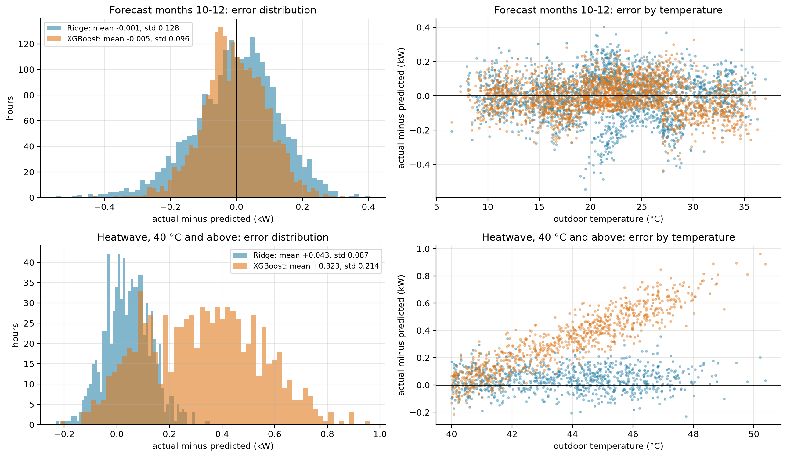
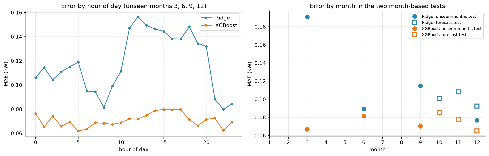
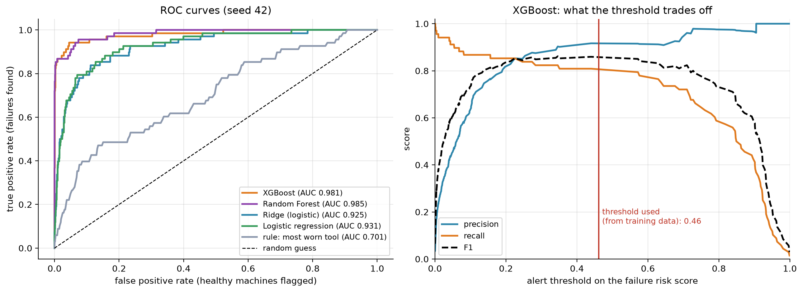
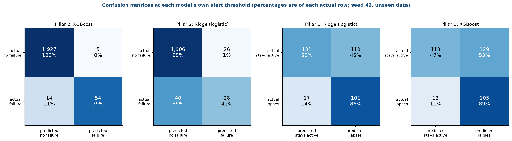
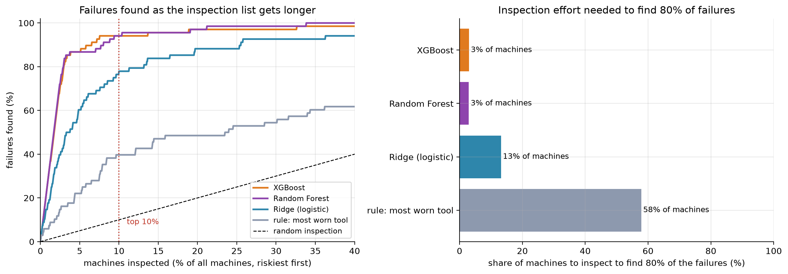
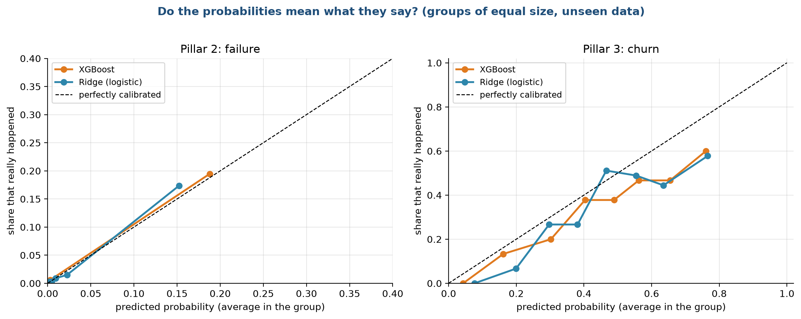
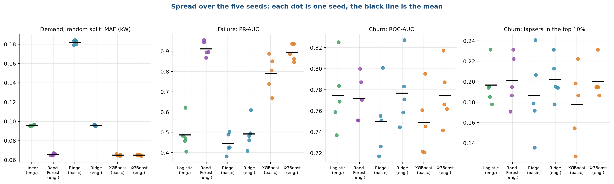
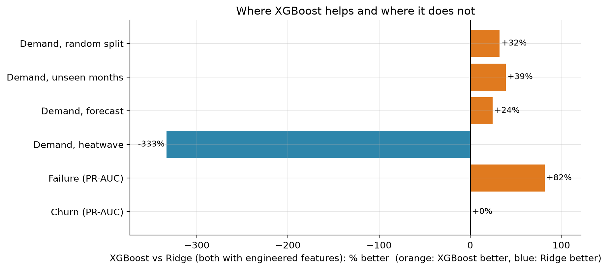

# Stage 8. Model evaluation and tuning

Owner: Animesh Basak (26911001). Group 1, CSC-505 Machine Learning, IIT Roorkee.

## 8.1 How we evaluate

Every score in this document comes from data the model did not see during training, and every score is the mean over five seeds with its standard deviation. We do not tune anything on the test data. The tests are described in stage 3 and the training protocol in stage 7. Here we explain the metrics, report the results pillar by pillar, look at the errors, and say what the results mean for the product.

### The metrics

| Metric | Used for | What it measures | Good value |
| :--- | :--- | :--- | :--- |
| MAE, mean absolute error | Demand | The average size of the miss in kW, ignoring direction | Low |
| RMSE | Demand | Like MAE but large misses count more | Low |
| R squared | Demand | The share of the variation in power that the model explains; 0 is the same as always predicting the mean, and a negative value is worse than that | Close to 1 |
| Peak-hour MAE | Demand | The MAE on the busiest 10% of hours | Low |
| ROC-AUC | Failure, churn | The chance that a randomly chosen positive case gets a higher risk score than a randomly chosen negative one | Close to 1 (0.5 is a coin flip) |
| PR-AUC (average precision) | Failure, churn | How well the model keeps precision high while finding more positives; it is the honest metric for rare events | Above the base rate (0.034 for failure, about 0.32 for churn) |
| Precision | Failure, churn | Of the cases we flag, the share that really are positive | High |
| Recall | Failure, churn | Of the real positives, the share we flag | High |
| F1 | Failure, churn | The balance of precision and recall at one threshold | High |
| Top-10% capture | Failure, churn | The share of all positives found in the 10% of cases with the highest risk | High (0.10 for a random list) |
| Lift | Churn | Top-10% capture divided by the share of customers contacted | Above 1 |

## 8.2 Pillar 1: demand

Table 1 gives the mean absolute error in kW for every model on every test. The reference rules never see the weather, and the other models use the engineered inputs unless noted.

Table 1. Mean absolute error (kW) of every demand model on every test

| Test | Training mean (rule) | Average by hour (rule) | Linear regression | Ridge, basic | Ridge | Random Forest | XGBoost, basic | XGBoost |
| :--- | :---: | :---: | :---: | :---: | :---: | :---: | :---: | :---: |
| Random 20% of hours | 0.942 | 0.934 | 0.096 | 0.182 | 0.096 | 0.066 | 0.065 | 0.065 |
| Unseen months 3, 6, 9, 12 | 1.017 | 0.995 | 0.118 | 0.224 | 0.118 | 0.077 | 0.070 | 0.072 |
| Forecast, months 10 to 12 | 1.012 | 1.024 | 0.101 | 0.242 | 0.100 | 0.083 | 0.085 | 0.076 |
| Heatwave, 40 °C and above | 1.648 | 1.574 | 0.077 | 0.468 | 0.077 | 0.365 | 0.332 | 0.336 |

The standard deviation over the five seeds is 0.001 to 0.002 kW on the random test, 0.009 or less in the heatwave for XGBoost, and exactly zero for the linear models on the three tests that do not depend on the seed. Table 2 adds the explained variation.

Table 2. Explained variation (R squared) for demand

| Test | Ridge R squared | XGBoost R squared | Rule R squared (average by hour) |
| :--- | :---: | :---: | :---: |
| Random | 0.987 | 0.995 | 0.037 |
| Unseen months | 0.982 | 0.994 | 0.056 |
| Forecast | 0.981 | 0.990 | -1.040 |
| Heatwave | 0.800 | -2.281 | -52.280 |

Three findings stand out.

First, any model that sees the weather beats the rules of thumb by a factor of ten or more. The average mean power is 1.92 kW, so an error of 0.065 kW is 3.4% of the load, while the rule of thumb is wrong by about half of the load.

Second, trees are better than a straight line in ordinary conditions. XGBoost beats Ridge by 32%, 39% and 24% in the first three tests (Figure 8 below). The straight line cannot capture how the relationship bends at the mode switches. The model with basic inputs and Ridge is the weakest, which again shows that the engineered gap is worth having for linear models.

Third, in the heatwave the order reverses. XGBoost is wrong by 0.336 kW and has a negative R squared of -2.28, which is worse than predicting the average of the heatwave hours. Ridge is wrong by 0.077 kW with an R squared of 0.80. Random Forest behaves like XGBoost (0.365 kW).

### Where the errors are

Figure 1 looks at the heatwave and forecast residuals, meaning actual power minus predicted power.

The top row is the forecast test, months 10 to 12. The left panel is a histogram of the residuals. Both models are centred on zero (mean -0.001 kW for Ridge and -0.005 kW for XGBoost), and XGBoost is narrower, with a standard deviation of 0.096 kW against 0.128 kW. The right panel plots the residual against the outdoor temperature. Ridge shows a slight pattern, with larger negative misses near 20 °C and near 28 °C, which are close to the places where the mode changes. XGBoost has no pattern.

The bottom row is the heatwave test. The residual of XGBoost (orange) has an average of +0.32 kW, so it underestimates the power. The right panel shows why: the residual rises with temperature, from close to zero at 40 °C to 0.8 kW and more near 50 °C. The model stays flat at the highest power it saw in training while the real power keeps rising. Ridge (blue) is centred near zero with a small average of +0.04 kW at every temperature, because it extends the straight line.

Figure 2 shows error against time. On the left, the average error by hour of day in the unseen-months test is 0.06 to 0.08 kW for XGBoost at every hour, but for Ridge it is 0.08 to 0.12 kW at night and 0.14 to 0.16 kW between 11:00 and 20:00. The linear model finds the afternoon harder, when the temperature is high and the bends in the relationship matter most. On the right, each marker is the error in one held-out month. Ridge has its largest error in March (0.19 kW), a month that is mostly idle in this data, which the straight line captures poorly. XGBoost stays between 0.065 and 0.085 kW in every held-out month.

### What this means for the Demand Planner

A manager reading the Demand Planner sees an hourly curve that is right to within about 0.07 kW in ordinary weather, and to within 0.08 kW in a heatwave, because the dashboard switches to Ridge above 40 °C. Without the switch, the heatwave curve would be low by about 0.3 kW per hour, and it would be low by the largest amount on the hottest days, which are the days the manager cares about most.

## 8.3 Pillar 2: failure

Table 3 gives the mean and standard deviation over five seeds on the 2,000 held-out machines.

Table 3. Failure prediction scores on 2,000 held-out machines (mean ± standard deviation over five seeds)

| Model | ROC-AUC | PR-AUC | F1 | Precision | Recall | Failures in top 10% |
| :--- | :---: | :---: | :---: | :---: | :---: | :---: |
| Rule: most worn tool first | 0.655 ± 0.027 | 0.123 ± 0.013 | 0.197 ± 0.011 | 0.158 ± 0.013 | 0.262 ± 0.012 | 0.365 ± 0.024 |
| Logistic regression | 0.930 ± 0.021 | 0.487 ± 0.080 | 0.480 ± 0.059 | 0.457 ± 0.065 | 0.512 ± 0.075 | 0.744 ± 0.069 |
| Ridge, basic inputs | 0.898 ± 0.022 | 0.445 ± 0.050 | 0.470 ± 0.048 | 0.456 ± 0.060 | 0.497 ± 0.085 | 0.662 ± 0.067 |
| Ridge | 0.925 ± 0.021 | 0.492 ± 0.074 | 0.489 ± 0.059 | 0.514 ± 0.088 | 0.471 ± 0.045 | 0.732 ± 0.069 |
| Random Forest | 0.988 ± 0.007 | 0.912 ± 0.037 | 0.887 ± 0.041 | 0.927 ± 0.046 | 0.850 ± 0.041 | 0.941 ± 0.040 |
| XGBoost, basic inputs | 0.980 ± 0.009 | 0.790 ± 0.088 | 0.727 ± 0.094 | 0.726 ± 0.138 | 0.738 ± 0.070 | 0.912 ± 0.039 |
| XGBoost | 0.987 ± 0.007 | 0.893 ± 0.042 | 0.851 ± 0.045 | 0.901 ± 0.039 | 0.806 ± 0.052 | 0.938 ± 0.035 |

The base rate is 3.4%, so a random guess has a PR-AUC of 0.034. XGBoost reaches 0.89 and Random Forest 0.91. The linear models reach 0.49, which is still ten times better than random but half of what the trees achieve. In the top 10% of machines, XGBoost holds 94% of all failures, against 73% for Ridge, 74% for logistic regression and 36% for the rule of thumb.

### Ranking quality

Figure 3 shows the ROC curves and the effect of the alert threshold.

The left panel plots the share of failures found against the share of healthy machines flagged, for every possible threshold. A curve that hugs the top-left corner is better. Random Forest (AUC 0.985) and XGBoost (0.981) rise almost vertically: they find about 85% of the failures before they flag any noticeable number of healthy machines. Ridge (0.925) and logistic regression (0.931) rise more slowly. The rule that sorts by tool wear (0.701) is far from the corner and not much above the diagonal, which stands for random guessing. The right panel follows one model, XGBoost, as the threshold on its risk score moves from 0 to 1. At low thresholds the recall (orange) is high and the precision (blue) is low, since almost every machine is flagged. At high thresholds the opposite happens. The F1 score (dashed) is flat and high between about 0.2 and 0.6, so the result does not depend on a precise threshold. The red line marks 0.46, the value chosen from training data for this seed.

### What the alerts look like

Figure 4 shows the confusion matrices for the two failure models and the two churn models at their own thresholds, for seed 42.

Each square counts the cases in one outcome. The two left panels are for failure. XGBoost flags 59 machines out of 2,000. Of those, 54 really fail (precision 91%) and 5 do not. It misses 14 of the 68 failures, so its recall is 79%. Ridge flags 54 machines and gets 28 right, with 26 false alarms and 40 failures missed, so its recall is 41%. In practice the XGBoost list wastes about one inspection in eleven, and Ridge's list wastes about one in two.

### Inspection effort

Figure 5 turns the ranking into a statement a manager can use.

The left panel plots the share of failures found (vertical) against the share of machines inspected (horizontal), riskiest first. The dotted line at 10% shows the top-10% capture that we quote: XGBoost and Random Forest are at about 94% there. The dashed diagonal is a random inspection order. The right panel counts how many machines must be inspected to find 80% of the failures: about 3% of machines with XGBoost or Random Forest, 13% with Ridge and 58% with the most-worn-tool-first rule. The rule needs about 19 times as many inspections as XGBoost to catch the same share of failures.

### Are the probabilities honest?

A risk of 20% should mean that one in five such machines fails. Figure 6 checks this.

Each marker groups cases of similar predicted probability and plots the actual rate of positives in the group against the average prediction. The dashed diagonal is a perfectly calibrated model. For failure (left panel), nearly all machines have a predicted probability below 3%, and the few with higher scores lie close to the diagonal, with 0.15 predicted against 0.17 observed for Ridge and 0.19 against 0.20 for XGBoost. Failures are so rare that the groups contain few cases, and we do not read much into the exact values. For churn (right panel), both models are slightly over-confident at the high end: of the customers given a probability of about 0.76, about 0.58 to 0.60 lapse. The scores rank customers well, and they are not exact probabilities, so the dashboard shows them as a risk percentage and a rank.

## 8.4 Pillar 3: churn

Table 4 gives the results on unseen customers in the later period. The test set holds about 360 customers, of whom about 32% lapse.

Table 4. Churn prediction scores on unseen customers in the later period

| Model | ROC-AUC | PR-AUC | F1 | Precision | Recall | Lapsers in top 10% | Lift |
| :--- | :---: | :---: | :---: | :---: | :---: | :---: | :---: |
| Rule: longest since purchase | 0.607 ± 0.041 | 0.417 ± 0.019 | 0.478 ± 0.022 | 0.318 ± 0.020 | 0.964 ± 0.019 | 0.162 ± 0.017 | 1.63 ± 0.17 |
| Logistic regression | 0.775 ± 0.033 | 0.575 ± 0.049 | 0.608 ± 0.024 | 0.459 ± 0.024 | 0.903 ± 0.019 | 0.197 ± 0.021 | 1.97 ± 0.21 |
| Random Forest | 0.772 ± 0.022 | 0.563 ± 0.035 | 0.595 ± 0.017 | 0.445 ± 0.018 | 0.901 ± 0.030 | 0.201 ± 0.025 | 2.01 ± 0.25 |
| Ridge, basic inputs | 0.750 | 0.547 | 0.593 | 0.476 | 0.788 | 0.187 | |
| Ridge | 0.777 | 0.578 | 0.609 | 0.465 | 0.885 | 0.202 | 2.0 |
| XGBoost, basic inputs | 0.749 | 0.529 | 0.590 | 0.491 | 0.741 | 0.178 | |
| XGBoost | 0.775 | 0.580 | 0.609 | 0.462 | 0.895 | 0.200 | 2.0 |

The result is plainer than for failure. Every model with the engineered inputs lands between 0.77 and 0.78 ROC-AUC, and the differences are far smaller than the standard deviation of 0.02 to 0.03. The rule of thumb reaches 0.61. So the model beats the rule clearly (0.78 against 0.61), and complexity buys nothing: logistic regression ties with XGBoost.

In terms of the call list, contacting the 10% of customers with the highest risk reaches 20% of those who lapse, twice as many as a random list (10%) and about 4 points more than the recency rule (16%). This is the weakest of the three results, and we say so in the conclusion.

The confusion matrices in Figure 4 (two right panels) show the trade-off. At its threshold of about 0.35, Ridge flags 211 of 360 customers. It catches 101 of the 118 who lapse (recall 86%) and wrongly flags 110 of 242 who stay (precision 48%). XGBoost catches 105 of 118 (89%) at the cost of 129 false alarms. The thresholds are set by F1 on the training data, which favours recall when lapsing is common, so the lists are long. For a small call budget, the manager should follow the ranking from the top instead of using the threshold, as the Retention List does.

### Why does a more complex model not help?

The learning curves in stage 7 show that XGBoost needs the full training set just to reach Ridge, and the importance plots in stage 5 show that the signal comes from simple counts, such as how often and how recently the customer ordered. A customer's own history holds a limited amount of information about the next 90 days, and every model hits the same limit. Better inputs, such as product categories or the behaviour of similar customers, are more likely to help than a bigger model. We list them in the future work.

## 8.5 Stability across seeds

Figure 7 shows each seed as a dot.

The black line is the mean of five seeds. The demand panel (first) shows almost no spread: all five dots sit on top of each other, because the large training set makes the model nearly deterministic. The failure panel (second) shows a wide spread for logistic regression and Ridge (0.38 to 0.62) and for XGBoost with basic inputs (0.67 to 0.89), and a tighter one for Random Forest and XGBoost with engineered inputs (0.85 to 0.95). The test set holds 68 failures, so one more or fewer detected changes the score visibly. The two churn panels have the widest spread, from 0.72 to 0.83 in ROC-AUC and from 0.13 to 0.24 for top-10% capture, which is a consequence of the small test set. This is why the selection rule treats gaps below one standard deviation as ties.

## 8.6 Tuning

We tuned very little, and on purpose.

| What | How it was chosen | On which data |
| :--- | :--- | :--- |
| Ridge penalty (alpha, C) | Five-fold cross-validation | Training rows only |
| Alert threshold | Best F1 on out-of-fold scores | Training rows only |
| XGBoost settings | Fixed in advance (stage 7) | None |
| Random Forest settings | Fixed in advance | None |
| Feature set | Compared basic and engineered | Test scores reported for both |
| Model per pillar | Tie rule on mean and standard deviation (stage 6) | Test scores of the five seeds |

Two points deserve honesty. First, the choice of model by the tie rule uses the test scores of the five seeds, so a small amount of selection pressure remains. With six candidates and one clear winner in each demand test, we think the effect is small. Second, we did not run a separate validation set, since the data is too small to hold out a third part. A truly independent check would need data from a real service company.

Stage 7 showed that a wide range of settings gives nearly the same score, so heavy tuning would not change the picture. The one place where more tuning is pointless is the heatwave: more trees, deeper trees or a lower learning rate cannot make a tree predict above its training range.

## 8.7 Summary of the evaluation

Figure 8 compares XGBoost with Ridge, both with engineered inputs, as a percentage improvement. XGBoost is better by 32%, 39% and 24% on the first three demand tests and by 82% on failure (PR-AUC). It is 333% worse in the heatwave, where its error is more than four times that of Ridge, and it is the same for churn.

| Pillar | Best result on unseen data | Compared with the rule of thumb | Verdict |
| :--- | :--- | :--- | :--- |
| Demand | MAE 0.065 kW (XGBoost), 0.077 kW in a heatwave (Ridge) | Rule: 0.93 kW and 1.57 kW | Strong, with the heatwave safeguard |
| Failure | PR-AUC 0.89 to 0.91; 94% of failures in the top 10% | Rule: PR-AUC 0.12 and 36% | Strong |
| Churn | ROC-AUC 0.78; 20% of lapsers in the top 10% | Rule: ROC-AUC 0.61 and 16% | Real but modest |

## 8.8 What could make these numbers too good

* The HVAC data looks simulated, and the AI4I data is synthetic. Both follow clean rules that a model can learn. The scores for demand and failure are therefore likely higher than on real service data.
* The churn test set is small, so its scores carry large error bars.
* The tie rule selects from the same test scores that we report.
* The failure test has 68 failures per seed.
* The heatwave test covers one building, one year and one kind of extrapolation.

<!--docs-only-->
## 8.9 Where to find things in the repository

| Item | Location |
| :--- | :--- |
| Full tables | `hvac_ml/outputs/results/RESULTS_SUMMARY.md` and `summary_mean_std.csv` |
| Every run | `hvac_ml/outputs/results/all_runs_by_seed.csv` |
| Model choice | `hvac_ml/outputs/results/model_choice.csv` |
| Figures | `hvac_ml/outputs/figures/report/s8_*.png`, from `hvac_ml/figs_models.py` |

Previous: [Stage 7](07_Model_Training.md). Next: [Stage 9, Model deployment](09_Model_Deployment.md).
<!--/docs-only-->
