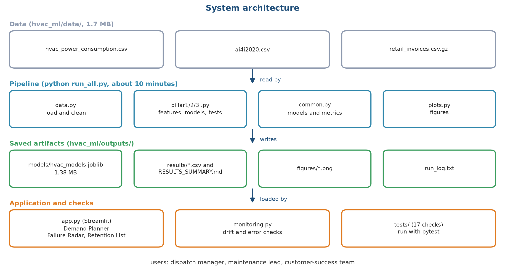
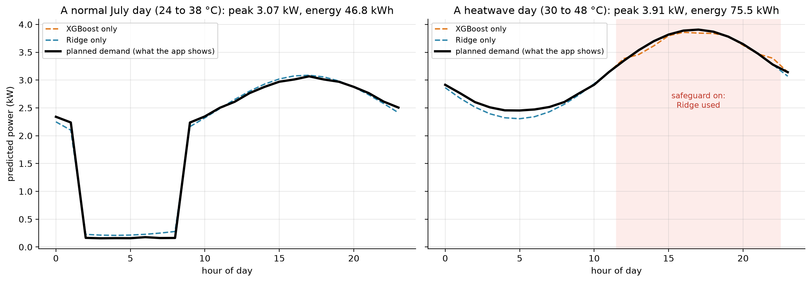
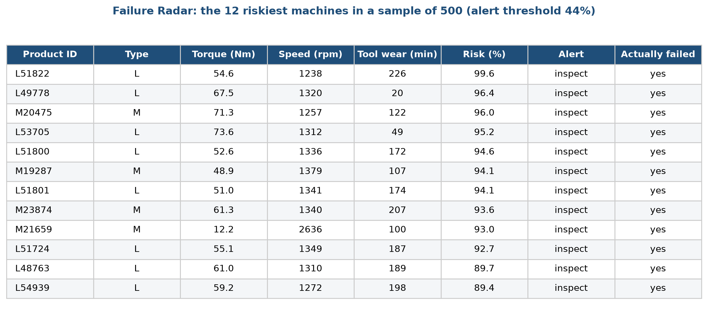
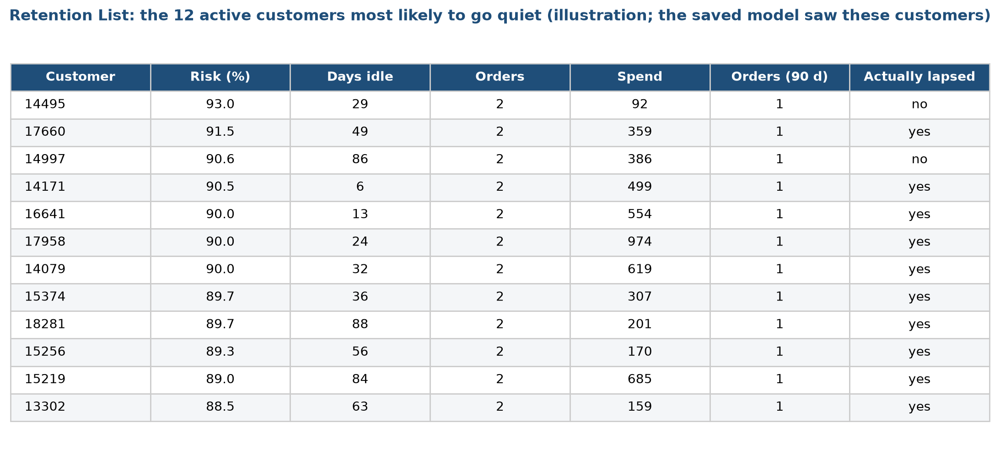
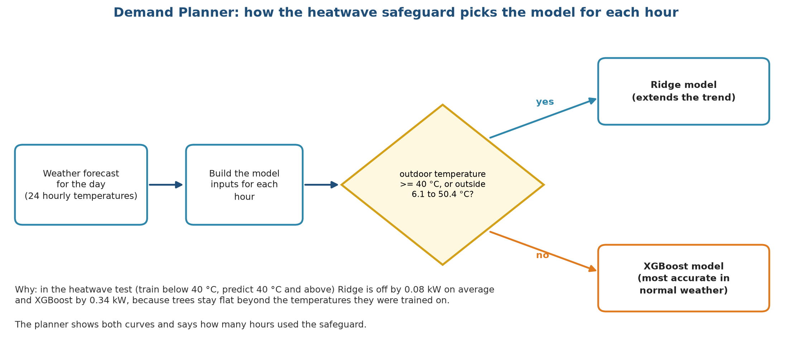

# Stage 9. Model deployment

Owner: Sourav Kumar Boro (26535026). Group 1, CSC-505 Machine Learning, IIT Roorkee.

## 9.1 What deployment means for this project

Deployment is the step that puts a trained model in front of the people who use its answers. A model that sits in a notebook helps nobody. For HVAC Service Planner, deployment means a small web dashboard that a dispatch manager, a maintenance lead or a customer-success team can open in a browser, and that turns the saved models into three tools. We did not deploy to a cloud service, because we have no real users or real data. We built the dashboard so it can run on any laptop with one command, and we describe what would change for a production deployment in section 9.9.

## 9.2 System architecture

Figure 1 shows the whole system, from data files to the people who use the results.

The picture has four layers, read from top to bottom. The grey boxes are the three data files, 1.7 MB in all. The blue boxes are the pipeline, the programs that clean the data, build features, train and test the models, and draw the figures. A full run takes about ten minutes. The green boxes are what the pipeline writes: the saved models in a single file of 1.38 MB, the result tables, the figures and a log. The orange boxes are the programs that use these results: the dashboard, the monitoring checks (stage 10) and the automated tests. The users at the bottom are a dispatch manager, a maintenance lead and a customer-success team.

The design keeps training and serving apart. The pipeline can be run again at any time and produces a fresh models file. The dashboard only reads that file and the data. It never trains anything while a user waits, so every click is answered in a few milliseconds (1.4 to 2.4 ms per single prediction).

## 9.3 What gets deployed

| Artefact | Content | Size |
| :--- | :--- | :--- |
| Models file | For each pillar, a Ridge model and an XGBoost model, trained on all rows, with the alert thresholds for the yes or no tasks and the list of features | 1.38 MB |
| Data files | The three datasets, needed for the sample lists and for the range of the demand data | 1.7 MB |
| Dashboard program | The three tools in one page with three tabs | one file |
| Supporting programs | Feature builders, the monitoring checks, settings | a handful of files |
| Tests | Seventeen automated checks | one file |

The models file includes the time at which it was trained and the choice made by the selection rule, so anyone can see which version the dashboard is using.

## 9.4 The three tools

### Tool 1: Demand Planner

The manager sets the month, the indoor setpoint, the humidity and the lowest and highest outdoor temperature of the day. The program builds a smooth temperature curve for the 24 hours, with the coolest hour at 05:00 and the hottest at 15:00, and works out the HVAC mode for each hour. It builds the model inputs for each hour and asks both models for a prediction. The tool shows the planned demand curve, the peak demand and the hour at which it occurs, the total energy for the day, and the number of hours that used the heatwave safeguard. The safeguard is explained in section 9.5.

Figure 2 shows the output for two days.

The left panel is a normal July day with temperatures from 24 to 38 °C. The black line is the planned demand: it falls to about 0.2 kW in the early hours, when the outdoor temperature is in the idle band, and rises to a peak of 3.07 kW in the late afternoon. The dashed orange and blue lines are the XGBoost and Ridge predictions alone, and they agree closely. The day's energy is 46.8 kWh. The right panel is a heatwave day from 30 to 48 °C. From about 11:00 to 22:00 the temperature is above 40 °C, which the pink band marks, and the planner uses the Ridge model there. The peak is 3.91 kW and the daily energy is 75.5 kWh. On this day the two models still agree closely, because the temperatures stay inside the range seen in training, but they would drift apart for temperatures above 50 °C, which is why the safeguard uses the range as well as the 40 °C line.

### Tool 2: Failure Radar

The maintenance lead enters one machine's readings (type, air and process temperature, speed, torque and tool wear) and sees its risk of failure as a percentage, whether it is above the alert threshold (44% for XGBoost), and how it compares with the 10,000 machines in the dataset. A table lists the riskiest machines in a random sample of 500, and a caption says how many of the actual failures in the sample the top 10% would catch. Figure 3 shows that table.

Each row is a machine, with its identifier, type, torque, speed and tool wear, the risk the model gives it, whether it passes the alert threshold, and, for illustration, whether it did fail. All twelve machines shown have risks from 89% to 100% and all did fail. The model was trained on all 10,000 machines, so this list is a demonstration of the tool and not a test. The honest scores are in stage 8.

### Tool 3: Retention List

The customer-success team chooses how many customers they can contact, from 10 to 200. The tool lists the active customers with the highest risk of buying nothing in the next 90 days, with each customer's risk, days since the last order, number of orders, spend and recent orders. A caption says what share of the customers who really lapsed this list would reach, and compares it with random contact. Figure 4 shows an example.

The twelve customers shown all have two orders in total and one in the last 90 days, and risks from 88% to 93%. They are the kind of customer the profile in stage 4 predicts: few orders, a short history. Ten of the twelve lapsed. As with the Failure Radar, the model saw these rows in its final fit, so this is an illustration. In the honest test in stage 8, the top 10% of the list reaches 20% of the customers who lapse, about twice as many as random contact.

## 9.5 The heatwave safeguard

The Demand Planner does not trust XGBoost everywhere. Figure 5 shows the rule.

For each hour the program checks the outdoor temperature. If it is at or above 40 °C, or outside the range of temperatures seen in the training data (6.1 to 50.4 °C), the hour is predicted by Ridge. Otherwise it is predicted by XGBoost. The reason is the result in stage 8: on the heatwave test Ridge is off by 0.08 kW on average and XGBoost by 0.34 kW, because trees stay flat beyond the temperatures they were trained on. The planner shows both curves and says how many hours used the safeguard, so the manager can see that the switch happened. A warning text appears whenever it is used.

The switch has a visible cost: at the boundary, the two models may predict a little differently, and the curve can have a small step. We accepted this because a visible step is better than a hidden error of 0.3 kW or more.

## 9.6 How the dashboard is tested

* We ran the app without a browser, using Streamlit's own test runner, and checked that it starts, that it shows the three tabs and that it raises no exception. This check is not part of the automated suite yet, and it should be added.
* The seventeen automated tests of the pipeline run before each release (stage 7). They cover the data, the splits, the leakage rules, the metrics and the monitoring functions, and they do not cover the dashboard code.
* We did not run a user test with real staff. A production deployment would need one.

## 9.7 Installing and running

A user needs Python 3.10 or newer, about 300 MB of disk space for the packages and no internet connection once the packages are installed. The steps are:

1. Create a virtual environment and install the listed packages.
2. Run the pipeline once to train the models and write the models file. This takes about ten minutes.
3. Start the dashboard. It opens in the browser at the local address.

The help file in the project folder gives the exact commands, the places where the data comes from, and a table of common problems and their fixes.

## 9.8 Operating limits

| Limit | Meaning |
| :--- | :--- |
| The data are stand-ins | The dashboard shows the method, and the numbers are not a forecast for a real company. |
| One building | Demand Planner is trained on one building and one year of data. |
| Static data | The dashboard reads stored files. It is not connected to live sensors or to a customer system. |
| Single user | It runs on one machine for one user at a time. |
| No login | There is no access control, and the data are public. |
| Failure model describes machine tools | The Failure Radar shows how to rank machines. It does not know HVAC units. |

## 9.9 What a production deployment would need

If an HVAC company adopted this, five things would change.

1. Real data feeds. Weather forecasts for the demand tool, sensor logs for the failure tool and the invoice or service history for the retention tool would flow in on a schedule.
2. A scheduled job instead of a manual run. Retraining would be triggered by the monitoring rules in stage 10 and would write a new versioned models file.
3. A hosted service with access control, so that staff log in and see only the data that concerns them.
4. A way to log every prediction and, later, the outcome, so the monitoring checks have something to compare. At present the checks run on stored datasets.
5. A rollback plan. The previous models file stays on disk, and the dashboard can be pointed back at it if a new model misbehaves.

## 9.10 Deployment checklist

| Check | Status |
| :--- | :--- |
| Models file loads, and the version and time are recorded | done |
| Dashboard starts without errors on a clean install | done |
| Heatwave safeguard switches at 40 °C and outside the training range | done |
| Failure and churn lists labelled as illustrations where the model has seen the rows | done |
| Limits stated in the help file and the report, and captions mark the lists that are illustrations | done |
| Live data connection | not built |
| Access control | not built |
| Automatic retraining | not built |

<!--docs-only-->
## 9.11 Where to find things in the repository

| Item | Location |
| :--- | :--- |
| Dashboard | `app.py`; start with `streamlit run app.py` |
| Models file | `hvac_ml/outputs/models/hvac_models.joblib` |
| Help file | `HELP.md` |
| Packages | `requirements.txt` |
| Figures | `hvac_ml/outputs/figures/report/s9_*.png`, from `hvac_ml/figs_diagrams.py` and `hvac_ml/figs_ops.py` |

Previous: [Stage 8](08_Model_Evaluation_and_Tuning.md). Next: [Stage 10, Monitoring and maintenance](10_Monitoring_and_Maintenance.md).
<!--/docs-only-->
