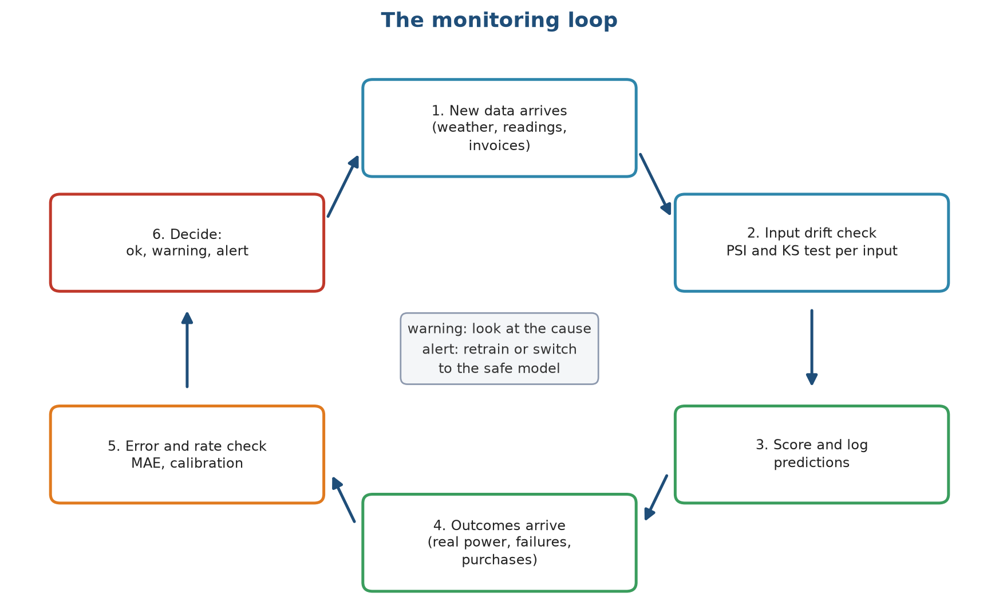
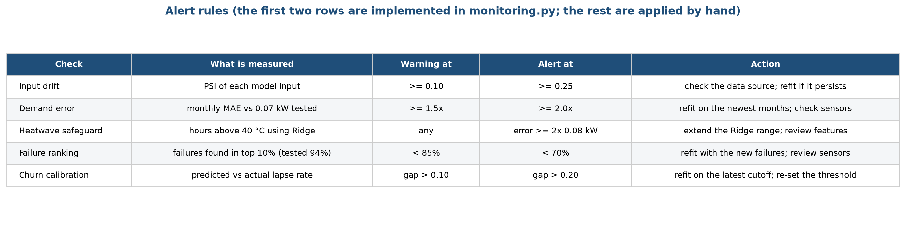
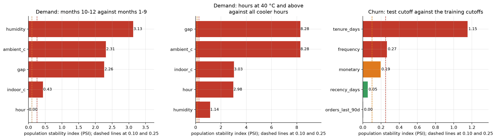
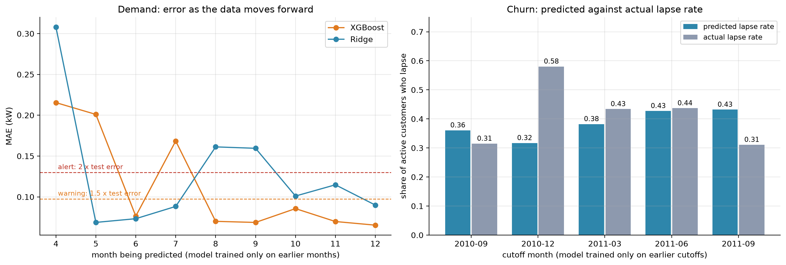
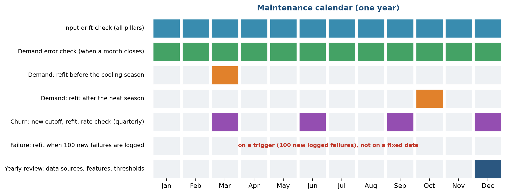

# Stage 10. Monitoring and maintenance

Owner: Sourav Kumar Boro (26535026). Group 1, CSC-505 Machine Learning, IIT Roorkee.

## 10.1 Why a deployed model needs watching

A model that scored well in testing can stop working afterwards without any error message. The world changes: a summer arrives that is hotter than any in the training data, a sensor is replaced and reads two degrees higher, a new group of customers joins. The model keeps returning numbers, and the numbers get worse. Nobody notices until a heatwave arrives with too few technicians or a call list is full of customers who were never at risk.

Monitoring is the routine that catches this early. Maintenance is what we do when it fires: investigate, retrain, or switch to a safer model. This document explains what we watch, the thresholds at which we act, how the checks behave on our own data, and the calendar of routine work. Everything here is written with a service company in mind, but the checks are tested on the datasets of this project, because we have no live system.

## 10.2 What can go wrong

| Problem | Plain meaning | HVAC example | How we notice |
| :--- | :--- | :--- | :--- |
| Input drift (data drift) | The inputs look different from the training data | Outdoor temperatures reach 52 °C, above anything in the training year | Compare the distribution of each input with the training distribution |
| Concept drift | The link between inputs and the answer changes | A new building has better insulation, so the same temperature gap draws less power | The error rises while the inputs look normal |
| Rate drift | The share of positives changes | More customers lapse after a price rise | Compare the predicted share with the share that really happened |
| Data quality | Missing values, broken sensors, changed units | A sensor reports Fahrenheit instead of Celsius | Range and missing-value checks (the loaders already assert sizes and missing values) |
| Silent software change | A package update changes results | A new scikit-learn version shifts the last digit | The tests and the fixed seeds |

## 10.3 The monitoring loop

Figure 1 shows the routine as a cycle.

The loop has six steps. New data arrives (1), whether weather, sensor readings or invoices. An input drift check compares it with the training data (2). The model scores it and the prediction is logged (3). Later the real outcome arrives, such as the measured power, the failure record or the purchases of the next 90 days (4). An error and rate check compares the predictions with the outcomes (5). The last step is a decision (6): everything is fine, or a warning says to look at the cause, or an alert says to retrain or switch to the safe model. The cycle then starts again with the next batch of data.

Checks 2 and 5 are separate on purpose. The input check needs no outcome, so it can be run the moment new data arrives, and it warns early. The error check needs the real outcome, so it comes later, and it is the final proof of whether the model works.

## 10.4 The checks we built

### Check 1: input drift with PSI and the KS test

The Population Stability Index (PSI) compares the distribution of one input in new data with its distribution in the training data. We cut the training values into ten bins of equal size and count what share of the new data falls in each bin. If the shares match, the PSI is near zero. If new data piles up in a few bins, it grows. The usual reading is below 0.10 for a stable input, 0.10 to 0.25 for a moderate shift and above 0.25 for a large shift. We use those thresholds. The Kolmogorov-Smirnov (KS) test is a second view: it gives the largest gap between the two cumulative distributions and a p-value. We also report how far the mean has moved, in units of the training standard deviation.

### Check 2: error against the tested error

For demand, we compute the mean absolute error of each new month and divide it by the error measured in testing, 0.065 kW. A ratio of 1.5 or more is a warning, and 2.0 or more is an alert.

### Check 3: rate against the observed rate

For failure and churn, we compare the share of cases the model flags, and its average predicted probability, with the share that really turned out positive. A gap of 0.10 is a warning and a gap of 0.20 is an alert.

Checks 1 and 2 are implemented as functions, and tested by three automated tests, which check that the PSI is small for the same distribution and large for a shifted one, that the drift table flags the column that moved, and that the error ratio maps to the right status. Check 3 is implemented as a function that returns the numbers. The 0.10 and 0.20 thresholds for it are applied by hand for now.

## 10.5 Alert rules

Figure 2 lists the rules and the action that follows.

Each row is one check. The columns give what is measured, the level that triggers a warning, the level that triggers an alert and what we do. The five checks are input drift, demand error, the heatwave safeguard, the failure ranking and the churn calibration. The failure ranking check uses the 94% top-10% capture found in testing: a fall below 85% warns and a fall below 70% is an alert. The heatwave safeguard check watches the hours above 40 °C that used Ridge: any use is noted, and an error of 0.16 kW or more on those hours (twice the tested 0.08 kW) is an alert that the Ridge range needs extending.

## 10.6 How the checks behave on our data

We ran the checks on the project data, as a rehearsal of what they would do on live data.

### Input drift

Figure 3 shows the PSI of the main inputs in three comparisons.

Each bar is one input and its colour shows the status: green is stable, orange is a warning and red is an alert. The two dashed lines are the 0.10 and 0.25 thresholds.

* Demand, months 10 to 12 against months 1 to 9 (left): humidity (PSI 3.13), outdoor temperature (2.31), the temperature gap (2.26) and indoor temperature (0.43) all alert. Only the hour of day is stable. The reason is the season: autumn weather is not like the average of the first nine months. This is a useful lesson. A drift check that compares a new month with the whole of the training period will fire every season. In production the comparison should be with the same season in the previous year, or with the training data from the same months.
* Demand, heatwave hours against cooler hours (middle): the PSI of the outdoor temperature is 8.3 and that of the gap is 8.3. This is the drift we expected, since the heatwave hours were defined by the temperature. The check would have flagged the heatwave before the model failed, which is the purpose of an input check. The alert on these inputs is the reason for the safeguard.
* Churn, test cutoff against the training cutoffs (right): tenure drifts strongly (PSI 1.15), because customers are a year older at the later cutoff. Frequency alerts (0.27), spend gives a warning (0.19), and recency (0.05) and recent orders (0.003) are stable. A growing customer base is expected to look older, and the alert says that tenure needs a new training window, not that the model is wrong. The churn scores in stage 8 were nevertheless steady.

The lesson is that PSI tells us when the inputs have moved. It does not say whether the model is hurt. That is the job of the error check.

### Performance over time

Figure 4 shows what the error check would have shown if we had run the models month by month, training only on earlier data.

The left panel is the monthly demand error for XGBoost (orange) and Ridge (blue), where each month is predicted by a model trained only on the months before it. The dashed lines are the warning (1.5 times the tested 0.065 kW, which is 0.098 kW) and the alert (0.13 kW). In April and May the errors of XGBoost are 0.22 and 0.20 kW, above the alert line, because the model has only seen the cold months and the spring weather is new to it, and July (0.17 kW) is above it too. Ridge is above the alert line in April (0.31 kW), and again in August and September (0.16 kW). From October on, both models are below the alert line, and XGBoost (0.066 to 0.086 kW) is also below the warning line. The panel shows two things: a model needs data from every season before it can be trusted, and our check would have raised the alarm in each of those months. The right panel is the churn check. For each cutoff, a model trained on the earlier cutoffs predicts a lapse rate (blue) that we compare with the real one (grey). The gaps are 0.05 in September 2010, 0.26 in December 2010 (an alert), 0.05 in March 2011, 0.01 in June 2011 and 0.12 in September 2011 (a warning). The December 2010 miss comes from the holiday weeks: more customers than usual go quiet, and a model trained on spring and summer does not know. The model ranks customers well even when it misjudges the total rate, so the retention list stays useful, but the number of customers who will lapse should be corrected for the season.

## 10.7 Maintenance routine

Figure 5 sets out the work over a year.

Each row is a task and each coloured square a month in which it happens. The input drift check runs every month for all three pillars, and the demand error check runs when each month closes (blue and green rows). The demand model is refitted before the cooling season, in March, so that it includes the newest winter data, and again after the heat season, in October, so that it learns the new highest temperatures. The churn model gets a new cutoff, a refit and a rate check each quarter (purple). The failure model is not refitted on a calendar. It is refitted when 100 new failures have been logged, since failures are rare and retraining without new failures would change nothing. In December there is a yearly review of the data sources, the features, the thresholds and this document (dark blue).

| Task | Who | How often | Output |
| :--- | :--- | :--- | :--- |
| Drift check, all inputs | Data analyst | Monthly | Table of PSI and KS per input |
| Error check, demand | Data analyst | Each month's end | MAE against 0.065 kW |
| Rate check, churn and failure | Data analyst | Quarterly | Predicted against real share |
| Refit with new data | Data analyst | As in Figure 5 | New models file with a new date |
| Compare new and old models | Maintenance lead | At each refit | Same test as stage 8, on a fixed set |
| Approve and deploy | Manager | At each refit | Replace the file, keep the old one |
| Yearly review | Whole team | Each December | Updated thresholds and documents |

## 10.8 What to do when a check fires

1. Warning. Look at the cause before changing anything. Find which input moved and since when. Check that the data source still reports in the same units. A warning on a seasonal input is often normal.
2. Alert on one input, error unchanged. Note it and watch the error check. Do not retrain on drift alone.
3. Alert on the error. Refit on the newest data, test the new model on the same fixed test set as in stage 8, and deploy it only if it is not worse on the old test and better on the recent data.
4. Alert in a heatwave. Use the safeguard (Ridge) for the affected hours, check that the range of the safeguard covers the new temperatures, and extend the training data.
5. Anything else. Roll back to the previous models file, which we keep for this purpose.

## 10.9 Keeping the project maintainable

* One configuration file holds every setting, including the monitoring thresholds.
* Each models file records its training time and the results of the selection rule.
* The tests run before every change. They would catch a broken split or a leaked feature.
* The documents in this folder, one per lifecycle stage, are meant to be updated each time the process changes.
* Package versions are recorded in the requirements file. A package update that changes a result is caught by comparing with the saved results.

## 10.10 Limits of our monitoring

* We have no live system, so the checks ran on stored data. We do not log predictions as they are made.
* PSI and KS are affected by sample size. With thousands of hourly rows, even a small shift gives a tiny p-value, so we rely on the PSI size and the size of the mean shift and not on the p-value.
* The thresholds (0.10, 0.25, 1.5 times and 2 times) are common rules of thumb, not values fitted to our data.
* Seasonal inputs need a comparison with the same season of the previous year, which we only have for the retail data.
* The failure model has too few failures to be monitored month by month.
* A drift check cannot tell whether a change is a real change in the world or a fault in the data feed. A person has to look.

## 10.11 Summary

| Question | Answer |
| :--- | :--- |
| What do we watch? | The distribution of each input, the monthly demand error, and the predicted against actual positive rate |
| When do we act? | PSI above 0.25, error above twice the tested value, a rate gap above 0.20 |
| What do we do? | Look at the cause first, then refit or fall back to the safe model |
| How often do we refit? | Demand twice a year, churn each quarter, failure after 100 new failures |
| What did the rehearsal show? | The checks fire when the weather moves into new ground, and a model needs a full year of data before it can be trusted |

<!--docs-only-->
## 10.12 Where to find things in the repository

| Item | Location |
| :--- | :--- |
| Monitoring functions | `hvac_ml/monitoring.py` |
| Thresholds | `hvac_ml/config.py` (PSI_WARN, PSI_ALERT, ERROR_WARN_RATIO, ERROR_ALERT_RATIO) |
| Tests | `hvac_ml/tests/test_pipeline.py` (three monitoring tests) |
| Drift results | `hvac_ml/outputs/results/drift_checks.csv` |
| Figures | `hvac_ml/outputs/figures/report/s10_*.png`, from `hvac_ml/figs_diagrams.py` and `hvac_ml/figs_ops.py` |

Previous: [Stage 9](09_Model_Deployment.md). Back to the [overview](../../README.md).
<!--/docs-only-->
