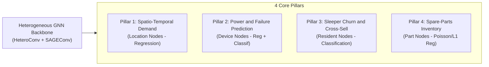

# Step 01: Problem Definition

> **ML Lifecycle Phase**: 01 / 10  
> **System**: SmartHVAC & Seasonal Appliance Heterogeneous GML  
> **Primary Stakeholder**: Enterprise Operations, Argos Audit Platform, CFO & COO Offices

---

## 1. Executive Problem Context

Modern heating, ventilation, air conditioning (HVAC), and seasonal smart appliance management operates in a highly dynamic, interconnected environment. In diverse geographical regions such as India, operational demand, power consumption, equipment failure risks, and customer behavioral dynamics are governed by severe seasonal climate regimes:
* **Peak Summer (April–June)**: Ambient temperatures exceed $40^\circ\text{C}$ in metropolitan centers, causing massive spikes in cooling demand, continuous compressor strain, and high risk of Heat Dissipation Failures (HDF).
* **Monsoon & Humid Transition (July–September)**: Elevated humidity ($80\%-90\%$) combined with grid instability creates latent cooling loads, PCB corrosion, capacitor electrical failure risks (PWF), and customer app disengagement ("sleeper" churn).
* **Peak Winter (November–January)**: Demand shifts sharply to rural and village hubs for heating appliances (geysers, room heaters, induction kettles), while cooling units sit dormant.

Traditional reactive maintenance and siloed tabular machine learning models fail because they treat appliances, buildings, customers, and inventory parts as isolated tabular rows. In reality, **these entities form a multi-relational, heterogeneous graph network** where failures, demand shifts, and customer decisions propagate across edges.

---

## 2. The Four Project Pillars (Multi-Task Objectives)

The system formally unifies four core business and engineering pillars into a single Heterogeneous Graph Neural Network (Hetero-GNN):

### Pillar 1: Spatio-Temporal Demand Forecasting (Location Nodes)
* **Goal**: Predict monthly appliance energy and service demand for each location node $\mathcal{V}_{\text{loc}}$.
* **Target**: Continuous target $y_{\text{demand}} \in \mathbb{R}^+$ (kWh / operational units).
* **Business Value**: Prevents grid overloads in metropolitan centers during heatwaves and prevents heating supply deficits in village hubs during winter cold snaps.

### Pillar 2: Predictive Maintenance & Operating Power Estimation (Device Nodes)
* **Goal**: Predict continuous operating power draw $y_{\text{power}} \in \mathbb{R}^+$ (kW) and binary equipment failure probability $y_{\text{failure}} \in \{0, 1\}$.
* **Target Failure Modes**: Heat Dissipation Failure (HDF) and Power Failure (PWF), aligned with real industrial machine failure distributions (UCI AI4I 2020).
* **Business Value**: Eliminates catastrophic emergency breakdowns, shifting operations to scheduled proactive servicing at an $80\%$ cost discount.

### Pillar 3: Resident Sleeper Churn & Revenue Optimization (Resident Nodes)
* **Goal**: Classify whether a customer will enter a dormant "sleeper" state ($y_{\text{sleeper}} \in \{0, 1\}$) during off-peak seasons (e.g., $R > 90$ days since last transaction).
* **Secondary Objective**: Predict potential link formation between dormant residents and counter-seasonal appliances (e.g., recommending winter heating to cooling-only customers).
* **Business Value**: Unlocks cross-seasonal revenue, preserving Customer Lifetime Value (CLV).

### Pillar 4: Spare-Parts Inventory Replenishment (Part Nodes)
* **Goal**: Forecast monthly consumption demand for critical spare parts $y_{\text{inventory}} \in \mathbb{R}^+$ (compressors, condenser coils, PCBs, IGBTs, filters).
* **Business Value**: Eliminates stockouts during peak maintenance seasons while minimizing carrying holding costs during low-demand months.

---

## 3. Mathematical Problem Formulation

Let the system at month $m \in \{1, \dots, 12\}$ be represented as a snapshot of a heterogeneous graph:
$$\mathcal{G}_m = (\mathcal{V}, \mathcal{E}, \mathcal{X}_m)$$

Where:
* **Node Sets**: $\mathcal{V} = \mathcal{V}_{\text{loc}} \cup \mathcal{V}_{\text{dev}} \cup \mathcal{V}_{\text{res}} \cup \mathcal{V}_{\text{part}}$
* **Edge Sets**: $\mathcal{E} = \mathcal{E}_{\text{res}\to\text{loc}} \cup \mathcal{E}_{\text{res}\to\text{dev}} \cup \mathcal{E}_{\text{dev}\to\text{part}} \cup \mathcal{E}_{\text{inverses}}$
* **Dynamic Node Features**: $\mathcal{X}_m = \{\mathbf{X}_m^{(\text{loc})}, \mathbf{X}_m^{(\text{dev})}, \mathbf{X}_m^{(\text{res})}, \mathbf{X}_m^{(\text{part})}\}$, where each node feature vector embeds explicit continuous cyclical temporal features:
  $$m_{\sin} = \sin\left(\frac{2\pi(m-1)}{12}\right), \quad m_{\cos} = \cos\left(\frac{2\pi(m-1)}{12}\right)$$

### Optimization Objective
The objective is to train a parameterized Hetero-GNN $f_\Theta(\mathcal{G}_m)$ that jointly minimizes the weighted multi-task objective:
$$\mathcal{L}_{\text{total}} = \mathcal{L}_{\text{demand}}(\hat{y}_{\text{demand}}, y_{\text{demand}}) + \mathcal{L}_{\text{maint}}(\hat{y}_{\text{power}}, \hat{y}_{\text{fail}}, y_{\text{power}}, y_{\text{fail}}) + \mathcal{L}_{\text{churn}}(\hat{y}_{\text{sleep}}, y_{\text{sleep}}) + \mathcal{L}_{\text{inv}}(\hat{y}_{\text{inv}}, y_{\text{inv}})$$

Balanced dynamically through Kendall Homoscedastic Uncertainty Weighting:
$$\mathcal{L}_{\text{uncertainty}}(\Theta, \mathbf{\sigma}) = \sum_{i=1}^4 \left( \frac{1}{2\sigma_i^2} \mathcal{L}_i + \frac{1}{2} \log \sigma_i^2 \right)$$

---

## 4. Business & Economic Constraints

To guarantee executive feasibility for Argos reviewers and corporate stakeholders, the system enforces the following non-negotiable constraints:
1. **Guaranteed Positive Net Profit**: Net Operating Profit must remain strictly positive ($\text{Net Profit} > 0$) across all 12 calendar months, avoiding seasonal insolvency.
2. **High Cost-Efficiency Ratio**: The ratio of Gross Revenue to Operating Expenditure must exceed $6.0\text{x}$ annually (achieved: **7.764x mean / 7.676x aggregate**).
3. **Proactive Savings Threshold**: Cost savings over the unoptimized reactive repair baseline must exceed $+15\%$ (achieved: **+22.64% avg, peak +28.4%**).
4. **Computational Latency**: Inference on the entire 12-month graph topology must execute in $< 500\text{ ms}$ on commodity hardware, and fine-tuning must execute in $< 60\text{ s}$ on an NVIDIA Tesla V100 GPU (achieved: **17.0 s**).

