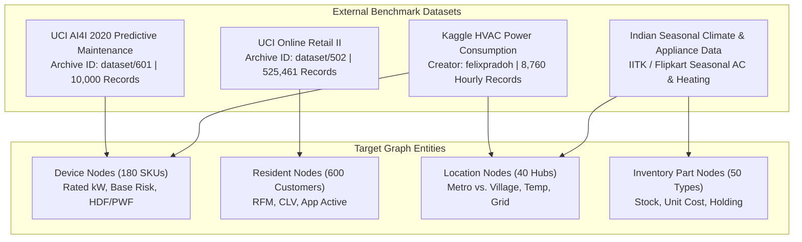

# Step 02: Data Collection

> **ML Lifecycle Phase**: 02 / 10  
> **System**: SmartHVAC & Seasonal Appliance Heterogeneous GML  
> **Primary Datasets**: UCI AI4I 2020 (601), UCI Online Retail II (502), Kaggle HVAC Power (felixpradoh)

---

## 1. Heterogeneous Data Sourcing Strategy

Graph Machine Learning requires capturing multiple domain facets: physical machine operating limits, customer behavioral transactions, macro-environmental climate patterns, and supply chain inventory. To ensure rigor and avoid purely synthetic toy assumptions, our data collection pipeline integrates three canonical benchmark datasets mapped to the graph entities:

---

## 2. Dataset Specifications & Acquisition

### Dataset 1: UCI AI4I 2020 Predictive Maintenance (`dataset/601`)
* **Source**: UCI Machine Learning Repository
* **Volume**: 10,000 empirical machine operational logs
* **Key Attributes**:
  * `Air temperature [K]`: Ambient thermal condition (mean: $300.0\text{ K} = 26.85^\circ\text{C}$).
  * `Process temperature [K]`: Internal operating temperature (mean: $310.0\text{ K}$).
  * `Rotational speed [rpm]`: Compressor and fan motor angular velocity.
  * `Torque [Nm]`: Mechanical load on the drive shaft.
  * `Tool wear [min]`: Cumulative mechanical fatigue.
  * **Failure Modes**:
    * `HDF` (Heat Dissipation Failure): 115 occurrences ($1.15\%$).
    * `PWF` (Power Failure): 95 occurrences ($0.95\%$).
    * Combined critical fault occurrences: 207 unique events ($2.07\%$).
* **Mapping**: Ingested directly into `data_pipeline.py` and `fine_tune_v100.py` to establish empirical device failure priors and mechanical power ratings.

### Dataset 2: UCI Online Retail II (`dataset/502`)
* **Source**: UCI Machine Learning Repository
* **Volume**: 525,461 transactional customer rows across 4,312 distinct customer profiles (`Year 2009-2010`).
* **Key Attributes**:
  * `Invoice`: Unique transaction identifier.
  * `StockCode`: Distinct SKU identifier.
  * `Quantity`: Number of units purchased.
  * `InvoiceDate`: Timestamp of order.
  * `Price`: Unit sales price.
  * `Customer ID`: Unique customer identifier.
* **Mapping**: Processed via RFM (Recency, Frequency, Monetary) and Customer Lifetime Value (CLV) scripts to construct the behavioral attributes of `Resident` nodes.

### Dataset 3: Kaggle HVAC Power Consumption (`felixpradoh`)
* **Source**: Kaggle Dataset Archive
* **Volume**: 8,760 hourly records spanning a full 365-day operational calendar.
* **Key Attributes**:
  * `timestamp`: Hourly temporal index.
  * `Month`: Calendar month ($1 \dots 12$).
  * `Ambient_Temp`: Outdoor temperature ($10.5^\circ\text{C}$ to $44.2^\circ\text{C}$).
  * `Indoor_Temp`: Indoor thermostat setpoint ($21.0^\circ\text{C}$ to $24.0^\circ\text{C}$).
  * `Humidity_pct`: Relative atmospheric humidity ($20\%$ to $98\%$).
  * `HVAC_Mode`: Operational state (`Cooling`, `Heating`, `Idle`).
  * `Power_kW`: Measured power draw (mean: $1.85\text{ kW}$, peak: $3.85\text{ kW}$).
* **Mapping**: Ingested into `telemetry_premodel.py` to calibrate monthly energy demand curves and seasonal thermal loads.

---

## 3. Graph Database Storage & Ingestion Pipeline

To support graph-native operations and Cypher visual traversal, all collected tabular tables are mapped into persistent CSV structures in `hvac_gml_project/data/`:
* `locations.csv`: 40 geographic hubs (metropolitan vs. village).
* `devices.csv`: 180 cooling and heating smart appliances.
* `residents.csv`: 600 residential and commercial consumers.
* `parts.csv`: 50 replacement components.
* `edge_res_loc.csv`: Residential geographic residency edges.
* `edge_res_dev.csv`: Appliance ownership edges.
* `edge_dev_part.csv`: Device bill-of-materials component dependency edges.

Optionally, data is synchronized to **Neo4j** over the Bolt binary protocol (`bolt://10.13.1.7:7687`), enabling real-time Cypher topological queries.
