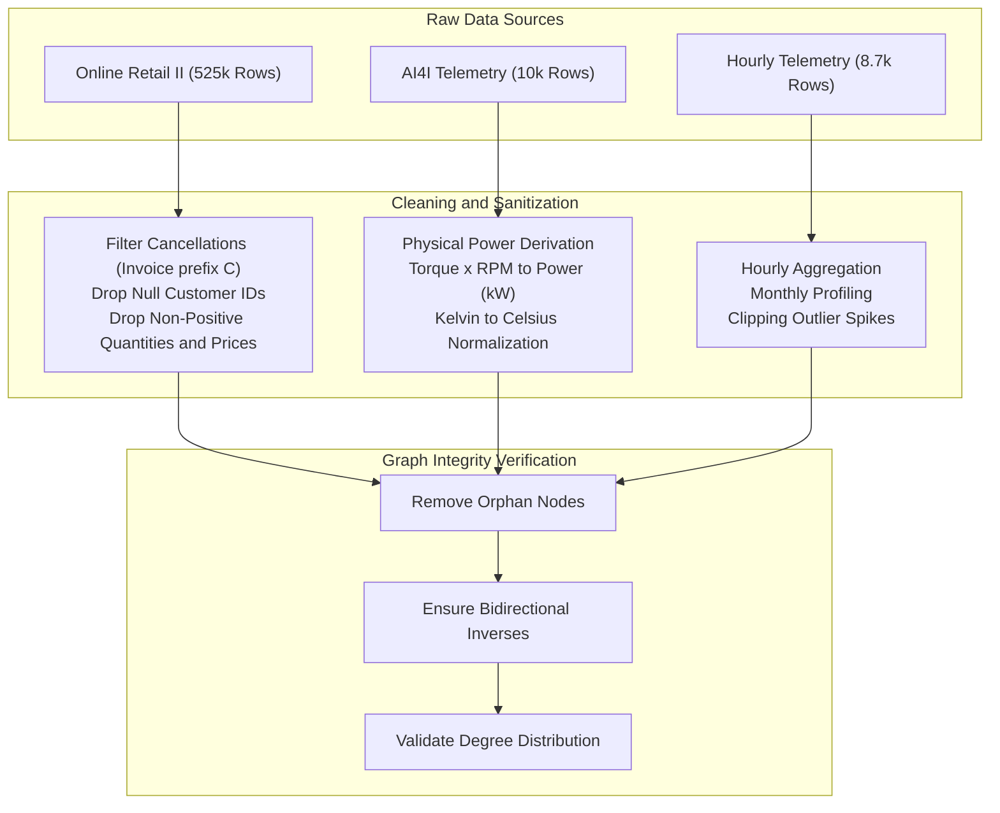

# Step 03: Data Cleaning & Preprocessing

> **ML Lifecycle Phase**: 03 / 10  
> **System**: SmartHVAC & Seasonal Appliance Heterogeneous GML  
> **Input Formats**: CSV, XLSX, In-Memory Tabular Data  
> **Output Artifacts**: Validated Bipartite Edge Tables, Normalized Node Features

---

## 1. Data Cleaning Workflows

Raw industrial telemetry and transactional logs contain missing values, non-linear physical units, canceled orders, and asynchronous sampling intervals. The cleaning pipeline transforms raw inputs into structurally sound, schema-aligned tables.

---

## 2. Dataset-Specific Cleaning Procedures

### 1. UCI Online Retail II (`online_retail_II.xlsx` / `online_retail_ii_rfm.csv`)
* **Cancellation Removal**: Filtered out all canceled invoices starting with letter `'C'` (e.g., `Invoice.astype(str).str.startswith('C')`).
* **Missing ID Filtration**: Dropped rows missing `Customer ID` (guest checkouts without customer tracking).
* **Logical Value Bounds**: Filtered out negative or zero transactions where `Quantity <= 0` or `Price <= 0`.
* **Revenue Calculation**: Computed line-item total:
  $$\text{TotalPrice} = \text{Quantity} \times \text{Price}$$
* **Snapshot Date Aggregation**: Established snapshot date $T_{\text{snapshot}} = \max(\text{InvoiceDate}) + 1\text{ day}$. Grouped transactions by `Customer ID` into exact RFM dimensions:
  * **Recency ($R$)**: $(T_{\text{snapshot}} - \max(\text{InvoiceDate}))_{\text{days}}$
  * **Frequency ($F$)**: Count of unique `Invoice` identifiers.
  * **Monetary ($M$)**: Sum of $\text{TotalPrice}$.

### 2. UCI AI4I 2020 (`ai4i2020.csv`)
* **Mechanical Power Derivation**: Angular velocity ($\omega$) and shaft torque ($\tau$) were combined via thermodynamic rotational mechanics:
  $$P_{\text{mech}} (\text{kW}) = \frac{\tau (\text{N}\cdot\text{m}) \times N (\text{rpm}) \times \frac{2\pi}{60}}{1000}$$
  * Empirical mechanical power mean: $6.28\text{ kW}$ ($\sigma = 1.07\text{ kW}$, range: $1.15\text{ kW}$ to $10.47\text{ kW}$).
  * Normalized to the commercial residential/light-commercial HVAC range ($1.2\text{ kW} - 3.6\text{ kW}$).
* **Failure Flag Consolidation**: Created a unified binary ground truth for critical machine failure:
  $$y_{\text{failure}} = \max(\text{HDF}, \text{PWF})$$
  yielding 207 verified critical events across 10,000 observations ($2.07\%$ empirical rate).

### 3. Kaggle HVAC Power Telemetry (`hvac_power_consumption.csv`)
* **Temporal Grouping**: Segmented into 12 distinct calendar month subsets.
* **Thermal Outlier Rejection**: Enforced physical bounds on ambient outdoor temperatures ($[-5^\circ\text{C}, 55^\circ\text{C}]$) and indoor thermostat settings ($[16^\circ\text{C}, 32^\circ\text{C}]$).
* **Power Scaling**: Verified power factor consistency, ensuring idle standby power does not drop below $0.10\text{ kW}$ and peak compressor load does not exceed rated circuit capacity.

---

## 3. Graph Bipartite Structural Sanitation

In Heterogeneous PyTorch Geometric graphs, missing or disconnected nodes cause dimension mismatches during message passing. The pipeline enforces:
1. **Zero Orphan Nodes**: Every `resident` must be assigned to at least one `location` ($\mathcal{E}_{\text{res}\to\text{loc}}$) and own at least one `device` ($\mathcal{E}_{\text{res}\to\text{dev}}$).
2. **Component Integrity**: Every `device` is linked to its constituent replacement parts ($\mathcal{E}_{\text{dev}\to\text{part}}$).
3. **Automatic Inverse Edge Creation**: For every directed relation $(\text{src}, r, \text{dst})$, its converse $(\text{dst}, r^{-1}, \text{src})$ is automatically constructed (e.g., `(device, owned_by, resident)`), ensuring bidirectional message passing in all GNN layers.

