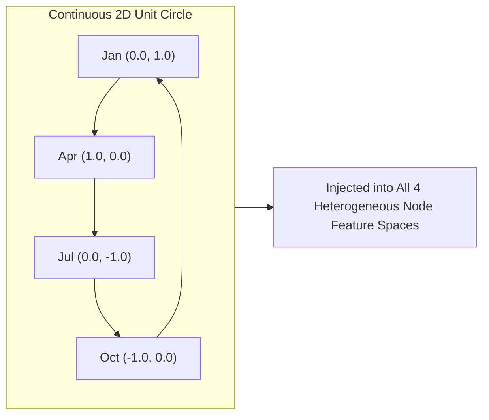

# Step 05: Feature Engineering & Selection

> **ML Lifecycle Phase**: 05 / 10  
> **System**: SmartHVAC & Seasonal Appliance Heterogeneous GML  
> **Feature Vector Spaces**: 8-Dimensional Dense Vectors per Node Entity  
> **Temporal Architecture**: Continuous Sine/Cosine Cyclical Encoding

---

## 1. Cyclical Continuous Temporal Encoding

A fundamental design flaw in traditional HVAC models is treating calendar months as discrete categorical integers ($m \in \{1, \dots, 12\}$). This creates an artificial mathematical discontinuity where Month 12 (December) is maximally distant from Month 1 (January), despite being consecutive winter months.

To enforce smooth periodic continuity, our pipeline applies **Trigonometric Cyclical Projections**:

$$\theta_m = \frac{2\pi(m - 1)}{12}$$
$$m_{\sin} = \sin(\theta_m), \quad m_{\cos} = \cos(\theta_m)$$

This representation ensures:
$$\|\mathbf{e}_{\text{Dec}} - \mathbf{e}_{\text{Jan}}\|_2 = \|\mathbf{e}_{\text{Jan}} - \mathbf{e}_{\text{Feb}}\|_2$$
preserving smooth temporal gradients across year-end boundaries.

---

## 2. Heterogeneous Node Feature Specifications

Every node type in the graph is engineered with a dense **8-dimensional feature vector** ($\mathbf{x} \in \mathbb{R}^8$), normalized to stable numerical ranges ($[0.0, 1.0]$):

### 1. Location Nodes ($\mathcal{V}_{\text{loc}}$) — Dimension: 8
| Index | Feature Name | Range | Transformation & Source |
| :---: | :--- | :---: | :--- |
| `0` | `is_metropolitan` | $\{0, 1\}$ | Binary indicator ($1 = \text{Metro}, 0 = \text{Village Hub}$) |
| `1` | `norm_base_temp` | $[0.0, 1.0]$ | $\text{Base Temperature} / 45.0^\circ\text{C}$ |
| `2` | `grid_stability` | $[0.0, 1.0]$ | Historical grid uptime coefficient ($0.60 - 0.99$) |
| `3` | `population_density` | $[0.0, 1.0]$ | Normalized consumer concentration |
| `4` | `m_sin` | $[-1.0, 1.0]$ | $\sin(2\pi(m-1)/12)$ |
| `5` | `m_cos` | $[-1.0, 1.0]$ | $\cos(2\pi(m-1)/12)$ |
| `6` | `cool_multiplier` | $[0.0, 1.0]$ | Seasonal cooling stress factor |
| `7` | `heat_multiplier` | $[0.0, 1.0]$ | Seasonal heating stress factor |

### 2. Device Nodes ($\mathcal{V}_{\text{dev}}$) — Dimension: 8
| Index | Feature Name | Range | Transformation & Source |
| :---: | :--- | :---: | :--- |
| `0` | `is_cooling_hvac` | $\{0, 1\}$ | $1 = \text{Cooling AC/Chiller}, 0 = \text{Heating/Induction}$ |
| `1` | `norm_unit_price` | $[0.0, 1.0]$ | $\text{Retail Price (INR)} / 60,000$ |
| `2` | `norm_margin` | $[0.0, 1.0]$ | $\text{Maintenance Service Margin (INR)} / 8,000$ |
| `3` | `norm_power_draw` | $[0.0, 1.0]$ | $\text{Real Operating Power (kW)} / 3.5$ (from `telemetry_premodel.py`) |
| `4` | `sensor_fail_prob` | $[0.0, 1.0]$ | Sensor failure risk prior calibrated with AI4I HDF/PWF |
| `5` | `m_sin` | $[-1.0, 1.0]$ | Cyclical month sine |
| `6` | `m_cos` | $[-1.0, 1.0]$ | Cyclical month cosine |
| `7` | `seasonal_stress` | $[0.0, 1.0]$ | $\text{Cooling/Heating load multiplier conditioned on category}$ |

### 3. Resident Nodes ($\mathcal{V}_{\text{res}}$) — Dimension: 8
| Index | Feature Name | Range | Transformation & Source |
| :---: | :--- | :---: | :--- |
| `0` | `is_metropolitan` | $\{0, 1\}$ | Geographic residency flag |
| `1` | `customer_app_active`| $\{0, 1\}$ | Digital engagement flag (derived from Frequency $\ge 2$) |
| `2` | `dynamic_engagement`| $[0.0, 1.0]$ | Base engagement scaled by seasonal activity drop |
| `3` | `norm_tenure` | $[0.0, 1.0]$ | $\text{Customer Tenure (months)} / 48.0$ |
| `4` | `income_tier` | $[0.0, 1.0]$ | Log-Monetary CLV: $\log(1 + M) / \log(1 + M_{95})$ (UCI 502) |
| `5` | `m_sin` | $[-1.0, 1.0]$ | Cyclical month sine |
| `6` | `m_cos` | $[-1.0, 1.0]$ | Cyclical month cosine |
| `7` | `climate_regime_norm`| $[0.0, 1.0]$ | $\text{Regime ID} / 2.0$ ($0 = \text{Winter}, 1 = \text{Summer}, 2 = \text{Monsoon}$) |

### 4. Inventory Part Nodes ($\mathcal{V}_{\text{part}}$) — Dimension: 8
| Index | Feature Name | Range | Transformation & Source |
| :---: | :--- | :---: | :--- |
| `0` | `for_cooling_hvac` | $\{0, 1\}$ | $1 = \text{Cooling component}, 0 = \text{Heating/Induction}$ |
| `1` | `norm_unit_cost` | $[0.0, 1.0]$ | $\text{Part Cost (INR)} / 10,000$ |
| `2` | `norm_holding_cost` | $[0.0, 1.0]$ | $\text{Monthly Holding Cost (INR)} / 300$ |
| `3` | `norm_current_stock`| $[0.0, 1.0]$ | $\text{Current Warehouse Stock} / 150.0$ |
| `4` | `m_sin` | $[-1.0, 1.0]$ | Cyclical month sine |
| `5` | `m_cos` | $[-1.0, 1.0]$ | Cyclical month cosine |
| `6` | `cool_multiplier` | $[0.0, 1.0]$ | Cooling spare demand multiplier |
| `7` | `heat_multiplier` | $[0.0, 1.0]$ | Heating spare demand multiplier |

---

## 3. Relational Graph Edges

Message passing flows across six canonical relations:
1. `('resident', 'located_in', 'location')` $\in \mathbb{R}^{2 \times |\mathcal{E}_1|}$
2. `('location', 'has_resident', 'resident')` $\in \mathbb{R}^{2 \times |\mathcal{E}_1|}$
3. `('resident', 'owns', 'device')` $\in \mathbb{R}^{2 \times |\mathcal{E}_2|}$
4. `('device', 'owned_by', 'resident')` $\in \mathbb{R}^{2 \times |\mathcal{E}_2|}$
5. `('device', 'requires_part', 'part')` $\in \mathbb{R}^{2 \times |\mathcal{E}_3|}$
6. `('part', 'used_in', 'device')` $\in \mathbb{R}^{2 \times |\mathcal{E}_3|}$

