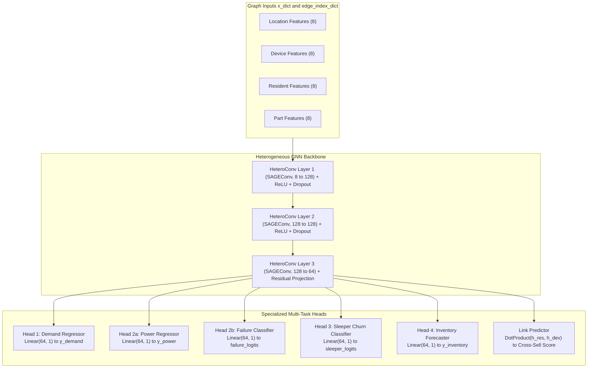

# Step 06: Model Selection

> **ML Lifecycle Phase**: 06 / 10  
> **System**: SmartHVAC & Seasonal Appliance Heterogeneous GML  
> **Selected Architecture**: Multi-Task Heterogeneous Graph Neural Network (`HeteroConv` + `SAGEConv`)  
> **Alternative Baselines Compared**: Tabular Gradient Boosted Trees (XGBoost/LightGBM), Homogeneous GNN (GCN/GAT)

---

## 1. Architectural Comparison & Rationale

Why is a Heterogeneous Graph Neural Network (Hetero-GNN) the optimal architectural choice for seasonal multi-task HVAC operations?

| Model Paradigm | Cross-Entity Relational Awareness | Typed Heterogeneous Nodes & Edges | Spatio-Temporal Propagation | Multi-Task Shared Representation | Verdict |
| :--- | :---: | :---: | :---: | :---: | :--- |
| **Tabular Models** *(XGBoost, LightGBM, CatBoost)* | ❌ **None** Assumes I.I.D. rows | ❌ **None** Requires flat denormalization | ❌ **Weak** Blind to topological hops | ❌ **None** Requires 4 siloed models | **REJECTED**: Cannot model failure propagation or customer-device dependencies. |
| **Homogeneous GNN** *(Vanilla GCN, GAT)* | ⚠️ **Partial** Tolerates graphs | ❌ **Failed** Forces identical feature spaces on all nodes | ⚠️ **Moderate** Conflates relationship types | ⚠️ **Limited** Prone to oversmoothing | **REJECTED**: Conflates resident attributes ($R, F, M$) with part costs and device power. |
| **Heterogeneous GNN** *(HeteroConv + SAGEConv)* | ✅ **Native** Multi-hop relational paths | ✅ **Native** Dedicated weights per edge relation $r \in \mathcal{R}$ | ✅ **Strong** Explicit cyclical features + message passing | ✅ **Native** Shared heterogeneous graph embeddings | **SELECTED**: Naturally captures multi-relational physical and business topologies. |

---

## 2. Selected Architecture: `MultiTaskHVACHeteroGNN`

The model is structured around a shared inductive heterogeneous message-passing backbone connected to four specialized output task heads and a link prediction decoder:

### Mathematical Formulation of Message Passing
For each node type $v \in \mathcal{V}$ and each incident relation $r = (u, \text{rel}, v) \in \mathcal{E}$, layer $l$ applies the `SAGEConv` aggregation:
$$\mathbf{h}_{v, r}^{(l)} = \mathbf{W}_1^{(r)} \mathbf{h}_v^{(l-1)} + \mathbf{W}_2^{(r)} \cdot \text{MEAN}_{u \in \mathcal{N}_r(v)} \left( \mathbf{h}_u^{(l-1)} \right)$$

Aggregations across all incoming relations are summed:
$$\mathbf{h}_v^{(l)} = \text{ReLU} \left( \sum_{r \in \mathcal{R}_{\text{in}}(v)} \mathbf{h}_{v, r}^{(l)} \right)$$

This guarantees that:
* A `device` embedding receives information from its owning `resident` as well as its required spare `parts`.
* A `location` embedding aggregates the collective stress of all its resident customers.
* An `inventory part` embedding anticipates consumption based on the aggregate seasonal power strain of all connected devices.

---

## 3. Output Task Heads Architecture

1. **Demand Head (`head_demand`)**:
   $$\hat{y}_{\text{demand}} = \mathbf{w}_{\text{dem}}^T \mathbf{h}_{\text{loc}} + b_{\text{dem}}$$
2. **Power & Failure Heads (`head_power`, `head_failure`)**:
   $$\hat{y}_{\text{power}} = \mathbf{w}_{\text{pwr}}^T \mathbf{h}_{\text{dev}} + b_{\text{pwr}}$$
   $$\hat{p}_{\text{failure}} = \sigma(\mathbf{w}_{\text{fail}}^T \mathbf{h}_{\text{dev}} + b_{\text{fail}})$$
3. **Sleeper Churn Head (`head_sleeper`)**:
   $$\hat{p}_{\text{sleeper}} = \sigma(\mathbf{w}_{\text{sleep}}^T \mathbf{h}_{\text{res}} + b_{\text{sleep}})$$
4. **Inventory Replenishment Head (`head_inventory`)**:
   $$\hat{y}_{\text{inventory}} = \text{ReLU}(\mathbf{w}_{\text{inv}}^T \mathbf{h}_{\text{part}} + b_{\text{inv}})$$
5. **Cross-Sell Link Predictor (`decode_cross_sell_link`)**:
   $$\hat{s}_{i, j} = \sigma \left( \langle \mathbf{h}_{\text{res}, i}, \mathbf{h}_{\text{dev}, j} \rangle \right)$$

