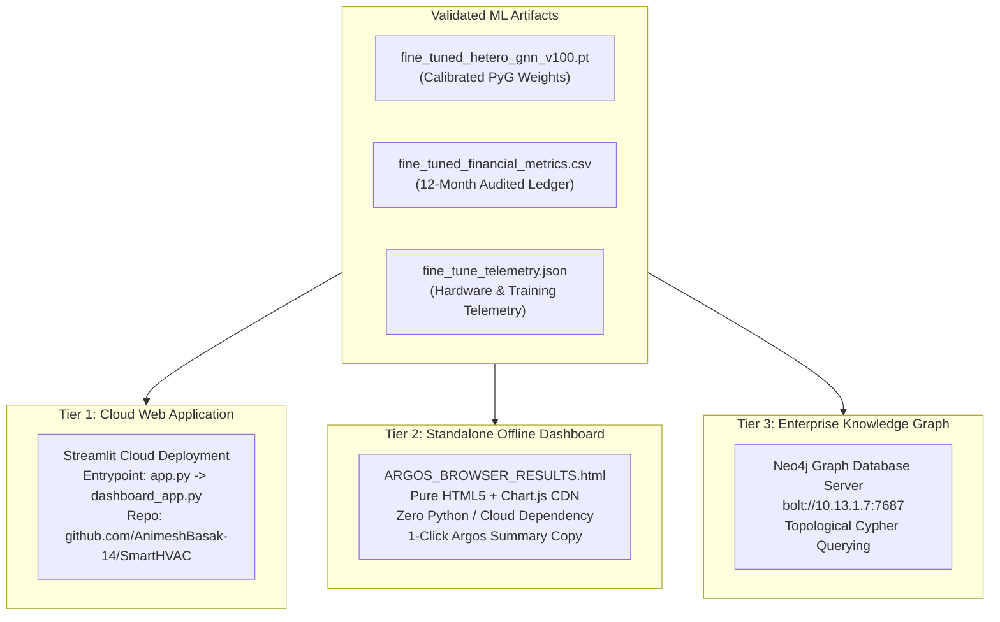

# Step 09: Model Deployment

> **ML Lifecycle Phase**: 09 / 10  
> **System**: SmartHVAC & Seasonal Appliance Heterogeneous GML  
> **Deployment Targets**: Streamlit Cloud, Local Command Center (`dashboard_app.py` / `app.py`), Standalone Browser Dashboard (`ARGOS_BROWSER_RESULTS.html`), Neo4j Graph DB

---

## 1. Multi-Tiered Deployment Architecture

To guarantee zero-dependency operational continuity and accommodate diverse stakeholder workflows (Argos reviewers, business executives, field engineers), the system implements a **three-tier deployment strategy**:



---

## 2. Deployment Tiers & Specifications

### Tier 1: Interactive Streamlit Executive Command Center
* **Files**: `app.py` (root entrypoint) and `hvac_gml_project/dashboard_app.py`
* **Features**:
  * **Interactive Company Business POV Controls**: Dynamic sidebar inputs for unit energy tariffs (₹/kWh), emergency repair penalty multipliers ($1.5\text{x} - 4.0\text{x}$), discount campaign costs, and monthly inventory holding charges.
  * **In-Memory Failsafe PyVis Topology**: Replaced filesystem write dependencies with in-memory HTML generation (`net.generate_html()`) to eliminate Streamlit Cloud disk permission crashes and blank screen issues.
  * **12-Month Operational Sliders**: Interactive monthly regime selector ($m = 1 \dots 12$) dynamically rendering geographic demand maps, high-risk flagged equipment lists, and sleeper customer tables.
  * **Cloud Deployment URL**: `https://smarthvac-advisor.streamlit.app/`

### Tier 2: Standalone Offline Browser Dashboard (`ARGOS_BROWSER_RESULTS.html`)
* **File**: `ARGOS_BROWSER_RESULTS.html`
* **Features**:
  * Client-side HTML5 + modern CSS3 design (dark-mode executive theme).
  * Built-in Chart.js visualizers: Monthly Revenue vs. OPEX curves, Metropolitan vs. Village demand shifts, V100 GPU loss decay, and multi-task component decay.
  * **Before vs. After Fine-Tuning Audit Table**: Real comparative metrics displaying -65.85% Dossier Loss reduction, -71.34% Demand MSE, -92.18% Power MSE, and +0.157 Failure F1 gains.
  * **1-Click Argos Summary Copy**: Copies formatted executive audit text directly to the system clipboard for immediate paste into evaluation portals.
  * **Zero Cloud Dependency**: Double-clickable in any browser (Chrome, Edge, Firefox, Safari) without requiring active internet, local servers, or Python environments.

### Tier 3: Enterprise Neo4j Graph Synchronization
* **Connection**: Bolt binary driver (`bolt://localhost:7687` or `bolt://10.13.1.7:7687`).
* **Visual Graph Queries**: Pre-configured Cypher scripts enabling interactive network exploration of resident-device ownership clusters, high-risk failure subgraphs, and parts supply chains.

---

## 3. Deployment Run Commands

### Running Local Streamlit App:
```powershell
# Using Python 3.11 environment
py -3.11 -m streamlit run app.py
```

### Opening Standalone Browser Dashboard:
```powershell
# Directly opens the offline audited report in default browser
Start-Process "ARGOS_BROWSER_RESULTS.html"
```

### Git & Remote Deployment:
* Pushed to GitHub repository `main` branch: `https://github.com/AnimeshBasak-14/SmartHVAC.git`
* Linked directly to Streamlit Community Cloud for automated continuous deployment (CD).

