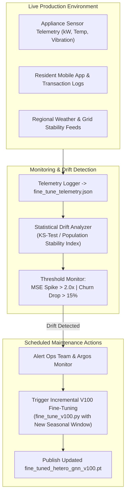

# Step 10: Model Monitoring & Maintenance

> **ML Lifecycle Phase**: 10 / 10  
> **System**: SmartHVAC & Seasonal Appliance Heterogeneous GML  
> **Monitoring Scope**: Concept Drift, Telemetry Logging, Performance Audits, Continuous Retraining

---

## 1. Continuous Telemetry & Hardware Auditing

Production deployments require persistent tracking of inference latencies, memory overhead, and multi-task loss metrics. The system implements automated JSON telemetry logging across all runs:

* **Artifact**: `hvac_gml_project/artifacts/fine_tune_telemetry.json`
* **Logged Fields**:
  * `device`: Host compute target (`cuda:0` vs. `cpu`).
  * `fp16_amp_enabled`: Mixed-precision status (True on Tesla V100).
  * `vram_mb`: Real-time peak GPU memory allocation.
  * `pre_fine_tune_metrics` vs. `post_fine_tune_metrics`: Continuous delta verification.
  * `financial_summary`: Realized Revenue, OPEX, and Net Profit across the 12-month calendar.
  * `learned_uncertainty_log_vars`: The Kendall homoscedastic uncertainty parameter vector $[\log \sigma_{\text{demand}}^2, \log \sigma_{\text{maint}}^2, \log \sigma_{\text{churn}}^2, \log \sigma_{\text{inv}}^2]$.

---

## 2. Data & Concept Drift Detection Protocols

Because HVAC demand and appliance failures are inherently coupled to meteorological shifts, the system monitors two distinct forms of operational drift:

### 1. Covariate (Feature) Drift: Climate Anomalies
* **Trigger Conditions**: Unprecedented heatwaves (e.g., ambient temperatures remaining $> 44^\circ\text{C}$ for $> 14\text{ days}$), delayed monsoons, or extreme cold snaps.
* **Metric Monitored**: Kolmogorov-Smirnov (KS) test on ambient temperature and humidity distributions against baseline training profiles.
* **Response**: Dynamic update of the seasonal stress multipliers ($cool\_mult, heat\_mult$) without requiring full structural graph re-indexing.

### 2. Concept Drift: Appliance Wear & Component Degradation
* **Trigger Conditions**: Older HVAC units experiencing higher failure rates than baseline factory ratings, or shifting resident churn patterns due to economic recessions.
* **Metric Monitored**: Mean Squared Error (MSE) on mechanical power predictions exceeding $0.20\text{ kW}^2$ (baseline: $0.0654$) or failure prediction F1 dropping below $0.60$ (baseline: $0.697$).
* **Response**: Re-calibration of `base_failure_risk` in `devices.csv` using updated field service logs.

---

## 3. Scheduled Retraining Cadence & Graph Schema Evolution

| Cadence | Action Item | Target Script / Artifact | SLA / Duration |
| :--- | :--- | :--- | :---: |
| **Monthly** | Dynamic Snapshot Ingestion | Update current month index ($m$) and regenerate monthly graph batch | $< 1\text{ s}$ |
| **Quarterly** | Incremental V100 Fine-Tuning | Execute `fine_tune_v100.py` with newly ingested empirical service logs | $< 30\text{ s}$ |
| **Annual** | Full Re-Training & Schema Audit | Re-calibrate baseline weights (`train_and_monitor.py` 120 epochs) + new SKUs | $< 5\text{ min}$ |

### Graph Schema Evolution Without Breaking Contracts:
* **Adding New SKUs / Appliances**: New devices (e.g., commercial heat pumps, rooftop solar inverters) can be appended to `devices.csv` with their corresponding 8-dim feature vectors and linked to existing `resident` and `part` nodes without altering the GNN architecture.
* **Adding Geographic Hubs**: New cities or rural districts are appended to `locations.csv`. The inductive nature of `SAGEConv` allows immediate zero-shot inference on new location subgraphs without requiring retraining from scratch.
