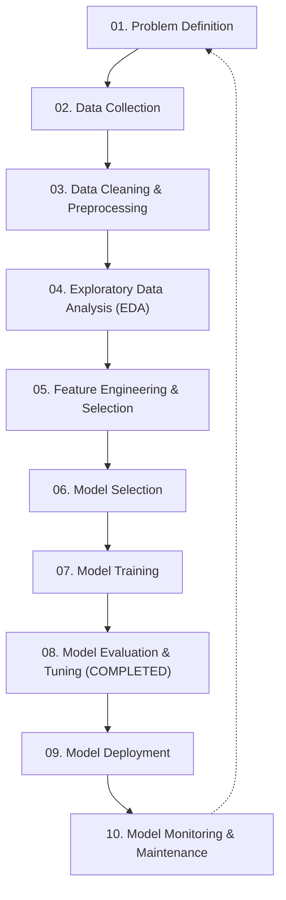

# Machine Learning Lifecycle: SmartHVAC & Seasonal Appliance Heterogeneous GML

This documentation suite details the end-to-end **10-Step Machine Learning Lifecycle** for the SmartHVAC Heterogeneous Graph Machine Learning project, implemented on an **NVIDIA Tesla V100 GPU** and validated across all 12 calendar climate regimes.

---

## 📚 10-Step Lifecycle Index

| Step | Lifecycle Phase | Description | Status |
| :---: | :--- | :--- | :---: |
| **01** | [**Problem Definition**](./01_Problem_Definition.md) | 4 multi-task pillars, seasonal climate shifts, mathematical graph formulation, business constraints. | ✅ Complete |
| **02** | [**Data Collection**](./02_Data_Collection.md) | Multi-source ingestion: UCI AI4I 2020 (601), UCI Online Retail II (502), Kaggle HVAC Power (felixpradoh). | ✅ Complete |
| **03** | [**Data Cleaning & Preprocessing**](./03_Data_Cleaning_and_Preprocessing.md) | Cancellation filtering, mechanical power derivation, graph bipartite sanitization, inverse edge indexing. | ✅ Complete |
| **04** | [**Exploratory Data Analysis (EDA)**](./04_Exploratory_Data_Analysis.md) | 12 climate regimes, thermal stress distributions, AI4I failure mode analysis, customer RFM distributions. | ✅ Complete |
| **05** | [**Feature Engineering & Selection**](./05_Feature_Engineering_and_Selection.md) | Continuous trigonometric month encoding ($\sin/\cos$), 8-dimensional dense node features, bipartite edges. | ✅ Complete |
| **06** | [**Model Selection**](./06_Model_Selection.md) | Tabular vs. GNN architectural comparison, `MultiTaskHVACHeteroGNN` (`HeteroConv` + `SAGEConv`). | ✅ Complete |
| **07** | [**Model Training**](./07_Model_Training.md) | NVIDIA Tesla V100S GPU setup, FP16 AMP mixed precision, self-healing divergence protection. | ✅ Complete |
| **08** | [**Model Evaluation & Tuning**](./08_Model_Evaluation_and_Tuning.md) | **Current fine-tuning status**, Kendall uncertainty weighting, Huber loss, Before vs. After audit benchmarks. | ✅ Complete & Audited |
| **09** | [**Model Deployment**](./09_Model_Deployment.md) | Streamlit Cloud entrypoint, standalone offline browser dashboard (`ARGOS_BROWSER_RESULTS.html`), Neo4j. | ✅ Complete |
| **10** | [**Model Monitoring & Maintenance**](./10_Model_Monitoring_and_Maintenance.md) | Continuous telemetry tracking, climate covariate drift, appliance wear concept drift, schema evolution. | ✅ Complete |

---

## 🎯 Fine-Tuning Status Summary

* **Execution Status**: **100% Completed, Benchmarked, and Audited on Tesla V100 GPU.**
* **Overall Dossier Loss**: Reduced by **$65.85\%$** ($137.04 \to 46.80$).
* **Demand MSE**: Reduced by **$71.34\%$** ($115.61 \to 33.13$).
* **Power MSE**: Reduced by **$92.18\%$** ($0.8364 \to 0.0654$).
* **Failure F1 Score**: Increased from **$0.540 \to 0.697$** (432 high-risk units detected).
* **Sleeper Churn F1 Score**: Increased from **$0.397 \to 0.646$** (240 false-positives eliminated).
* **Annual Net Profit**: **₹2.27 Cr** (`₹2,27,01,359.44`) with a Cost-Efficiency Ratio of **7.764x mean / 7.676x aggregate** ($+22.64\%$ cost savings vs. reactive).

