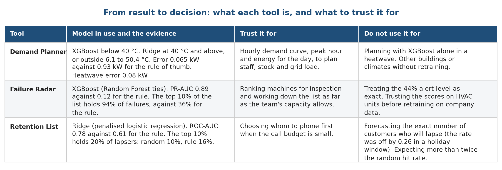

# Chapter 11. Results and discussion

## 11.1 The results on one page

The table below collects the headline result of each pillar, next to the rule of thumb that a company could apply today. All numbers come from data the models did not see and are means over five seeds.

| Pillar | Measure | Rule of thumb | Statistical baseline | Ridge | XGBoost | Best result |
| :--- | :--- | :---: | :---: | :---: | :---: | :--- |
| Demand, ordinary weather (forecast test) | Error in kW, lower is better | 1.02 | 0.101 | 0.100 | 0.076 | XGBoost |
| Demand, heatwave | Error in kW, lower is better | 1.57 | 0.077 | 0.077 | 0.336 | Linear models |
| Failure | PR-AUC, higher is better | 0.123 | 0.487 | 0.492 | 0.893 | Random Forest 0.912, XGBoost close |
| Failure | Failures found in the top 10% | 36% | 74% | 73% | 94% | Random Forest and XGBoost |
| Churn | ROC-AUC, higher is better | 0.607 | 0.775 | 0.777 | 0.775 | All four models tie |
| Churn | Lapsers found in the top 10% | 16% | 20% | 20% | 20% | All four models tie |

The statistical baseline is ordinary linear regression for demand and logistic regression for failure and churn. The rule of thumb is the average by hour of day for demand, the most worn tool first for failure and the longest time since the last purchase for churn.

## 11.2 What the results tell us

First, using the weather beats ignoring it by a wide margin. For demand, every model that sees the temperature has an error around 0.1 kW or less, while the rule that ignores it is wrong by about 1 kW, which is half of the average load. The same is true for failure: a ranking built from the sensor readings finds more than twice as many failures as the most-worn-tool rule.

Second, the best model depends on the question. XGBoost is the best choice in ordinary weather and for failure. A linear model is the only safe choice beyond the training range, as the heatwave test showed. In churn, the simplest model is as good as any. A group that had chosen XGBoost for everything would have a good dashboard on most days and a wrong forecast on the hottest days, which are the days that matter. A group that had chosen Ridge for everything would have missed 40% of the accuracy on failure.

Third, engineered inputs matter most for the simple models. The absolute temperature gap halves the error of Ridge in demand and removes almost all of its heatwave error. Trees find the same shape on their own. A feature that is based on the physics of the problem is therefore cheaper than a more complex model.

Fourth, the metric decides what looks good. If we had scored the failure model by accuracy, a model that never raises an alarm would have scored 96.6%. By PR-AUC and top-10% capture, it scores almost nothing, as it should.

Fifth, small test sets give wide error bars. The churn test holds about 360 customers and the failure test 68 failures, and the five seeds disagree by several points on them. The tie rule, which treats gaps below one standard deviation as equal, kept us from reading too much into those differences.

## 11.3 How the product is used

Figure 1 sums up what each tool is, what it should be trusted for, and what a manager should do with it. The first column names the tool. The second gives the model in use and the evidence for it. The third states what a manager can rely on, and the fourth states what the tool should not be used for.

## 11.4 What the numbers would mean in practice

These examples are arithmetic on our test results, not forecasts for a company.

* Demand. On an ordinary day with an average load of 1.9 kW, an error of 0.065 kW is a miss of about 3%. A manager who plans staffing from the average-by-hour rule would be wrong by half of the load.
* Failure. A team that can inspect one machine in ten finds 94 of every 100 failures with the model and 36 with the wear rule. To find 80 in every 100, the model needs inspections of about 3% of the machines and the wear rule needs 58%.
* Retention. A team that can phone 190 of 1,900 active customers reaches 20% of those who lapse with the model, 16% with the recency rule and 10% by calling at random. The gain over the rule is four points, and over random calling it is a factor of two.

## 11.5 Threats to the validity of the results

| Threat | Direction of the bias | What we did about it |
| :--- | :--- | :--- |
| The demand and failure data are simulated and follow clean rules | Scores are probably higher than on real data | Said so in every stage; claim only the method |
| One building, one year | The heatwave result may not transfer to other sites | Tested forecast and heatwave separately |
| The tie rule uses the same test scores that we report | A small optimistic bias in the choice of model | Five seeds; gaps below one standard deviation count as ties |
| Small churn test set | Wide error bars | Report the spread for every number |
| Final models saw all rows for the dashboard lists | The lists look better than the test | Marked as illustrations; honest scores come from the tests |
