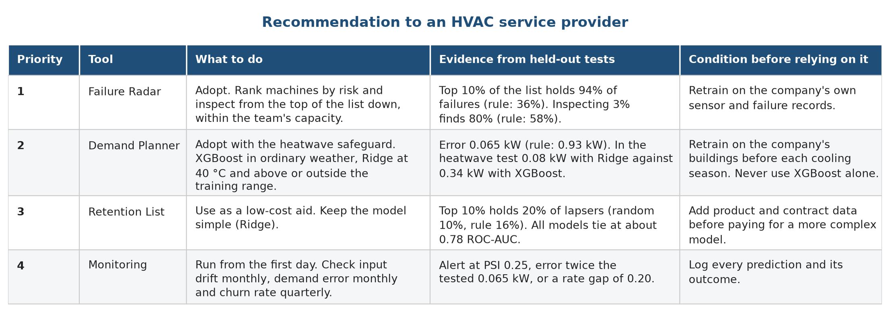

# Chapter 12. Conclusion and recommendation

## 12.1 Conclusion

We set out to show how machine learning could help an HVAC service provider such as Aire Serv with three weekly decisions: planning for demand, choosing which machines to inspect and choosing which customers to call. We built a dashboard with one tool for each decision and tested the models behind them on data they had never seen.

The work answered the question for our three public stand-in datasets. Predicting hourly power from the weather is easy for a model that sees the weather, and the question is only how far the model can be trusted when the weather leaves the range of the training data. Ranking machines by failure risk is where machine learning adds the most: the best models find 94% of failures in the 10% of machines they rank highest. Predicting which customers will go quiet is the hardest of the three, and a simple model is as good as a complex one.

We also learned some things about the process. A test that matches the real use, such as forecasting the last three months or predicting a heatwave, tells us more than a random split. A baseline from statistics and a rule of thumb keep the comparison honest. The best model changes with the question, and we should say plainly where the more complex model does not win.

## 12.2 Recommendation

We recommend that an HVAC service provider adopt the three tools in this order and under these conditions.

Figure 1 states the recommendation as a table. In words:

1. Start with the Failure Radar. Use XGBoost (Random Forest is equally good in our tests) to rank machines by failure risk, and inspect from the top of the list down to the capacity of the team, without relying on a single alert threshold. In testing, inspecting the top 10% finds 94% of failures against 36% for the most-worn-tool rule. Before relying on it, retrain on the company's own sensor and failure records, since our data describe machine tools.
2. Then use the Demand Planner, always with the heatwave safeguard. Use XGBoost in ordinary weather and switch to Ridge regression for hours at or above 40 °C and for temperatures outside the range seen in training. Never use XGBoost alone for planning peak load. Retrain before each cooling season on data from the company's own buildings.
3. Treat the Retention List as a low-cost aid. Use a simple penalised logistic regression (Ridge) to rank active customers, and expect about twice the hit rate of random calling. Do not spend on a more complex model until richer data, such as product categories or service contracts, are available.
4. Run the monitoring routine from the first day. Check input drift each month, compare the demand error with the tested 0.065 kW each month, and compare predicted and actual churn each quarter. Refit the demand model before and after the cooling season, the churn model each quarter and the failure model after 100 new logged failures.

This recommendation depends on a pilot. The scores in this report are from public stand-in data, and a service provider should confirm the gains on its own records before changing how it works. A reasonable pilot is a four-week side-by-side run, in which the tools produce lists and the current process continues, and the two are compared at the end.

## 12.3 Closing note

Of the three tools, we trust the Failure Radar and the Demand Planner the most, on the evidence of the held-out tests. We trust the Retention List the least, because its gain is small, and we say that clearly.
