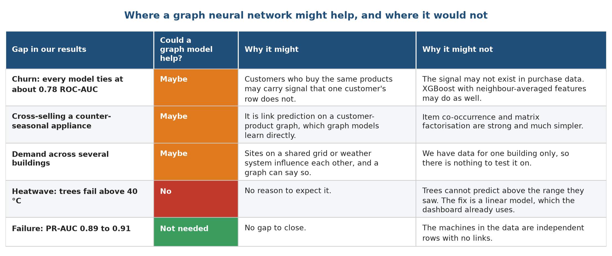

# Chapter 13. Limitations and future work

## 13.1 Limitations

* None of the three datasets comes from an HVAC service company. The demand file looks simulated, the failure file is synthetic and describes machine tools, and the purchase file is from an online gift shop. The method transfers, and the scores do not.
* The demand data covers one building for one year. We cannot say how the models behave in another climate, and the heatwave test is one kind of extrapolation.
* The churn definition (no purchase in 90 days) suits a shop. A service company would define churn from contract renewals or missed visits.
* The churn test set is small, about 360 customers, so its scores have wide error bars.
* The models choose among six candidates using the same test scores that we report, so a small optimistic bias remains.
* The monitoring checks ran on stored data. We have no live system that logs predictions and outcomes.
* The dashboard is a demonstration. It has no login, no live data feed and no automatic retraining.

## 13.2 Future work: where a graph neural network may help

An earlier version of this project used a graph neural network (GraphSAGE) on a synthetic graph of locations, residents, devices and spare parts. We tested it on held-out months and nodes with three seeds. It never clearly beat a simple model, as the table below shows. The reason lies in the data: every label in that graph was computed from the node's own features, so neighbours carried no extra information. We therefore removed the graph model and do not claim that it helps.

| Test (held-out months 3, 6, 9, 12) | GraphSAGE | Ridge with pairwise products |
| :--- | :---: | :---: |
| Demand error (MSE, lower is better) | 29.6 ± 2.9 | 28.5 ± 5.2 |
| Inventory error (MSE) | 24.5 ± 1.7 | 19.2 ± 0.8 |
| Forecast of months 10 to 12, demand error | 73.5 ± 21.7 | 36.2 ± 6.0 |

The results of this project point to a short list of places where a graph model deserves a fair test.

Figure 1 lists each gap in our results, why a graph model might help and why it might not. The first row is churn, where every model ties at about 0.78 ROC-AUC. Customers who buy the same products might carry signal that a single customer's row does not, and a customer-product graph is a natural way to add it. The second row is cross-selling a counter-seasonal appliance, which is link prediction on a customer-product graph. The third row is demand across several buildings that share a power grid. The fourth row is the heatwave, and a graph model would not fix it: trees fail there because they cannot extrapolate, and the remedy is the linear model that the dashboard already uses. The last row is failure, which is not a gap, since XGBoost reaches 0.89 PR-AUC and the machines in the data have no links between them.

### How to test the idea properly

1. Build a customer-product graph from Online Retail II, with customers and products as nodes and purchases as links.
2. Define two tasks: churn as node classification, and "which product next" as link prediction on purchases held out in time.
3. Compare the graph model with XGBoost given neighbour-averaged features, such as the average recency of a customer's co-buyers, and with ridge or logistic regression and an item co-occurrence recommender.
4. Use the same split as this project, unseen customers in a later period, with at least five seeds and the same tie rule. The graph model must beat the best simple model by more than one standard deviation to be preferred.

## 13.3 Other future work

* Retrain and test on real HVAC data: smart-thermostat or building-management logs, technician call-out records and service contracts.
* Add a weather forecast feed to the Demand Planner and measure the error of the forecast itself, not only of the model given the true weather.
* Extend the demand model to several buildings and test whether a shared model beats one model per building.
* Add product categories to the churn features and test a cross-sell recommender.
* Log every prediction and outcome in the dashboard, so that the monitoring checks run on live data.
* Run the four-week pilot described in the recommendation, with the current process running alongside.
